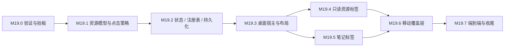

# AI 对话右侧栏：资源引用在侧栏打开

> 文档版本：v0.2（实施记录） | 创建 2026-11-22
> 状态：**M19.1–M19.6 已实现（`63eb33a`）；2026-11-22 补做桌面覆盖态 Esc、焦点规则与刷新恢复，真实栈 E2E 16 passed / 6 skipped，Lighthouse 桌面全绿、移动端仅无关路由未达门槛；`/ai/chat` 首屏 310.5 / 310.0 KB，超 0.5 KB（此前接受 0.3 KB，需重新确认）；视觉截图已生成待人工确认；改动未提交**
> 范围：`apps/web`。桌面 `/ai/chat`、`/ai/chat/[id]`，移动 `/m/ai/chat`、`/m/ai/chat/[id]`。**不改后端、OpenAPI 契约、SQL、Nacos**，因此不需要 OpenSpec 提案
> 关联：[知识检索方案 §8.2 / §11](./KNOWLEDGE_RETRIEVAL_PLAN.md#82-引用)、[回答文本处理方案](./AGENT_OUTPUT_TEXT_PLAN.md)、
> [运行过程展示方案 §5.7](./AGENT_TRACE_VIEW_PLAN.md#57-对话界面)、[AI 里程碑](./AI_MILESTONES.md)
> 参考：DeepSeek Harness，本机 `C:\Users\YXLMz\code\deepseek-harness`，提交 `39163dd30f`（下文称「参考项目」，路径相对该仓库）

---

## 1. 摘要

**要做什么**

- AI 对话页右侧增加一个可收起的「右侧栏」。对话里列出的知识库资源（回答正文里的引用编号、回答下方的引用来源、
  过程区工具结果条目）被左键单击时，在右侧栏打开，不再整页跳走。
- 一期覆盖检索 Agent 能引用的全部六类实体：知识库、笔记、资料（PDF）、慕课、慕课条目（含字幕、总结两种子类型）、任务。
  **笔记在侧栏里可以直接编辑**，其余五类只读展示。
- 每个资源都能「在新窗口打开」：在浏览器新标签页打开现有的完整页面，并带上定位参数。
- 移动端一期提供全屏覆盖层，行为与桌面一致。
- 右侧栏是通用容器：标签类型通过注册表登记，后续功能以「新的标签类型」或「新的宿主页面」接入，不改容器本身。

**四条核心设计**

1. **一个资源只有一种描述。** `ResourceTarget`（类型、标识、所属知识库、定位）是唯一的中间表示，
   完整页面地址与侧栏标签都由它派生。现在 `citationHref` 里的路由规则原样迁进来，行为不变。
2. **一个入口。** 所有能打开资源的地方都调同一个 `openResource`；同一资源在一个会话的侧栏里只开一个标签，
   再次打开时聚焦已有标签，并按新的定位跳转。
3. **链接仍是真链接。** 页面上渲染的仍是指向完整页面的 `<a href>`；只拦截不带修饰键的左键单击并转进侧栏。
   Ctrl/⌘ 点击、中键、右键菜单「在新标签页中打开」全部保持浏览器原生行为。
4. **容器不认识业务。** 标签条、布局、持久化、离开保护归容器；每类资源怎么取数、怎么展示、怎么定位归各自的标签定义。
   容器之外的部分全部懒加载，首屏只多一个按钮和一段点击处理。

| # | 方面 | 现在 | 本方案 |
|---|---|---|---|
| 1 | 单击引用 | 整页跳到资源页面（过程区条目、引用列表、正文编号都是） | 在右侧栏打开；PDF 问答页的当前资料定位不变 |
| 2 | 新窗口 | 只有浏览器原生的修饰键点击（过程区条目也一样） | 原生行为保留；侧栏标签头、引用来源条目、过程区条目增加「在新窗口打开」 |
| 3 | 笔记 | 只能在完整编辑页编辑 | 侧栏内可编辑，保存、冲突、协同、离开保护与完整页同一套 |
| 4 | 多个资源 | 每次跳走只剩一个 | 多标签，同一资源去重；按会话保存，刷新后恢复 |
| 5 | 移动端 | 整页跳转 | 全屏覆盖层，返回手势关闭 |

---

## 2. 已确认的决策（2026-11-22）

| # | 问题 | 结论 | 未选方案 |
|---|---|---|---|
| S1 | 笔记在侧栏里只读还是可编辑 | **可编辑**；其余五类只读展示 | 只读预览，编辑去完整页面 |
| S2 | 普通左键单击引用做什么 | **在侧栏打开**；Ctrl/⌘ 点击、中键、右键菜单保持原生新标签页；另提供显式的「在新窗口打开」按钮 | 单击仍整页跳转，旁边加侧栏按钮 |
| S3 | 「在新窗口打开」打开什么 | **新标签页打开现有完整页面**（带定位参数，可编辑），`target="_blank"` + `rel="noopener"` | `window.open` 指定尺寸的弹窗；新增无外壳的预览路由 |
| S4 | 移动端一期怎么处理 | **一期做全屏覆盖层** | 一期保持整页跳转 |
| S5 | 桌面宽度不够时 | **先把侧栏压到最小宽度；仍不够就临时收起会话列表（关闭侧栏后恢复）；再不够侧栏改为覆盖在对话区上**。应用导航栏不动，不改用户的侧栏偏好 | 打开右栏时收起应用导航栏（参考项目做法）；只压缩对话区 |
| S6 | 多个资源怎么组织 | **多标签**；同一资源只开一个标签 | 单内容 + 后退 |
| S7 | 侧栏状态保存范围 | **按会话保存并持久化**，刷新后恢复；按用户 id 隔离，**只存资源标识，不存标题**，登出时清理 | 按会话仅内存；全局一份 |
| S8 | 侧栏里的笔记是否提供删除、移动 | **不提供**，到完整页面操作；「历史版本」以新标签页打开 | 与完整页一致 |

下文标「方案默认」的条目是本方案在 S1–S8 之下自行做的取舍，附理由，开工前可以调整；汇总在 [§15](#15-开放项与待确认)。

---

## 3. 现状

以下事实均来自 2026-11-22 当前 `dev` 工作区的代码与文档。

### 3.1 对话页布局

- `/ai/chat` 与 `/ai/chat/[id]` 是满幅路由（`components/layout/navigation.ts` 的 `isFullBleedRoute`），
  外壳给内容列确定高度并 `overflow-hidden`，页面自己分配剩余高度。
- 应用导航栏宽 16rem（256px），收起方式为 `offcanvas`（收起后宽度为 0）；视口小于 768px 时变为抽屉（`components/ui/sidebar.tsx`、`hooks/use-mobile.ts`）。
- `ChatPage`（`features/ai/components/chat-page.tsx:56`）是两列：会话列表 `<aside className="hidden w-72 … md:block">`（288px，不可收起）
  加 `<main>` 里的 `ChatPanel`。
- `ChatPanel` 桌面形态有一条 56px 高的页头，只放会话标题（`chat-panel.tsx:286-291`）；会话列表的页头也是 56px，两条分隔线对齐。
- 移动端 `MobileChat`（`features/ai/components/mobile/chat-mobile.tsx`）把同一个 `ChatPanel` 以 `variant="mobile"` 放进 `MobileScreen`；
  `MobileScreen` 支持 `actions`、`onBack`、`confirmLeave`（`components/layout/mobile/mobile-screen.tsx`）。

### 3.2 资源链接从哪来

| 位置 | 渲染方式 | 现在的点击行为 |
|---|---|---|
| 回答正文 `[n]` | `AiCitation` 节点，由 `applyCitationReferences` 改写成 `target="_self"` 的链接（`lib/ai/citation-editor.ts`） | `CitationAnswer` 在捕获阶段拦截「左键且无修饰键」：先交给 `onCitation`，未处理则 `router.push(href)`（`citation-answer.tsx:41-50`）。`aiAnswer` 预设强制只读，TipTap 链接点击插件在只读时直接返回（`if (!view.editable) return false`），所以修饰键点击今天已经是浏览器原生的新标签页 |
| 引用来源列表 | `CitationAnswer` 里的 `<Link aria-label="查看引用 n">` | 同上，同一个捕获处理器 |
| 过程区结果条目 | `ProcessArea` → `ResultEntry` 把 `entry.ref / kbId / locator` 拼成伪引用，调 `citationHref`（`process-area.tsx:272`） | 普通 `<Link>`，没有拦截，单击整页跳转 |
| 过程区工具对象 `· {target.label}` | `ToolRow` | 不可点：事件里的 `target` 只有 `label`、`resolved`，没有标识 |
| PDF 问答页 | 同一个 `ChatPanel` + `onCitation` | 当前资料的引用翻到预览页；其余引用整页跳转 |

`citationHref`（`lib/ai/citations.ts:52`）只接受 `^(kb|note|doc|mooc|mooc_item|task):<正整数>(#transcript|#summary)?$`：

| 类型 | 桌面地址 | 移动地址 | 必需字段 |
|---|---|---|---|
| `kb` | `/notes/{id}/overview` | `/m/notes/{id}` | — |
| `note` | `/notes/{kb}/{id}?section=&line=` | `/m/notes/{kb}/{id}?section=&line=` | `kbId` |
| `doc` | `/ai/pdf?baseId=&docId=&page=` | `/m/ai/pdf/{id}?page=` | —（`kbId` 可选） |
| `mooc` | `/notes/{kb}/mooc/{id}` | `/m/notes/{kb}/mooc/{id}` | `kbId` |
| `mooc_item` | `/notes/{kb}/mooc/{moocId}?itemId={id}&t={秒}` | 同形，前缀 `/m` | `kbId`、`locator.moocId` |
| `task` | `/notes/{kb}/tasks/{id}` | `/m/notes/{kb}/tasks/{id}` | `kbId` |

检索侧与此对应：`ai-service/retrieval/models.py` 的 `ENTITY_TYPES` 是这六类加两个子类型，`notice` 在 `EXCLUDED_ENTITY_TYPES` 里，
`RetrievalSession.gate()` 直接拒绝 `notice:`。因此一期不存在「通知」类引用。

### 3.3 各类实体现有的页面与可复用部件

| 类型 | 完整页面 | 可复用的数据与部件 | 与地址或整页的耦合 |
|---|---|---|---|
| 笔记 | `NoteEditor`（`features/notes/components/note-editor.tsx`），桌面与移动共用 `useNoteEditorSession` | `useNoteEditorSession`、`TiptapEditor`（`full` / `collaborative`）、`SaveStatusBadge`、`CollabSyncBadge`、`ConflictDialog`、`CollabNotices` | 小节定位读 `window.location.search`（`use-note-editor-session.ts:228`）；页面布局按 1000px 正文列设计 |
| 资料 | `PdfChatPage`（`/ai/pdf`） | `useDocQuery(docId)` 取签名地址；`PdfViewer({ url, page, navigationKey })` 已支持按页跳转 | 页面读 `useSearchParams` 作初始值 |
| 慕课 | `MoocDetailPage` | `useMoocQuery`、`useMoocItemsQuery`、`features/mooc/lib/catalog` | 读 `useSearchParams` 的 `itemId`（`mooc-detail.tsx:38`）；返回链接与两栏网格 |
| 慕课条目 | `MoocDetailPage` 内部的 `SelectedItemPanel` | `useMoocItemQuery(moocId, itemId)`、`useObjectUrlQuery`、`VideoPlayer({ url, title, startTime })`、只读 `TiptapEditor` | 读 `itemId` / `t`（`mooc-detail.tsx:359-361`）；「下一节」用 `window.scrollTo`；`VideoPlayer` 在 `startTime` 变化时销毁重建播放器（`video-player.tsx:49`） |
| 任务 | `TaskDetailPage`：本库 `permissions === 1` 走管理员视角，否则成员视角 | `useKnowledgeBaseQuery`、`useAdminTaskQuery`、`useMemberTaskQuery`、`features/tasks/lib/task-window` | 只依赖属性，但整页包含提交、退回、热力图等管理功能 |
| 知识库 | `KnowledgeBaseOverview` | `useKnowledgeBaseQuery`、`useNotesQuery`、`useKnowledgeBaseDocsQuery` | 只依赖属性，但是整页概览 |

结论：详情页是整页组合（返回链接、页头、网格、窗口滚动、读地址参数），**不能原样嵌进侧栏**；
数据 hooks 与叶子部件都能复用。侧栏里的每类正文是这些部件的新组合。

### 3.4 约束

- **首屏体积几乎没有余量。** `/ai/chat` 与 `/ai/chat/[id]` 首屏 JS 为 **308.7 / 310 KB**
  （[2026-11-21 AI 对话 UI 重构清单](../changelist/2026-11-21-ai-chat-ui-refactor.md)），移动端最重路由 **246.5 / 250 KB**
  （[2026-11-22 下拉框修复清单](../changelist/2026-11-22-select-dark-theme-fixes.md)）。编辑器、pdfjs、DPlayer 已经是懒加载，
  `CLAUDE.md` 禁止静态引入重依赖。Lighthouse 门禁覆盖 `/ai/chat` 与 `/m/ai/chat`（`apps/web/scripts/lib/lighthouse.mjs`）。
- **AI 页面没有设计稿。** UI 补稿 2026-09-15 决定「AI 页面暂不出稿」（`docs/ui/UI补稿落地改造方案.md` §1.2），视觉按现有语义 Token 与参考项目落地。
- **笔记保存语义。** `useSaveNote` 卸载时用普通请求补发未保存草稿（`flushDetached("fetch")`）；离线、失败、冲突（`hasUnsavedRisk`）时补发会被跳过或失败；
  `useNoteEditorSession` 内部调用 `useLeaveGuard`：在 `document` 捕获阶段拦截站内链接，并拦截 `beforeunload`；按钮触发的跳转用 `confirmLeave()`。
- **本地存储。** `stores/ui-store.ts` 把左侧栏开合持久化到 `localStorage` 的 `anynote-ui`；
  登出（`use-logout-mutation.ts`）清空查询缓存并删除 IndexedDB 里的笔记副本，**不清理 `localStorage`**。
- **既有 E2E 依赖整页跳转。** `e2e/support/agent-retrieval.ts:177-184` 点击正文 `[1]` 后断言地址变为 `/notes/{kb}/{note}?section=`（桌面与移动共用），本方案上线必须同步修改。

---

## 4. 参考项目怎么做

依据：`packages/client/ui-sidebar-right/README.zh.md`、`packages/client/ui-sidebar-right/src/client/tab-registry.ts`、
`packages/client/ui-layout/README.zh.md`、`packages/client/ui-sidebar-documentpreview/README.zh.md`。

### 4.1 要点

- **每个会话一个停靠面。** 导航控制器 `ctx.sidebarRight.openResource(address, options)` 与 `openTab(kind, options)` 是进入右栏的唯一路径：
  会话区的文件链接、工具行的行号引用、文件树的行都调它。
- **资源地址与标签类型分开。** 资源是 `dsh-resource://<type>/…` 地址；标签类型是一份没有运行时钩子的静态声明
  `{ id, kind, patterns, priority, canOpen, title, guide, keepMounted, multiple }`，正文按同一 `id` 另行注册。
  同一 (kind, contentId) 已经打开时聚焦它并递增导航 `revision`；行号等导航参数随导航送达，**不进布局状态**。
- **呈现。** `push`（会话区让出宽度）与 `fullscreen`；窗口低于 768px 打开即全屏。面板没有标题行，标签条就是面板上边，
  形态切换与收起按钮在标签条末端；面板取会话区底色，「是页面的一列，不是压在页面上的卡片」。
  收起后，会话页头角落出现展开按钮（左侧栏折叠图标的镜像）；展开时这个按钮不渲染。
- **宽度。** 首次打开为视口的 45%，之后保留用户拖出的像素宽度，上限 70%；为中栏保留 400px，先把右栏压到 300px，
  再报告空间不足由占用方收起；打开右栏会收起手动展开的左侧栏。
- **状态。** 每个会话的布局、标签身份、选中项等以 JSON 存在 `localStorage` 的 `dsh.sidebar-right.v1.<sessionId>`；
  恢复前逐字段校验，无效数据只清除对应会话的键；存储失败时内存中的布局仍可用；导航参数、资源内容、活动连接都不持久化。
- **关闭规则。** 其它标签独自留下时，关闭它会连同整列收起；标签类型可注册关闭处理器；`keepMounted` 默认关闭，只挂载可见正文。
- **扩展路径自证。** 随包发布的引导页走的是与外部类型同一条公开注册路径。
- **只读。** 文档预览「预览而非编辑」。

### 4.2 采用与不照搬

| 参考项目 | 本方案 | 理由 |
|---|---|---|
| 唯一导航入口 `openResource` / `openTab` | 采用：`openResource` / `openPage` | 所有链接表面只需接一个函数 |
| 资源地址 + 静态标签声明 + 懒加载正文 | 采用：`ResourceTarget` + `TabDefinition` + `body: () => import(...)` | 容器与业务解耦，正文不进首屏 |
| 同一资源去重，导航 `revision` | 采用 | 「再点一次同一处」也要能重新定位 |
| 导航参数不持久化 | 采用：定位不持久化 | 与 S7「只存标识」一致 |
| push / 全屏两种呈现，窄屏自动全屏 | 采用：推入 / 覆盖两种呈现，另有「最大化」 | — |
| 展开按钮在会话页头角落、展开后不渲染 | 采用 | 收起时不占对话区任何宽度 |
| 面板用会话区底色、没有浮起感 | 采用 | — |
| 关闭最后一个标签收起整列 | 采用 | 展开时永远有内容 |
| 持久化前校验、无效只清一处、存储失败退回内存 | 采用 | — |
| 打开右栏时收起左侧栏 | **不照搬**：改为临时收起会话列表（S5） | Anynote 左边有两列；应用导航栏的开合是用户持久化偏好 |
| 只读预览 | **不照搬**：笔记可编辑（S1） | 用户要求；这是与参考项目最大的不同，离开保护见 §5.7 |
| 持久化标签标题 | **不照搬**：只存标识（S7） | `localStorage` 不随登出清理，共用电脑上会留下标题 |
| 优先级档位 + glob 认领 | 不照搬：按资源类型直接分派 | 一期每类资源只有一种标签；出现第二种时再加（§14） |
| 分栏、浮窗、拖拽、撤销重做 | 不照搬 | 一期没有消费方 |
| Cordis slot / inject 组合 | 不照搬：静态注册表 + `next/dynamic` | Anynote 是普通 React 应用，没有插件运行时 |
| 右栏快捷键 | 不照搬（方案默认） | ⌘B 已被左侧栏与编辑器加粗占用，一期不引入新的全局快捷键 |

---

## 5. 总体设计

### 5.1 模块与目录

```text
apps/web/src/lib/ai/resource-target.ts      纯函数：引用 / 工具条目 → ResourceTarget；资源身份；完整页面地址
apps/web/src/features/side-panel/
├── types.ts           标签记录、标签定义、正文属性（只有类型）
├── link-context.tsx   链接拦截上下文与点击策略（首屏）
├── launcher.tsx       首屏常驻入口：展开按钮、首次需要时懒加载宿主（首屏）
├── store.ts           按宿主分区的标签状态与动作（zustand；是否进首屏由 M19.0 实测决定，见 §5.8）
├── persistence.ts     按用户读写 localStorage、校验、淘汰、登出清理
├── layout.ts          桌面宽度规则（纯函数）
├── registry.ts        静态注册表：汇总各 definition 并校验（只在懒加载宿主里引用）
├── desktop/           推入 / 覆盖呈现、拖拽条、标签条、标签头（懒加载）
├── mobile/            全屏覆盖层（懒加载）
└── tabs/<kind>/
    ├── definition.ts  轻量声明：图标、类型名、标题 hook、完整页面地址、正文加载器
    └── body.tsx       正文（懒加载）
```

`features/side-panel` 不放任何领域逻辑：笔记、资料、慕课、任务、知识库的取数与展示只在 `tabs/<kind>/` 里，
且只经由各领域已有的 hooks 与组件（`features/notes`、`features/ai/use-docs`、`features/mooc`、`features/tasks`）。

### 5.2 资源模型

```ts
type ResourceType = "kb" | "note" | "doc" | "mooc" | "mooc_item" | "task";

/** 资源身份：决定去重与持久化，只含标识。 */
type ResourceRef =
  | { type: "kb"; id: number }
  | { type: "note" | "mooc" | "task"; id: number; kbId: number }
  | { type: "doc"; id: number; kbId: number | null }
  | { type: "mooc_item"; id: number; kbId: number; moocId: number };

/** 定位：只随一次导航传递，不参与去重，不持久化。 */
type ResourceLocator = {
  section?: string; // 笔记标题路径
  line?: number; // 笔记行号
  page?: number; // 资料页码
  seconds?: number; // 视频秒数
  subtype?: "transcript" | "summary";
};

type ResourceTarget = {
  ref: ResourceRef;
  locator: ResourceLocator;
  /** 打开时随手带上的标题与知识库名，只在内存里用于数据到达前显示标签标题。 */
  hint?: { title?: string; kbName?: string };
};
```

- `targetFromCitation(citation)`、`targetFromToolItem(entry)`：返回 `ResourceTarget | null`。解析规则与必需字段**逐条照搬** §3.2 的表；
  `mooc_item` 的 `moocId` 放进 `ref`，因为取条目详情必须带它（`GET /moocs/items/{moocItemId}?moocId=`）。
- `resourceKey(ref)`：`"note:12"`、`"mooc_item:7"`。子类型与定位都不参与身份：同一视频条目的字幕引用与总结引用打开同一个标签。
- `resourceHref(target, variant)`：完整页面地址，输出与现在的 `citationHref` 逐字节一致。`citationHref` 改为
  `resourceHref(targetFromCitation(...))` 的薄封装，`lib/ai/__tests__/citations.test.ts` 不改一行仍须通过。
- **可点击的前提不变（方案默认）**：能生成完整页面地址的资源才渲染成链接。由此「在新窗口打开」对任何能在侧栏打开的资源都可用，
  不会出现「能进侧栏、不能开新窗口」的不对称。

### 5.3 链接点击策略

宿主（桌面 `ChatPage`、移动 `MobileChat`）提供 `SidePanelLinkContext`，值为 `{ open(target, { focus }) } | null`；没有宿主的页面（PDF 问答页）拿到 `null`。
所有链接表面共用一个处理函数：

1. `event.button !== 0`，或按着 Ctrl / ⌘ / Shift / Alt：**不处理**，交给浏览器（新标签页、新窗口）。
2. 页面传了 `onCitation` 且返回 `true`：`preventDefault`，到此为止（PDF 问答页的当前资料定位保持现状）。
3. 有宿主：`preventDefault`，调 `open(target, { focus: event.detail === 0 })`。`detail === 0` 表示键盘触发，焦点进侧栏（§6.5）。
4. 没有宿主：保持现状（`CitationAnswer` 走 `router.push`，`ResultEntry` 走 `Link` 默认跳转）。

接入点：`CitationAnswer` 已有的捕获处理器（正文编号与引用来源列表），`ResultEntry` 新增同样的处理。
有宿主时，引用来源条目与过程区结果条目末尾增加「在新窗口打开」图标链接（`target="_blank" rel="noopener noreferrer"`），
桌面悬停或键盘聚焦时显示，触屏常显；没有宿主时不渲染，PDF 问答页的界面不变。
正文里的 `[n]` 太小，不加图标，依赖原生修饰键点击与打开后的标签头按钮。

宿主同时给消息列表容器加 `data-side-panel-links` 标记，供离开保护识别（§5.7 第 4 条）。

### 5.4 侧栏状态与动作

状态按「宿主分区」保存。对话页的分区键沿用对话流 store 的会话 key：`chat:c12`、`chat:new`、`chat:new:kb3`。
将来别的页面挂宿主时用自己的前缀（§9.3）。

```ts
type SurfaceKey = string; // "chat:c12"
type TabId = string & { readonly __brand: "SidePanelTabId" };

type TabRecord =
  | { id: TabId; kind: string; family: "resource"; ref: ResourceRef }
  | { id: TabId; kind: string; family: "page"; contentId: string };

type SurfaceState = {
  open: boolean;
  maximized: boolean; // 不持久化
  tabs: TabRecord[]; // 显示顺序
  activeId: TabId | null;
  recent: TabId[]; // 最近使用顺序：关闭后激活谁、超限淘汰谁
  seq: number; // 标签 id 计数
  navigation: Record<TabId, { locator: ResourceLocator; revision: number }>; // 不持久化
  hints: Record<TabId, { title?: string; kbName?: string }>; // 不持久化
};
```

| 动作 | 行为 |
|---|---|
| `openResource(surface, target)` | 已有同 `resourceKey` 的标签：激活它，替换定位并 `revision + 1`；否则在当前标签右侧插入新标签并激活。无论哪种都展开侧栏。标签数超过 `MAX_TABS = 10`（方案默认）时关闭最久未用的**非活动**标签 |
| `openPage(surface, kind, contentId?)` | 页面类标签；定义里 `multiple` 为假时每个分区只开一个 |
| `activate(surface, tabId)` | 切换活动标签 |
| `close(surface, tabId)` | 关闭；关的是活动标签时激活最近使用的另一个；关掉最后一个时侧栏收起 |
| `setOpen(surface, open)` | 展开 / 收起；展开且没有标签时显示空态 |
| `toggleMaximized(surface)` | 最大化 / 还原（§6.2） |
| `renameSurface(from, to)` | 新会话拿到 id 时迁移分区，与对话流 store 的 `renameKey` 在同一个 `flushSync` 里执行 |
| `removeSurface(key)` | 会话被删除时调用 |

**只挂载活动标签的正文（方案默认 `keepMounted: false`）。** 切走、关闭、收起都会卸载正文。理由：页面上同一篇笔记至多一个编辑器实例；
协同连接、PDF 渲染、视频播放不会在后台继续。注册表保留 `keepMounted` 字段，供将来确有需要的类型打开。

**守卫。** 正文可以通过 `registerGuard(() => boolean)` 登记一个同步守卫。任何会卸载活动正文的动作（切到别的标签、关闭它、收起侧栏）
先调守卫，返回 `false` 时动作整体放弃、状态不变。在同一标签内换定位不调守卫。淘汰只动非活动标签，非活动标签的正文已经卸载，不需要守卫。

### 5.5 标签类型注册表

```ts
type TabDefinition = {
  kind: string; // 全表唯一
  family: "resource" | "page";
  resourceType?: ResourceType; // resource 类必填；每种资源类型恰好一个定义
  multiple?: boolean; // page 类：每次打开是否新建
  keepMounted?: boolean; // 默认 false
  persist?: boolean; // 默认：resource 为 true，page 为 false
  mobile: boolean; // false 时移动端仍整页跳转
  icon: LucideIcon;
  typeLabel: string; // 取不到标题时的兜底，如「笔记」
  /** 标签条上的标题；与正文共用查询缓存，数据到达前用 hint，再兜底 typeLabel。 */
  useTitle: (record: TabRecord, hint?: { title?: string }) => { title: string | null; unavailable: boolean };
  /** 完整页面地址；有值时标签头显示「在新窗口打开」「打开完整页面」。 */
  href?: (record: TabRecord, locator: ResourceLocator, variant: "desktop" | "mobile") => string | null;
  body: () => Promise<{ default: ComponentType<TabBodyProps> }>;
};

type TabBodyProps = {
  record: TabRecord;
  navigation: { locator: ResourceLocator; revision: number };
  variant: "desktop" | "mobile";
  actions: {
    openResource: (target: ResourceTarget) => void; // 在同一侧栏打开别的资源
    close: () => void;
    registerGuard: (guard: () => boolean) => () => void;
  };
};
```

- `registry.ts` 是一个静态数组，由各 `tabs/<kind>/definition.ts` 汇总；加载时校验 `kind` 唯一、六种资源类型各有且只有一个定义，违反即抛错（单测覆盖）。
- 注册表与全部 definition 只被懒加载的宿主引用，因此 definition 里可以使用查询 hooks（标题）；正文另行懒加载，编辑器、pdfjs、DPlayer 只在打开对应标签时下载。
- 一期没有内置的页面类标签；页面类这条路径由单测里的测试定义覆盖（打开、去重、`multiple`、不持久化），并在 §9.2 给出第一批候选。

### 5.6 持久化（S7）

| 项 | 规则 |
|---|---|
| 键 | `anynote-ai-side-panel:v1:<userId>`，`userId` 取自 `useMe()`；取不到正整数 id 时只在内存里保存 |
| 值 | `{ surfaces: { [conversationId]: { open, activeId, tabs: [{ id, kind, ref }], recent, seq, touchedAt } } }` |
| 写什么 | 只写 `chat:c<id>` 分区；新会话拿到 id、迁移分区后才开始写 |
| 不写什么 | 标题与知识库名（`hints`）、定位与导航版本、最大化、滚动位置；页面类标签默认不写 |
| 上限（方案默认） | 每个用户最多 50 个会话分区，按 `touchedAt` 淘汰最旧的；每个分区最多 10 个标签 |
| 读取 | 宿主拿到用户 id 后读一次；整体经 zod 校验，`ref` 再按 §5.2 的规则逐个校验；任一处不合法则**只删除该用户的这个键**，从空状态开始 |
| 写入 | 状态变化后防抖 300ms 写入；`setItem` 失败（配额、隐私模式）时吞掉错误，内存状态照常使用 |
| 登出 | `useLogoutMutation` 的 `onSuccess` 里删除所有以 `anynote-ai-side-panel:` 开头的键，与现有的 `clearAllLocalNotes()` 放在一起 |
| 删除会话 | `useDeleteConversationMutation` 成功后调 `removeSurface` |
| 资源已删除或失去权限 | 标签保留，显示不可读状态，由用户关闭；不自动移除，避免标签无故消失 |
| 多窗口 | 不监听 `storage` 事件做实时同步；各窗口写自己的状态，下次加载读最后一次写入（与参考项目一致） |
| 桌面与移动 | 同源同键，标签共用；移动端加载时忽略 `open`，覆盖层总是从关闭开始 |
| 宽度偏好 | 写进 `ui-store` 新字段 `sidePanelWidth`（像素），全局一份、不分用户；`merge` 里校验为有限正数，否则用默认值 |

刷新后的标题：恢复的标签没有 `hint`，由定义的 `useTitle` 用与正文相同的查询键取数（至多 10 个请求）。取不到时标签显示类型名并置灰。

### 5.7 离开保护与笔记编辑（S1、S8）

笔记标签复用完整页面的整套保存语义：缓存优先、自动保存、版本冲突对话框、协同、卸载补发。容器只补齐「页面没换、但编辑器要卸载」这一类场景。

1. **页面上同一篇笔记至多一个编辑器。** 同一分区按资源去重；只挂载活动标签；其他会话的分区不渲染；`/ai/chat` 上没有别的笔记编辑器。
2. **切标签、关标签、收起侧栏。** 笔记正文登记的守卫就是 `useNoteEditorSession` 已有的 `confirmLeave()`：有丢失风险时用现有文案确认，取消则不动。
   确认或无风险时卸载，由 `useSaveNote` 卸载时的补发把待保存草稿送出——与完整页面在站内跳走时完全相同。
3. **离开对话页、刷新、关页。** `useNoteEditorSession` 内部的 `useLeaveGuard` 与 `beforeunload` 照常生效（切换会话、点应用导航都是站内链接，会被它拦截确认）。
4. **消息列表里的资源链接。** `useLeaveGuard` 在 `document` 捕获阶段比 React 的处理器先执行；资源链接其实不会离开页面，若不排除，有风险时会先弹「离开」确认、再弹第 2 条的确认。
   因此 `useLeaveGuard` 增加一条：**跳过位于 `[data-side-panel-links]` 内的链接**，这类点击交给侧栏的守卫。没有宿主时不会出现该标记，完整页面行为不变。
5. **定位改为参数传入。** `useNoteEditorSession(noteId, { locate? })` 新增可选参数 `{ section?, line?, revision }`：传入时不再读 `window.location.search`，
   `revision` 变化时重新滚动；完整页面把地址参数解析后传入，行为不变。`scrollToNoteCitation(editor, search, markdown)` 相应改为接收 `{ section, line }`。
6. **在新窗口打开笔记。** 有待保存或在途的保存时，在点击处理里**同步**执行 `window.open("about:blank", "_blank")` 保住用户激活（不会被拦截弹窗），
   `await flush()` 之后再对新窗口 `location.replace(href)` 并置 `opener = null`；没有待保存改动时直接用原生 `<a target="_blank" rel="noopener">`。
   目的是新标签页打开时读到的就是刚才的内容。「历史版本」（S8）走同一流程，与完整页面「先 flush 再进历史」的做法一致。
7. **回到窗口时同步外部改动。** 侧栏笔记标签打开 `syncOnVisible`（`useNoteEditorSession` 的新可选项，完整页面不开）：窗口重新可见时，
   若未处于协同、保存状态空闲（没有待保存、没有在途请求、没有冲突），就重新取一次详情；服务端 `updateTime` 比本地版本新，
   则走冲突处理里「使用服务端版本」的同一条路径替换正文、标题与版本基线。有本地改动时什么都不做，后续保存仍由版本冲突对话框把关。
   这一条解决「侧栏开着、在新标签页改完回来，侧栏还显示旧正文」。
8. **协同。** 以 `NEXT_PUBLIC_COLLAB_NOTES=1` 构建时，侧栏编辑器与完整页面一样进入 `note:<id>` 房间；新标签页同时打开同一篇时两边是同一用户的两个端，协同方案已支持。服务端落库模式下，离开保护用 `collab.leaveGuard`（现有）。
9. **权限。** 与完整页面相同，不另写只读判断。
10. **菜单（S8）。** 侧栏笔记的「更多」菜单只有「打开完整页面」「历史版本」；没有删除与移动。

### 5.8 首屏体积

- 首屏只允许新增：`resource-target.ts`（由 `citations.ts` 拆出，净增近似为零）、`link-context.tsx`、`launcher.tsx`
  （展开按钮、宿主的 `dynamic()` 加载器，以及一段只读 `localStorage` 判断「刷新前是否展开」的代码），以及 `store.ts`——**若实测放得下**。
- 懒加载：桌面宿主（布局、拖拽条、标签条、标签头、注册表、全部 definition 与标题 hook）、每一类正文（笔记沿用现有的编辑器懒加载链）、移动覆盖层。
- M19.0 在原型上实测增量。**不上调预算。** 放不下时把 `store.ts` 也移进懒加载块（入口按钮与链接处理通过 `import()` 调用动作）；仍放不下则停止并请用户决定。
- 刷新前展开的分区在宿主加载完成后再出现，与左侧栏偏好在挂载后恢复的方式一致；骨架屏（`ai/chat/loading.tsx`）不预留右栏。

---

## 6. 桌面端

### 6.1 入口与收起

- `ChatPanel` 的桌面页头新增 `headerActions` 插槽；`ChatPage` 在页头右端放展开按钮（`PanelRightOpen`，「展开右侧栏」）。
  侧栏展开时按钮不渲染；收起控件在标签条末端（`PanelRightClose`，「收起右侧栏」）。
- 用按钮展开且没有标签时显示空态：「点击回答里的引用，在这里查看和编辑」。
- 新会话（还没有消息）同样显示按钮；首条消息拿到会话 id 时随 `renameSurface` 迁移。

### 6.2 布局与宽度（S5）

`layout.ts` 导出纯函数 `computeLayout({ width, preferred, maximized })`，`width` 是 `ChatPage` 容器的实测宽度（`ResizeObserver`，已扣除应用导航栏）：

| 常量（初始值，待视觉验收） | 值 |
|---|---|
| 会话列表 `LIST` | 288px（现有） |
| 对话区最小宽度 `CHAT_MIN` | 440px |
| 侧栏最小宽度 `PANEL_MIN` | 360px |
| 首次默认宽度 | 容器宽度的 40%，夹在 420–720px |
| 侧栏最大宽度 | 容器宽度的 70% |

规则（按顺序取第一条成立的）：

1. `maximized`：**覆盖**呈现，侧栏铺满 `ChatPage` 容器（会话列表与对话区之上），应用顶栏与导航栏不受影响。
2. `width ≥ LIST + CHAT_MIN + PANEL_MIN`（1088px）：三列；侧栏宽度 = `clamp(preferred, PANEL_MIN, width − LIST − CHAT_MIN)`。
3. `width ≥ CHAT_MIN + PANEL_MIN`（800px）：**临时收起会话列表**；侧栏宽度 = `clamp(preferred, PANEL_MIN, width − CHAT_MIN)`。
4. 否则：覆盖呈现，同第 1 条，此时不显示「最大化」按钮。

常见视口的结果（默认宽度、未拖动过）：

| 视口 | 应用导航栏 | 容器 | 结果 |
|---|---|---|---|
| 1920 | 展开 | 1664 | 三列：侧栏 666，对话 710 |
| 1536 | 展开 | 1280 | 三列：侧栏 512，对话 480 |
| 1440 | 展开 | 1184 | 三列：侧栏压到 456，对话 440 |
| 1366 | 展开 | 1110 | 三列：侧栏压到 382，对话 440 |
| 1280 | 展开 | 1024 | 收起会话列表：侧栏 420，对话 604 |
| 1280 | 收起 | 1280 | 三列：侧栏 512，对话 480 |
| 1024 | 展开 | 768 | 覆盖 |
| 1024 | 收起 | 1024 | 收起会话列表：侧栏 420，对话 604 |

- 会话列表的临时收起是 `ChatPage` 的页面内状态，不写任何偏好；侧栏收起或容器变宽后自动恢复。列表被收起期间没有单独的入口，关掉侧栏即可回到列表（S5 的取舍，见 §13）。
- 拖拽条：侧栏左缘，8px 命中区，`role="separator"`、`aria-orientation="vertical"`、`aria-valuemin/max/now`；←/→ 每次 16px，Home/End 到最小/最大；
  双击恢复默认；拖动时按当前规则的上下限夹住，松手时写入 `sidePanelWidth`。覆盖呈现时不显示。
- 宽度变化 200ms 线性过渡，与左侧栏一致；`prefers-reduced-motion` 时关闭。拖动过程中不过渡。

### 6.3 标签条

- 高 56px，与对话页头、会话列表页头的分隔线对齐；它就是侧栏的上边，没有单独的标题行。
- `role="tablist"`；每个标签 `role="tab"`、`aria-selected`、`aria-controls`；←/→ 在标签间移动焦点，Enter/Space 激活。
- 标签：类型图标 + 标题（单行截断，最宽 12rem）+ 关闭按钮（悬停、活动、键盘聚焦时显示；粗指针设备常显）；中键点击关闭。
  标题不可用时置灰，显示「未找到或无权访问的内容」。
- 标签多到放不下时横向滚动，激活的标签自动滚进视口；末端控件（最大化 / 还原、收起）固定不收缩。

### 6.4 标签头与「在新窗口打开」

每类正文顶部渲染统一的 `TabHeader`：标题、元信息（知识库名 · 类型名）、右侧操作：

- 类型自己的状态：笔记是保存徽标与协同在线成员，资料是索引状态徽标。
- 「在新窗口打开」（`ExternalLink` 图标）：定义提供 `href` 时显示；笔记走 §5.7 第 6 条的流程，其余是原生 `<a target="_blank" rel="noopener noreferrer">`。
- 「更多」菜单：「打开完整页面」（当前窗口跳到完整页面，离开对话页，离开保护照常；侧栏状态已持久化，回来时还在）；笔记另有「历史版本」（新标签页）。
- 新窗口地址带当前定位，例如笔记带 `section` / `line`，资料带 `page`，视频带 `itemId` 与 `t`。

### 6.5 无障碍与焦点

- 侧栏是 `<aside aria-label="右侧栏">`；正文 `role="tabpanel"`、`aria-labelledby` 指向标签。
- 鼠标点开资源：焦点留在被点的链接上；键盘触发（`event.detail === 0`）：焦点移到正文。两种情况都经礼貌型播报区宣读「已在右侧栏打开「{标题}」」。
- 键盘关闭标签后焦点到新的活动标签；收起侧栏后焦点回到展开按钮。
- 覆盖呈现时，焦点在标签条或标签头上按 Esc 收起；焦点在正文内（编辑器、PDF）时不处理 Esc，避免与编辑器菜单冲突。

### 6.6 视觉初始值（2026-11-22 已确认，按本表初始值）

AI 页面没有设计稿，以下按现有语义 Token 与参考项目确定，M19.3 用真实浏览器在深浅两色下验收，有设计稿则以设计稿为准：

- 推入呈现：`bg-surface`（与对话区同底），左边 `border-separator` 1px，无阴影；覆盖呈现同底色，不加遮罩。
- 标签：高 32px、圆角 `rounded-md`、`text-xs`；活动 `bg-fill-hover text-label`，非活动 `text-label-secondary`、悬停 `bg-fill-hover`。
- 末端控件与展开按钮：`variant="ghost" size="icon-sm"`，与左侧栏的展开 / 收起按钮同规格。
- 拖拽条悬停时显示 2px 分隔色竖线，与左侧栏的 `SidebarRail` 一致。

---

## 7. 各类资源的标签

| 类型 | 正文 | 定位 | 标签头 | 新窗口地址 |
|---|---|---|---|---|
| 笔记 | **可编辑**：桌面编辑器的侧栏版式（状态条 + 随侧栏宽度伸缩的正文列，无常驻工具条，`full` / `collaborative` 预设） | 小节路径或行号，`revision` 变化时重新滚动 | 保存徽标、协同成员、新窗口、更多（打开完整页面、历史版本） | `/notes/{kb}/{id}?section=&line=` |
| 资料 | `PdfViewer`：地址取自 `useDocQuery`，`page` 与 `navigationKey = revision` 已支持跳页；索引未完成或无法提取文本时照常预览 | 页码 | 索引状态徽标、新窗口 | `/ai/pdf?baseId=&docId=&page=` |
| 慕课 | 课程名、简介、课程目录（复用 `features/mooc/lib/catalog`，章节可展开）；点可播放条目在侧栏打开该条目 | — | 新窗口 | `/notes/{kb}/mooc/{id}` |
| 慕课条目 | 视频（`useObjectUrlQuery` + `VideoPlayer`）或文档类条目的只读正文；字幕、总结子类型打开同一条目 | 秒数 | 新窗口 | `/notes/{kb}/mooc/{moocId}?itemId={id}&t={秒}` |
| 任务 | 任务名、时间窗与阶段（`task-window` 现有函数）、只读描述；提交与管理到完整页面 | — | 新窗口 | `/notes/{kb}/tasks/{id}` |
| 知识库 | 名称、简介、最近笔记与资料各 5 条（复用概览页的查询）；点条目在侧栏打开 | — | 新窗口 | `/notes/{id}/overview` |

- **共用状态**：加载用现有骨架（笔记 `EditorSkeleton`、资料 `DocumentSkeleton`、其余 `PanelSkeleton`）；不存在与无权访问**不区分**，统一显示
  「未找到或无权访问的内容」（与检索方案 §8.3「权限导致的没有与不存在表现相同」一致，文案沿用过程区已有的 `UNREADABLE_TITLE`）；网络错误显示「加载失败，请稍后重试」与「重试」。
- **视频定位改为原地跳转**：`VideoPlayer` 增加与 `PdfViewer` 同名的 `navigationKey`；地址不变、只换时间点时调 `seek`，不再销毁重建播放器。完整页面不传该属性时行为不变。
- **任务数据源**：沿用 `TaskDetailPage` 的分流（本库权限为管理员走 `useAdminTaskQuery`，否则 `useMemberTaskQuery`）。`GET /noteTasks/{id}`（契约摘要「获取单个笔记任务」）对成员是否可用尚未核对，列为 M19.0 的核对项；核对通过也只在本方案内使用，不改完整页面。
- **慕课与知识库正文里打开别的资源**用 `actions.openResource`，在侧栏新开标签，不替换当前标签。

---

## 8. 移动端全屏覆盖层（S4）

- **宿主**：`MobileChat` 提供链接上下文，`ChatPanel variant="mobile"` 里的资源点按打开覆盖层；地址按移动端规则生成（`/m/…`）。
- **结构**：固定定位铺满视口，压在底部标签栏之上，留出安全区；顶部一行是「关闭」、当前标签标题、「在新窗口打开」、「更多」；
  多于一个标签时下面是一行可横滑的标签胶囊；正文以 `variant="mobile"` 渲染。拖拽条、最大化、会话列表规则都不适用。
- **笔记**：`MobileNoteEditor` 拆成「正文 + `MobileScreen` 外壳」两层，覆盖层复用正文层（`toolbar="mobile"`、移动端徽标）；守卫与第 5.7 节相同，关闭覆盖层等同于收起侧栏。
- **返回手势**：打开覆盖层时 `history.pushState` 一条同地址、带标记的记录，`popstate` 时关闭覆盖层；点「关闭」时若栈顶是这条记录就 `history.back()`。
  这依赖 Next 15 App Router 对原生 `pushState` 的集成，且要与新会话的 `replaceState` 回填共存，**列为 M19.0 的验证项**；验证不通过时退回「不压历史记录，返回键离开对话页」，并请用户确认。
- **再次进入**：覆盖层关闭后，若当前会话有标签，`MobileScreen` 的 `actions` 显示「已打开的内容（{n}）」，点按重新展开。
- **体积**：覆盖层整块懒加载；`/m/ai/chat` 首屏只增加链接上下文与入口按钮。

---

## 9. 扩展方式

### 9.1 新增一种资源类型

例如检索开放「知识库通知」（`notice:<id>`，目前被检索侧排除）或「知识库视频」（`n_video`，上传端点未实现）：

1. `resource-target.ts`：`ResourceType` 加一项，补解析规则、身份与完整页面地址；单测覆盖桌面与移动地址。
2. `tabs/<kind>/definition.ts` + `body.tsx`，在 `registry.ts` 登记。
3. 后端引用里出现该类型之前，前端不会生成链接，可以先合入。

### 9.2 新增页面类标签

页面类标签不对应某个资源，用 `openPage(kind, contentId?)` 打开。第一批候选（都不在一期范围）：

- **本会话引用汇总**：把会话内所有回答的引用按资源合并列出，点条目在侧栏打开。数据已在对话流 store 里，无需新接口。
- **运行过程详情**：从过程区「查看完整过程」打开，展示比过程区更完整的工具行；管理员的完整 Trace 仍留在设置页（运行过程展示方案 T5）。
- **知识库目录浏览**：在侧栏里浏览某个知识库的笔记、资料、慕课树。

### 9.3 新增宿主页面

例如让 PDF 问答页或笔记编辑页也能在侧栏打开引用：挂载同一个宿主组件，分区键用自己的前缀（`pdf:doc:3`），
宿主提供链接上下文，即可复用全部标签类型。是否持久化由宿主决定（一期只持久化 `chat:c<id>`）。

### 9.4 检查清单

- definition 只引用图标、轻量函数与查询 hooks；正文经 `body: () => import(...)` 懒加载；重依赖不得出现在 definition 的静态引用里。
- 正文只读 `TabBodyProps`，不直接访问侧栏 store；需要打开别的资源、关闭自己、登记守卫都走 `actions`。
- 会卸载时丢数据的正文必须登记守卫。
- 新增用户可见文案先进 §11 的确认流程。
- 单测：注册表唯一性、身份与地址、正文的加载 / 不可读 / 出错 / 定位分支；改完跑 `bundle:budget`。

---

## 10. 里程碑（M19）

编号沿用 AI 里程碑序列（M18 已用于 PDF OCR）。原计划从 `dev` 切 `feat/ai-side-panel`，完成后 `--no-ff` 合并回 `dev`；**实际按用户要求留在 `dev`，未切分支（2026-11-22）**。
提交只动 `apps/web`（文档单独提交），提交说明用中文；每批在 `docs/changelist/` 写逐文件清单。规模为相对大小，不是工期。

| 里程碑 | 内容 | 依赖 | 规模 |
|---|---|---|---|
| M19.0 | 技术验证与拍板 | — | 小 |
| M19.1 | 资源模型与链接点击策略 | M19.0 | 小 |
| M19.2 | 侧栏核心：状态、注册表、持久化 | M19.1 | 中 |
| M19.3 | 桌面宿主与布局 | M19.2 | 中 |
| M19.4 | 只读资源标签：资料、慕课、慕课条目、任务、知识库 | M19.3 | 中 |
| M19.5 | 笔记标签（可编辑） | M19.3 | 大 |
| M19.6 | 移动端全屏覆盖层 | M19.4、M19.5 | 中 |
| M19.7 | 端到端验收与收尾 | M19.6 | 中 |

**当前进度（2026-11-22）**：下表的复选框保留开工前的原始任务清单，实际进度以本表与 §16 为准；未验证项不勾选。

| 里程碑 | 代码 | 单测 | 真实栈 / E2E | 门禁 / 视觉 | 说明 |
|---|---|---|---|---|---|
| M19.0 | — | — | — | V1 超 0.3 KB | V5 已核对；V2/V3/V4 未验证；文案与视觉初始值已确认 |
| M19.1 | 完成 | 完成 | 未跑 E2E | bundle 未通过 | 引用解析移到懒加载宿主（§16 偏差 1） |
| M19.2 | 完成 | 完成 | 未跑 E2E | bundle 未通过 | 宽度偏好改由 `panel-width.ts` 承载（§16 偏差 2） |
| M19.3 | 完成 | 完成 | 未跑 E2E | bundle/Lighthouse/视觉未通过 | 布局在懒加载宿主计算（§16 偏差 3）；桌面覆盖态 Esc 未实现 |
| M19.4 | 完成 | 完成 | 未跑 E2E | pdfjs/DPlayer 产物检查未单独做 | 正文测试以 hook 打桩，未逐项打桩到 `openapi-fetch` |
| M19.5 | 完成 | 完成 | 未跑 E2E | — | 协同构建与新窗口真实栈未验证 |
| M19.6 | 完成 | 完成 | 未跑 E2E | 移动 bundle 通过；Lighthouse/视觉未跑 | 返回手势真实浏览器未验证 |
| M19.7 | E2E 代码已写 | — | 未执行 | — | 资料第 2 页与登出清理的 E2E 未写；文档与清单已完成 |

M19.4 与 M19.5 互不依赖，可以并行。



### M19.0 技术验证与拍板

**任务**（一次性验证，代码不进主干）

- [ ] V1 体积：生产构建记录 `/ai/chat`、`/ai/chat/[id]`、`/m/ai/chat` 当前首屏 JS；在原型里加入链接上下文、入口按钮与 `store.ts`，测增量，按 §5.8 决定 `store.ts` 是否进首屏
- [ ] V2 移动返回手势：Next 15 下 `pushState` / `popstate` 关闭覆盖层，确认不触发 RSC 导航，且与新会话的 `replaceState` 共存
- [ ] V3 笔记嵌入：在 `ChatPage` 内挂一个 `useNoteEditorSession` 原型，确认不依赖路由参数之外的页面结构；`ConflictDialog`、气泡菜单、斜杠菜单在侧栏与覆盖层内的层级与定位正确；协同开、关两种构建各走一遍
- [ ] V4 移动工具条：`toolbar="mobile"` 在覆盖层内随软键盘贴底（Playwright `mobile` 项目 + 真实浏览器）
- [ ] V5 核对 `GET /noteTasks/{id}` 对成员是否可用（§7）
- [ ] 与用户确认 §11 文案、§6.6 视觉初始值、§15 开放项

**验收**

- [ ] V1–V5 的结论与原始数据回写到本文 §16，含 V1 的具体字节数
- [ ] 文案与开放项的确认结果回写到本文

### M19.1 资源模型与链接点击策略

**任务**

- [ ] 新增 `lib/ai/resource-target.ts`（§5.2）；`citationHref` 改为薄封装；`ResultEntry` 改用 `targetFromToolItem`
- [ ] 新增 `SidePanelLinkContext` 与共用点击处理（§5.3），接入 `CitationAnswer` 与 `ResultEntry`；本里程碑不挂宿主，上下文恒为 `null`
- [ ] `useLeaveGuard` 跳过 `[data-side-panel-links]` 内的链接（§5.7 第 4 条）

**验收**

- [ ] `lib/ai/__tests__/citations.test.ts` 不改动即通过；新增 `resource-target` 单测：六类的解析与必需字段、非法与越界 id、缺 `kbId`、`mooc_item` 缺 `moocId`、子类型、身份不受定位与子类型影响、桌面与移动地址逐一与旧实现比对
- [ ] 点击策略单测：无修饰左键、修饰键、中键、`onCitation` 优先、有无上下文两种结果、`detail === 0` 时 `focus: true`
- [ ] `useLeaveGuard` 单测：标记区域内的链接不拦截，区域外照旧拦截
- [ ] 对话页、PDF 问答页的现有组件测试与行为不变；`bundle:budget` 通过

### M19.2 侧栏核心：状态、注册表、持久化

**任务**

- [ ] `features/side-panel/types.ts`、`store.ts`（§5.4）、`registry.ts`（§5.5）、`persistence.ts`（§5.6）
- [ ] `ui-store` 增加 `sidePanelWidth`
- [ ] `useLogoutMutation` 清理前缀键；`useDeleteConversationMutation` 调 `removeSurface`

**验收**（单测；`CLAUDE.md` 要求断言覆盖业务分支与异常路径）

- [ ] 打开：新标签插在当前标签右侧并激活、侧栏展开；同一资源再次打开只激活且 `revision + 1`、定位被替换；第 11 个标签淘汰最久未用的非活动标签，从不淘汰活动标签
- [ ] 关闭：关活动标签后激活最近使用的另一个；关最后一个后侧栏收起
- [ ] 守卫：返回 `false` 时切换、关闭、收起都不改变状态；同一标签换定位不调守卫
- [ ] 页面类（测试定义）：`multiple` 真 / 假、默认不持久化
- [ ] `renameSurface` 迁移完整状态；迁移前的新会话不写入存储
- [ ] 持久化：键带用户 id；序列化结果里**没有**标题、知识库名、定位、最大化（断言 JSON 文本）；损坏 JSON、结构不符、版本不符、`ref` 不合法各自只删除该用户的键；超过 50 个分区淘汰最旧的；`setItem` 抛错时内存状态可用；登出删除全部前缀键；删除会话移除分区；没有用户 id 时不读不写
- [ ] 注册表：`kind` 重复、资源类型缺失或重复时抛错
- [ ] `bundle:budget` 通过（`store.ts` 若进首屏，以 V1 的结论为准）

### M19.3 桌面宿主与布局

**任务**

- [ ] `launcher.tsx`、`desktop/` 宿主（推入 / 覆盖、拖拽条、标签条、标签头、空态、播报区）
- [ ] `layout.ts`（§6.2）；`ChatPage` 接入宿主、会话列表临时收起；`ChatPanel` 增加 `headerActions` 并在有宿主时给消息列表加 `data-side-panel-links`
- [ ] 引用来源条目、过程区结果条目的「在新窗口打开」图标（§5.3）
- [ ] 正文暂用占位，按资源类型显示标题与新窗口地址，供 M19.4 / M19.5 替换

**验收**

- [ ] `computeLayout` 单测覆盖 §6.2 表格中的每一行、四条规则的边界值（1087/1088、799/800）与最大化
- [ ] 组件测试：展开按钮只在收起时出现；标签条的 tablist 键盘操作；中键关闭；拖拽条键盘调整与双击复位；覆盖呈现下 Esc 的生效范围；鼠标与键盘打开的焦点差异；播报文案
- [ ] 对话页集成测试：单击正文编号、引用来源、过程区条目都进侧栏且地址不变；修饰键点击不被拦截
- [ ] `bundle:budget`、`lighthouse:budget`（`/ai/chat` Performance ≥ 90、Accessibility ≥ 95）通过
- [ ] 真实浏览器验收：1920 / 1440 / 1280 / 1024 四档宽度 × 深浅两色，截图存档；标签溢出（10 个）与超长标题

### M19.4 只读资源标签

**任务**

- [ ] 资料、慕课、慕课条目、任务、知识库五类的 definition 与正文（§7）
- [ ] `VideoPlayer` 增加 `navigationKey` 原地跳转

**验收**

- [ ] 每类正文的组件测试（网络层打桩到 `openapi-fetch` 客户端）：加载、不可读、网络错误与重试、定位（资料页码、视频秒数随 `revision` 变化）、在侧栏内打开别的资源
- [ ] `VideoPlayer` 单测：传 `navigationKey` 时换时间点只 `seek` 不重建；不传时行为与现在一致
- [ ] 打开任一标签前不下载 pdfjs、DPlayer（构建产物检查）；`bundle:budget` 通过

### M19.5 笔记标签（可编辑）

**任务**

- [ ] `useNoteEditorSession` 增加 `locate` 与 `syncOnVisible`；`scrollToNoteCitation` 改为接收参数；完整页面改为传入解析后的地址参数
- [ ] 笔记正文：侧栏版式、守卫、标签头（保存徽标、协同成员、新窗口、更多）、新窗口与历史版本的先保存后打开流程（§5.7）

**验收**

- [ ] 单测：`locate` 首次定位与 `revision` 变化后重新定位；完整页面从地址参数定位的行为不变；守卫在有风险时调用确认、取消时返回 `false`；
  有待保存改动时「在新窗口打开」先同步打开空白页、`flush` 完成后才设置地址，无改动时不拦截原生链接；
  `syncOnVisible` 在空闲且服务端更新时替换正文与版本基线，在有待保存、在途、冲突、协同时都不替换
- [ ] 真实栈 E2E：侧栏内编辑并等到「已保存」，在完整页面看到改动；保存失败态下切标签弹确认、取消后仍停在原标签；新窗口打开读到最新正文；在新窗口改完回到对话页，侧栏正文更新
- [ ] 协同构建（`NEXT_PUBLIC_COLLAB_NOTES=1`）下侧栏与新标签页同时编辑同一篇，两边内容一致

### M19.6 移动端全屏覆盖层

**任务**

- [ ] `mobile/` 覆盖层、`MobileChat` 接入、「已打开的内容（{n}）」入口、返回手势（按 V2 结论）
- [ ] `MobileNoteEditor` 拆层，覆盖层复用正文层；五类只读正文的 `variant="mobile"` 版式

**验收**

- [ ] 组件测试：点按打开覆盖层；关闭与 `popstate` 关闭；守卫阻止关闭；入口计数
- [ ] Playwright `mobile` 项目（Pixel 5）：点正文编号进覆盖层、编辑笔记并保存、返回手势回到对话且消息未丢、「在新窗口打开」的地址是 `/m/…`
- [ ] `bundle:budget`（`/m/*` ≤ 250KB）、`lighthouse:budget:mobile`（`/m/ai/chat` Performance ≥ 85、Accessibility ≥ 95）通过
- [ ] 真实浏览器 390×844 深浅两色验收，截图存档

### M19.7 端到端验收与收尾

**任务**

- [ ] 修改 `e2e/support/agent-retrieval.ts`：桌面与移动的「定位笔记小节」改为在侧栏 / 覆盖层内断言标题进入视口，另加一条修饰键点击断言新页面地址仍是 `/notes/{kb}/{note}?section=`（Playwright `context.waitForEvent("page")`）
- [ ] 新增桌面与移动各一份右侧栏用例（复用 `support/agent-retrieval.ts` 的脚本化供应商与夹具，`E2E_AGENT_RETRIEVAL=1`）：资料引用跳到第 2 页；同一笔记两处引用只开一个标签；刷新后恢复标签（不恢复定位）；登出后 `localStorage` 中没有 `anynote-ai-side-panel:` 键；1280 与 1024 宽度的列表收起与覆盖
- [ ] PDF 问答页的既有用例不改即通过
- [ ] 文档：本文 §16 实施记录、[AI 里程碑](./AI_MILESTONES.md) 增加 M19 记录、[目录](./README.md) 状态更新；
  知识检索方案 §11 与运行过程展示方案 §5.7 中「引用点击跳转」的描述改为指向本文；逐文件清单写入 `docs/changelist/`

**验收**

- [ ] `pnpm test`、`pnpm typecheck`、本批文件的 Biome check 通过
- [ ] `bundle:budget`、`lighthouse:budget`、`lighthouse:budget:mobile` 通过
- [ ] 新增与修改的 E2E 在真实栈上全部通过，原始输出留存于 `apps/web/e2e/.output/`
- [ ] 深浅两色、桌面四档与移动一档的视觉验收完成；未能实测的项在交付说明中写明「未验证」

---

## 11. 新增文案（2026-11-22 已确认）

| 位置 | 文案 | 备注 |
|---|---|---|
| 对话页头按钮 | 展开右侧栏 | `aria-label` 与 `title`；左侧已有「展开侧边栏」，用「右侧栏」区分 |
| 标签条末端 | 收起右侧栏 | 同上 |
| 标签条末端 | 最大化 / 还原 | |
| 侧栏区域 | 右侧栏 | `<aside aria-label>` |
| 标签关闭按钮 | 关闭「{标题}」 | `aria-label` |
| 标签头 | 在新窗口打开 | 图标按钮的 `aria-label` 与 `title` |
| 标签头「更多」 | 打开完整页面 / 历史版本 | 「历史版本」沿用完整页面 |
| 引用来源条目、过程区条目 | 在新窗口打开「{标题}」 | 图标链接的 `aria-label` |
| 空态 | 点击回答里的引用，在这里查看和编辑 | |
| 播报 | 已在右侧栏打开「{标题}」 | 礼貌型播报区 |
| 不可读 | 未找到或无权访问的内容 | 沿用过程区已有文案 |
| 加载失败 | 加载失败，请稍后重试 / 重试 | |
| 类型名 | 知识库 / 笔记 / 资料 / 慕课 / 慕课条目 / 任务 | 标题取不到时的兜底 |
| 知识库正文 | 最近笔记 / 资料 | 「打开知识库」用标签头的「打开完整页面」 |
| 慕课正文 | 课程目录 | 沿用完整页面 |
| 移动覆盖层 | 关闭 / 已打开的内容（{n}） | |
| 切走或关闭有风险的笔记 | 沿用现有「改动尚未保存，离开后会丢失。确定离开吗？」与协同的离开文案 | 不新增 |

---

## 12. 测试与验收总表

| 层 | 内容 | 位置 |
|---|---|---|
| 纯函数 | 资源解析、身份、地址；宽度规则；持久化校验与淘汰 | `lib/ai/__tests__/`、`features/side-panel/__tests__/` |
| store | 打开、去重、导航版本、淘汰、关闭、守卫、迁移、移除 | `features/side-panel/__tests__/` |
| hooks | `useNoteEditorSession` 的 `locate` 与 `syncOnVisible`；`useLeaveGuard` 的排除区域 | `features/notes/__tests__/` |
| 组件 | 点击策略接入、宿主、标签条、拖拽条、各类正文、覆盖层、`VideoPlayer` | 各自的 `__tests__/` |
| 端到端 | §10 M19.5、M19.6、M19.7 所列 | `apps/web/e2e/` |
| 门禁 | `bundle:budget`、`lighthouse:budget`、`lighthouse:budget:mobile` | README「端到端与性能门禁」 |
| 视觉 | 深浅两色；桌面 1920 / 1440 / 1280 / 1024；移动 390×844；标签溢出、长标题、不可读、加载失败 | 真实浏览器，截图存档 |

约定沿用 `CLAUDE.md`：hooks 用 `renderHook` + 每例新建 `QueryClient`；网络打桩到 `openapi-fetch` 客户端，不 mock 全局 `fetch`；交互用 `fireEvent`；
修缺陷先写复现用例。`window.open`、`history.pushState`、`ResizeObserver`、`localStorage` 在单测里按用例替换并在用例结束时还原。

---

## 13. 风险与取舍

| 风险 | 影响 | 处理 |
|---|---|---|
| 首屏余量只有约 1.3KB | 超预算构建失败 | §5.8：宿主、注册表、正文全部懒加载；M19.0 先测；不上调预算，放不下停下来问。**实测 `/ai/chat` 310.3 / 310.0 KB，超 0.3 KB；2026-11-22 用户确认接受，预算未调整，门禁记录为未通过** |
| 侧栏与新标签页同时编辑同一篇（非协同） | 旧正文覆盖新改动 | 新窗口前先保存（§5.7 第 6 条）；回到窗口时空闲同步（第 7 条）；仍有并发修改时由现有的版本冲突对话框把关 |
| 离开保护重复确认 | 一次点击弹两次确认 | `useLeaveGuard` 排除 `[data-side-panel-links]`（第 4 条），侧栏只用一个守卫 |
| 切标签即卸载编辑器 | 切回时重新初始化、丢失滚动位置与撤销历史 | 这是 `keepMounted: false` 的代价，换来页面上至多一个编辑器实例；保存不受影响（卸载补发）。若用户反馈强烈，再给笔记打开 `keepMounted` 并配套多实例约束 |
| 会话列表临时收起时无法切换会话 | 需要先关侧栏 | S5 的取舍；列表恢复规则确定（关侧栏或变宽），验收时观察是否需要补一个入口 |
| 持久化的资源标识留在本机 | 会话过期但未登出时，下一位用户看不到（键按用户 id 隔离），但数据仍在磁盘上 | 只存标识不存标题与小节名；登出清理；标题按当前用户权限重新取 |
| 刷新后恢复的标签逐个取标题 | 至多 10 个请求；笔记详情含正文 | 可接受；若实测明显拖慢首屏，改为只取活动标签、其余在悬停或激活时再取 |
| 编辑器浮层在窄侧栏或覆盖层内错位 | 气泡、斜杠菜单被裁切 | M19.0 V3 先验证；浮层沿用 portal |
| 移动返回手势依赖 Next 对 `pushState` 的集成 | 可能触发导航或与 `replaceState` 冲突 | M19.0 V2 先验证；不通过时退回并请用户确认 |
| 现有 E2E 断言整页跳转 | 上线即红 | M19.7 同批修改，并新增修饰键点击的断言保住「新窗口」路径 |
| 桌面壳（Tauri）里的 `target="_blank"` | 行为未知（壳尚未编译验证） | 不在本期；桌面壳重做（`docs/desktop/`）时一并验证 |

---

## 14. 暂不做与触发条件

| 能力 | 触发条件 |
|---|---|
| 分栏、浮窗、标签拖拽、撤销重做 | 出现需要并排对照两个资源的明确需求 |
| 刷新后恢复定位与滚动位置 | 用户反馈恢复后需要重新找位置；需重新评估 S7 的隐私取舍 |
| 内容级前进 / 后退 | 侧栏内跳转链路变长（例如知识库 → 笔记 → 笔记） |
| 笔记正文里的站内链接在侧栏打开 | 笔记间链接（Wikilink）被大量使用 |
| 过程区工具对象可点击 | Python 投影在 `tool.started/finished` 的 `target` 里带上资源标识（需另立 OpenSpec） |
| PDF 问答页、笔记编辑页挂宿主 | 这些页面出现引用列表或资源链接的需求（§9.3） |
| 优先级档位与多实现认领 | 同一种资源出现第二种查看方式（例如资料的「文本视图」） |
| 右侧栏快捷键 | 确定一个不与左侧栏、编辑器冲突的键位 |
| 页面类标签（§9.2） | 逐个立项 |
| 通知等新资源类型 | 检索侧开放该类型 |

---

## 15. 开放项与待确认

**已于 2026-11-22 确认**

1. §11 新增文案：全部按原文确认（Q1）。
2. §6.6 视觉初始值与 §6.2 的宽度常量（`CHAT_MIN` 440、`PANEL_MIN` 360、默认 40% 夹在 420–720）：按方案初始值确认（Q2-A）；如有设计稿仍以设计稿为准。

**方案默认，可调整**

| # | 内容 | 默认 | 理由 |
|---|---|---|---|
| A1 | 宿主范围 | 只有对话页（桌面与移动）；PDF 问答页不变 | 用户需求限定在 AI 对话；PDF 页已有自己的预览栏 |
| A2 | 可点击的前提 | 能生成完整页面地址才可点（与现在一致） | 「在新窗口打开」永远可用 |
| A3 | 正文挂载 | 只挂载活动标签；收起即卸载 | 同一篇笔记至多一个编辑器实例 |
| A4 | 标签上限 | 每个会话 10 个，淘汰最久未用的非活动标签 | 控制标签条长度与恢复时的请求数 |
| A5 | 持久化上限 | 每个用户 50 个会话 | 控制 `localStorage` 体积 |
| A6 | 不持久化 | 定位、标题、最大化、滚动位置、未拿到 id 的新会话 | 与 S7「只存标识」一致 |
| A7 | 宽度偏好 | 全局一份，存 `ui-store` | 非敏感，与左侧栏偏好同处。**实现改为 `features/side-panel/panel-width.ts` 的 `anynote-side-panel-width` 本地键（§16 偏差 2）** |
| A8 | 快捷键 | 一期不加 | 避免与左侧栏、编辑器冲突 |
| A9 | 首屏预算 | 不上调 | 仓库约定。**实测超 0.3 KB，2026-11-22 用户确认接受，预算未调整，门禁记录为未通过** |
| A10 | 笔记标签的保存语义 | 与完整页面相同，另加「新窗口前先保存」「回到窗口空闲同步」 | 可编辑（S1）与新窗口（S3）同时存在时的必要补充 |

**M19.0 核对结论（已定）**

- `store.ts` **不进首屏**（懒加载）；首屏仍超 0.3 KB，已确认接受。
- 移动返回手势按 `pushState` / `popstate` 实现；Next 15 集成与真实浏览器行为**未验证**。
- 任务成员端使用 `GET /noteTasks/{id}`（V5 已核对：端点存在、权限锚定知识库 READ）。

---

## 16. 实施记录

**2026-11-22：M19.1–M19.6 已实现；M19.7 的 E2E 代码已编写但未执行（Q3-A）。**

### M19.0 验证结论

- **V5（`GET /noteTasks/{id}` 对成员是否可用）**：已核对。端点已存在（`NoteTaskController#getMemberNoteTaskById`），OpenAPI `note.json` 已收录，权限锚定任务所在知识库的 `READ`。侧栏成员视角使用该单条端点；管理员仍用 `GET /admin/noteTasks/{id}`。
- **V1（首屏体积）**：`pnpm --filter web bundle:budget` 结果为 `/ai/chat` **310.3 KB / 310.0 KB**，超 **0.3 KB**；`/m/*` 247.3 / 250 通过，编辑器 18.0 / 250 通过。已按 §5.8 把 `store.ts`、注册表、全部正文、宽度偏好、布局计算与资源解析移入懒加载块，仍未回到预算内。**2026-11-22 用户确认接受 0.3 KB 超预算，不调整预算；`bundle:budget` 记录为未通过。**
- **V2（移动返回手势）**：已实现 `pushState` / `popstate` 与单测；Next 15 集成、软键盘贴底与真实浏览器行为**未验证**（本次不跑 E2E）。
- **V3（笔记嵌入）**：笔记正文复用 `useNoteEditorSession` 与编辑器预设；真实浏览器下浮层层级**未验证**。
- **V4（移动工具条）**：**未验证**（需要真实浏览器 + Playwright `mobile` 项目）。

### 与方案的偏差（内部实现，用户可见行为不变）

1. **引用解析移到懒加载宿主**：首屏 `SidePanelLinkContext` 传原始引用/工具条目，宿主再调用 `targetFromCitation` / `targetFromToolItem`。`citationHref` 保留直接实现，不再是 `resourceHref` 的薄封装；`citations.test.ts` 未改仍通过。原因是 `resource-target` 解析进入首屏后超出预算。
2. **宽度偏好不在 `ui-store`**：改为 `features/side-panel/panel-width.ts` 的 `anynote-side-panel-width` 本地键，只被懒加载宿主引用；仍为全局一份、非法值回默认。
3. **桌面布局由宿主计算**：`computeLayout` 与容器 `ResizeObserver` 在懒加载的 `desktop/host.tsx` 内；`ChatPage` 只接收 `onListVisibleChange` 决定是否临时收起会话列表。宽度规则与 §6.2 表格一致。
4. **`TabDefinition` 增加 `moreMenu`**：移动端顶部「更多」需要笔记的「历史版本」，由定义提供菜单项，容器不判断业务类型。
5. **`TabBodyActions` 增加 `registerNewWindow`**：笔记正文登记「先保存再打开新窗口」处理器，移动端顶部按钮与桌面标签头共用；其余类型仍走原生 `window.open` / `<a>`。

### 验收结果

- 本批 22 个测试文件 / **176 条**全部通过（`resource-target`、store、persistence、registry、layout、launcher、tab-bar、resize、mobile-host、六类正文、note-body、`useNoteEditorSession`、`useSaveNote.applyServerVersion`、`VideoPlayer.navigationKey`、点击策略与离开保护）。
- 全量 `pnpm --filter web test`：196 files / 2245 tests，**2242 passed / 3 failed**；失败为既有任务日期控件 5s 超时（`date-time-field.test.tsx` 2 条、`task-form-page.test.tsx` 1 条），未修改相关代码。
- `pnpm --filter web typecheck` 通过；本批文件 Biome check 通过。
- `pnpm --filter web build` 编译与静态页生成成功；末尾 standalone 符号链接复制在 Windows 报 `EPERM`（环境问题，未改代码），`.next` 产物完整可用于 `bundle:budget`。
- **未执行**：Playwright E2E、Lighthouse、真实浏览器深浅两色与 1920/1440/1280/1024/390×844 视觉验收（Q3-A）。

### 未完成 / 已决定

- **`/ai/chat` 首屏超预算 0.3 KB：2026-11-22 用户确认接受**，不调整预算，代码与测试保持现状；`bundle:budget` 仍为失败状态，作为已知门禁缺口记录。
- **桌面覆盖态 Esc 未实现**：移动覆盖层已在标签头绑定 Esc；桌面 `SidePanelHost` 的标签条尚未绑定。需要补做或确认不做。
- M19.7 的 E2E 用例已写入 `apps/web/e2e/support/agent-retrieval.ts`，本次未执行；V2/V3/V4 的真实浏览器结论待 E2E 阶段回写。
- 逐文件清单见 [`docs/changelist/2026-11-22-ai-chat-side-panel.md`](../changelist/2026-11-22-ai-chat-side-panel.md)。

### 2026-11-22 补做与验收（第二批）

**补做**

- 桌面覆盖态 Esc：焦点在标签条或标签头时收起，焦点在正文内不处理。
- 焦点规则：收起侧栏后焦点回到「展开右侧栏」；关闭活动标签后焦点移到新的活动标签。
- 刷新恢复：桌面首屏读取并消费全局展开标记，宿主加载后恢复展开；移动端 `restoreOpen={false}` 始终从关闭开始。
- 移动端入口：记录标签数量，刷新后「已打开的内容（n）」仍可重新展开并恢复标签。

**验证**

- 本批 3 个单测文件 / 18 条通过；全量 196 files / 2250 tests，**2247 passed / 3 failed**（既有任务日期控件 5s 超时，未改相关代码）。
- `typecheck`、本批 Biome、生产构建通过。
- 真实栈 E2E（脚本化供应商）：**16 passed / 6 skipped**，桌面与移动端用例全部通过；视觉截图用例同批执行。
- Lighthouse 桌面：五条路由全部通过（`/ai/chat` Performance 99 / Accessibility 96）；移动端 `/m/ai/chat` 88 / 96 通过，但 `/m/dashboard` 79、`/m/notes` 83 未达 85；改用 Docker web `:3000` 复跑同样失败，判定与本批无关。
- 视觉截图：`tmp/m19-side-panel/visual/` 下 10 张（桌面 1920/1440/1280/1024 × 深浅，移动 390×844 × 深浅），待人工确认。
- `/ai/chat` 首屏 **310.5 / 310.0 KB**，超 0.5 KB；此前接受的是 310.3（超 0.3 KB），需重新确认。
- 改动未提交。逐文件清单见 [`docs/changelist/2026-11-22-ai-chat-side-panel-acceptance.md`](../changelist/2026-11-22-ai-chat-side-panel-acceptance.md)。
