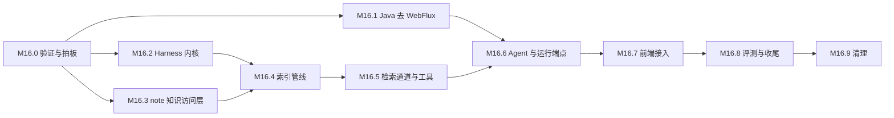

# AI 模块重构里程碑（M16.x）

> 文档版本：v0.2（技术验证稿） | 创建 2026-11-12 | 更新 2026-11-14
> 状态：**D1–D17、P1/P2 均已拍板；本次按无生产环境的破坏性升级实施；M16.0–M16.2 已于 2026-11-14 完成**
> 关联文档：[调研报告](./AI_RESEARCH.md) · [总体方案](./AI_REFACTOR_PLAN.md) · [知识检索方案](./KNOWLEDGE_RETRIEVAL_PLAN.md)
>
> 本文是执行计划：每个里程碑的任务、验收标准与依赖。设计取舍在两份方案里，这里不重复。
> 开工后，执行结果、与方案的偏差、验收记录都回写到本文对应的里程碑下面。

---

## 0. 总览

| 里程碑 | 内容 | 主要改动面 | 依赖 | 粗估（人日） |
|---|---|---|---|---|
| M16.0 | 技术验证与拍板 | 一次性验证脚本，不进主干 | — | 3–4 |
| M16.1 | Java 去 WebFlux，改用虚拟线程 | `services/ai` 及连带模块 | M16.0 | 5–6 |
| M16.2 | Python 工程化与 Harness 内核 | `ai-service/` | M16.0 | 7–8 |
| M16.3 | note 的知识访问层 | `services/note` | M16.0 | 6–7 |
| M16.4 | 索引管线 | `ai-service/indexing` | M16.2、M16.3 | 7–8 |
| M16.5 | 检索通道与工具 | `ai-service/retrieval`、`tools` | M16.4 | 6–7 |
| M16.6 | 知识检索 Agent 与运行端点 | `ai-service/agents`、`services/ai` | M16.1、M16.5 | 5–6 |
| M16.7 | 前端接入 | `apps/web` | M16.6 | 4–5 |
| M16.8 | 评测、压测与收尾 | 评测集、文档 | M16.7 | 5 |
| M16.9 | 清理 | 破坏性升级后的残留引用与旧依赖 | M16.8 | 2 |

工期是按一个熟悉本仓库的开发者估的粗略数字，没有经过实际拆分验证，合计约 50–58 人日。
M16.1、M16.2、M16.3 三项互不依赖，可以并行。

### 通用约定

- **分支**：每个里程碑从 `dev` 切一个 `feat/ai-<描述>` 分支，完成后 `--no-ff` 合并回 `dev`（`README.md`「Git 工作流」）。
  本批方案文档按用户要求直接提交在 `dev` 上，不代表实施也这样做。
- **提交粒度**：一次提交只动一个服务或一个包，Java、Python、前端的改动分开提交；提交说明用中文。
- **测试**：每个里程碑的改动都附带单测。修缺陷时先写复现它的失败用例，再改代码（`CLAUDE.md`「测试要求」）。
- **契约**：改 Controller 之前先写 OpenSpec 提案；改完跑 `pnpm openapi:generate`，把 `openapi/specs/*.json` 一起提交。
- **配置**：运行时配置改 Nacos 的 Data ID（`infra/docker/nacos/configs/`），不改 `application.yml`。
- **数据库**：迁移脚本放 `infra/sql/migrations/`，同步更新 `infra/sql/anynote.sql`，手动执行。
- **每个里程碑结束时 `dev` 可运行**：`pnpm services:build`、`mvn test`、`pnpm test`、`pnpm typecheck` 全绿。
- **范围边界（2026-11-14 用户确认）**：验收阻断项仅限本批引入的问题。验证时发现且确认非本批引入的问题，记录其实际状态，但不修复、不作为里程碑关闭的阻塞项；不得因此宣称全仓门禁全绿。
- **破坏性升级（2026-11-14 用户再次确认）**：当前无生产环境，本里程碑及后续任务均不建设过渡期目录、旧协议适配层或兼容映射。Python 旧对话与 PDF 问答在 M16.2 直接删除；Whisper 按 D12 拆为独立进程。Java 旧对话端点仍由 M16.6 直接替换，不增加过渡适配。

---

## M16.0 技术验证与拍板

**目标**：把两份方案里标了「待核对」的假设变成事实，把 D1–D17 定下来。验证脚本是一次性的，不进主干。

**任务**

- [x] 拍板 D1–D17，结果回写 [README](./README.md) 的决策表（2026-11-14：全部采用推荐项；D4 附加「模型供应商运行时可改」）
- [x] 定模型供应商凭据的运行时存放方式（**P1 已选 A**：业务库 AES-GCM 密文，主密钥只注入 `services/ai`；Python 经内部端点取快照，不直接读库）
- [x] **虚拟线程**：写一个最小的 Spring MVC 服务（与 `services/ai` 相同的 Boot 版本、连接池、驱动），
      用 `SseEmitter` 转发一个模拟上游的流；按[总体方案 §4.6](./AI_REFACTOR_PLAN.md#46-配置与验收) 的场景压到 2000 条并发流，
      打开 `-Djdk.tracePinnedThreads=full`，记录每个库的钉住情况、平台线程数、每连接内存
- [x] 确认 `RestClient` 加 `@LoadBalanced` 能按 Nacos 服务名解析到 Python 实例，并能流式读取响应体
- [x] 确认 Druid 实际生效的版本，统一根 pom 与 BOM 里的两个版本属性
- [x] **Elasticsearch 8.7**：可索引的向量维度上限、带过滤条件的近邻搜索、`cjk` 分析器对中文的切分效果；
      在 384MB 堆下灌入约 5 万个片段，观察内存与查询延迟
- [x] **Python 环境**：在选定的解释器版本上装齐在线进程的依赖；确认 `nacos-sdk-python` 的注册、心跳、注销与配置监听可用；
      核对现有 `requirements.txt` 在本机默认解释器上的安装情况
- [x] **PDF 解析**：拿仓库已有的几份资料和几份有代表性的 PDF（双栏、带表格、带公式、扫描件），
      比较候选解析库在标题识别、表格、速度、许可证上的差异（**P2 已选 A：`pdfplumber`（MIT），不引入 AGPL**）
- [x] **嵌入与重排模型**：按 D3 的方向各选两个候选，用一个小样本比较中文检索效果、维度、延迟、成本
- [x] **数据核对**：是否存在不属于任何知识库的笔记；慕课的 `data_scope` 实际取值分布；资料两种默认权限串各占多少
      （2026-11-14，本机 dev 库，非生产数据：笔记 614 条，不属于任何知识库的 0 条，权限串全部为 `70000`；
      慕课 2 条，`data_scope` 都是 `1`、权限串都是 `77400`，即 D10 所说两套规则冲突的情形，按 D10 检索中只有创建者可见；
      资料与知识库通知都是 0 条。**2026-11-14 用户确认目前没有生产环境，取消生产库补查与生产迁移方案**）
- [x] 把调研报告 §2.3 里标「静态」的缺陷在真实栈上复现一遍，记录现象（被前置缺陷掩盖的项单独注明，不冒充端到端通过）

### M16.0 验证记录（2026-11-14）

验证脚本与原始输出均在本机 `tmp/m16-0/`，按约定不进主干。真实服务使用仓库正在运行的 dev 栈；容量验证改用与部署相同的 `eclipse-temurin:21-jre-alpine`，避免 Windows 宿主 socket 限制干扰。临时笔记/知识库已删除，验证容器与旧 Python 进程已停止；临时账号按仓库 E2E 的既有约定保留，所发会话均已注销。

#### 1. Java：MVC、虚拟线程、Nacos 与 Druid

- 最小服务使用 Boot 3.3.4、Tomcat 10.1.30、Druid、MySQL 驱动 8.3.0。每条流执行 Feign 健康调用和首尾两次短数据库查询，再用 `@LoadBalanced RestClient.Builder` + JDK `HttpClient` 读取 Python SSE 并转发。
- 真实 Nacos 服务名解析和流式读取成功；最终一轮上游有 **4 个健康实例**，均经同一服务名 `m16-0-py-stream` 调用。`RestClient.exchange` 内读取响应体可行，不能用会先消费/关闭响应的写法替代。
- 最终阶梯结果（每流标称 60 秒、5 事件/秒）：100 / 500 / 1000 / 2000 均全部成功，每流 300 事件，0 最终失败、0 重试、0 断线。2000 档总耗时 82.93 秒，包含 2000 路的建立与收尾；不是单连接服务端延迟。
- 内存口径：每档启动前与运行 15 秒时各做一次 GC，以两次 heap-used 差值除以连接数。它包含框架与残余临时对象，是容量预算口径，不是某个对象的精确大小。

| 并发 | 成功 | 总耗时（秒） | 平台线程峰值 | 稳态保留堆/连接 |
|---:|---:|---:|---:|---:|
| 100 | 100 | 59.99 | 102 | 约 185KiB（小样本含固定开销） |
| 500 | 500 | 62.56 | 122 | 约 164KiB |
| 1000 | 1000 | 65.81 | 143 | 约 151KiB |
| 2000 | 2000 | 82.93 | 183 | 约 160KiB |

- 平台线程没有随连接数线性增长。原 100KB/连接起步线偏紧，**校准为 200KiB/连接**；M16.8 还需用真实 Python 上游重跑，不能把模拟上游结果当成整条模型链路的容量。
- `-Djdk.tracePinnedThreads=full` 最终记录 7 类栈：MySQL 驱动短查询、Druid 取连接，以及首次 Feign/Nacos 初始化。没有 JDK `HttpClient` 长读、Tomcat/SseEmitter 长写钉住记录。短数据库钉住可接受，但必须短事务、无事务转发、限制 DB 并发。
- 早期 Windows 宿主运行在 500/1000 档出现 socket 缓冲区失败；同一 JAR 在 Linux 容器通过，记录为宿主网络边界。早期 1000 档另有 5 次「响应头为空」，方案据此补充**首次事件前最多重试一次**；收到任何事件后禁止重试。
- 当前真实 `services/ai` 的 actuator 证明数据源类型是 `DruidDataSource`，基线 Maven 解析为 1.2.15。根 pom 已统一升到 BOM 的 **1.2.21**；依赖树和 `mvn test -pl ai -am` 均通过。AI 模块自身仍是 **0 个测试**，这由 M16.1 补齐。

#### 2. Elasticsearch 8.7.0（384MB 堆）

- **维度上限实测为 2048**，1024、1025、2048 的可索引向量均创建成功，2049 返回维度范围错误。方案中的「印象中 1024」已修正。
- 带 `kb_id`、ACL 的 kNN 各返回 20 条且越权 0；只有一个知识库 73 条候选时也能返回 20 条，证明过滤不是简单地对全局前 k 条做事后过滤。
- 混合查询必须给全文 `query` 与 `knn` 两段都加同样的权限过滤。只过滤 kNN 时，实测 20 条中有 16 条越出指定知识库；两段都过滤后为 0。
- `cjk` 是中文二元切分，例如「知识库权限判定」产生「知识 / 识库 / 库权 / 权限 / 限判 / 判定」。`match` 对「知识库权限」命中 46,249 条，`match_phrase` 仅 611 条；精确匹配/高亮可用，但原话查找应走 `match_phrase` 或 `kb_grep`，不能把二元 `match` 当精确匹配。
- `smartcn`、`ik_smart`、`ik_max_word` 当前镜像均未安装；沿用自带 `cjk`，不换镜像。8.7 对 RRF 返回 `Unknown key ... [rrf]`，应用层融合方案不变。
- 50,000 个 1024 维片段 bulk 错误 0，refresh 0.4 秒，存储约 **1.29GiB**。写入总耗时 1095.4 秒包含本机逐条生成随机向量，不可当作 ES 写入吞吐。
- 查询每通道 200 次，服务端 p50/p95：带过滤 BM25 **8/16ms**，带过滤 kNN **6/18ms**，混合 **7/18ms**；不过滤 kNN 为 38/46ms。稳态 heap 约 179MB/384MB，breaker 0，old GC 0。
- force-merge 不是本项验收内容；其实际耗时超过客户端 600 秒且任务不支持取消，未形成 post-merge 数据。临时索引随后已删除。生产重建不应把 force-merge 放在在线关键路径。

#### 3. Python 3.12 与 Nacos

- 解释器固定 **3.12.14**。新在线进程的最小依赖已实际安装，FastAPI/Pydantic/httpx/OpenAI/Redis/ES/Nacos 等导入成功，`uv pip check` 全部兼容，且 **没有 torch**。
- 本机默认 3.14.6 安装现有 requirements 时，`onnxruntime==1.19.2` 无 cp314 wheel；3.13 也无对应 wheel。Windows 直接安装还会先遇到 Linux 专用 `nvidia-nccl-cu12`。
- 旧完整依赖在 3.12 上最终安装、导入和 `uv pip check` 成功，但 Windows 需要排除 Linux CUDA/triton/uvloop，并补 `setuptools<81`、numpy、pybind11 的源码构建前置。这证明 3.12 可用，也证明当前单份 requirements 不可复现；M16.2 必须拆在线/索引/Whisper 并生成锁文件。
- `nacos-sdk-python==1.0.0` 实测注册、心跳、注销均成功，实例元数据带版本；配置监听收到更新耗时 **0.08 秒**，读取内容正确，移除监听和配置成功。Windows 配置监听会启动子进程，入口必须有标准 `if __name__ == "__main__"` 保护。
- 旧服务真实运行：80 个不带 `Authorization` 的请求全部进入本地假模型上游，确认鉴权缺失；80 路流式请求时实际 uvicorn 子进程线程数从 45 增至 62，确认同步生成器占线程池。M16.2 的异步化与内部签名是必要修复，不是可选优化。

#### 4. PDF 三库五类样本

样本：受控中文标题/表格/公式、受控双栏中文、由双栏渲染出的纯扫描件、15 页双栏论文《Attention Is All You Need》、仓库 16 页中文 UI 设计稿。速度为同机 3 次中位数；pdfplumber/PyMuPDF 的时间包含表格探测，不与 pypdf 的纯文本提取混作同口径。

| 库 | 许可证 | 标题/结构 | 受控表格 | 双栏 | 15 页论文完整解析 | 结论 |
|---|---|---|---|---|---:|---|
| pypdf 5.1.0 | BSD | 无结构 API | 无结构化表格 | 文本可读但无栏位模型 | 1.74s | 只能做底层文本提取，不单独采用 |
| pdfplumber 0.11.10 | MIT | 字号/位置可识别；双栏标题需区域切分 | 单元格完整 | 需自行分栏 | 19.62s | 宽松许可，worker 离线处理可接受，推荐 |
| PyMuPDF 2.1 | **AGPL-3.0 / Artifex 商业** | 标题识别最好，栏位与块信息完整 | 单元格完整 | 开箱效果最好 | 8.86s | 技术更强，但必须先过 P2 许可证决策 |

- 三者对扫描件都提取 0 字，符合 D6「标记无法提取文本，不做 OCR」。仓库 UI PDF 也基本无文本层，同样归入此类。
- 方案影响：默认推荐 pdfplumber，并把双栏区域切分与标题识别列入 worker 单测；若用户接受 AGPL/商业许可，才可改选 PyMuPDF。

#### 5. 嵌入与重排小样本

口径：16 篇固定中文短文档、10 个固定问题，本地 CPU、torch 2.5.0+cpu。召回均对 16 篇排序；重排统一使用 bge-small-zh 的前 10 候选。模型体积是本地缓存文件总量；本地部署无按次 API 费用，成本主要体现为体积、内存与 CPU 延迟。这个小样本只筛选候选，**不用于宣称达到正式验收线**。

| 类型 | 候选 | 维度 | 体积 | 查询/Top10 平均延迟 | Recall@1 / @10 | MRR |
|---|---|---:|---:|---:|---:|---:|
| 嵌入 | BAAI/bge-small-zh-v1.5（MIT） | 512 | 96MB | 23.1ms/查询 | 0.90 / 1.00 | 0.950 |
| 嵌入 | intfloat/multilingual-e5-small（MIT） | 384 | 493MB | 46.2ms/查询 | 0.80 / 1.00 | 0.883 |
| 重排 | 不重排基线 | — | — | 0 | 0.90 / 1.00 | 0.950 |
| 重排 | BAAI/bge-reranker-base | — | 1.13GB | 673ms | 0.80 / 1.00 | 0.863 |
| 重排 | BAAI/bge-reranker-v2-m3 | — | 2.29GB | 1782ms | 0.90 / 1.00 | 0.920 |

- 第一本地嵌入候选选 bge-small-zh；需要多语言时保留 E5-small 做对照。两者都远低于 ES 的 2048 维上限。
- 两个重排候选在本样本均未超过不重排基线，且增加明显延迟，**一期默认关闭重排**；M16.8 用正式语料重新做消融，不能把小样本结论永久化。语义通道的默认开关同样由正式评测决定。
- 正式检索验收线暂保留「期望证据前十召回率 ≥85%」；本样本不用于调整该阈值。

#### 6. 调研报告 §2.3 的真实栈复核

| # | 真实栈现象与证据等级 | 对方案的影响 |
|---|---|---|
| 1 | **直接复现**：会话列表与新会话均抛 `NoSuchElementException: Context is empty`；新会话随后还出现 `role=null` 的消息插入约束错误 | M16.1 先写登录用户与落库失败用例 |
| 2 | **运行时证实**：Nacos 有 `anynote-ai-nio`，没有 `anynote-ai`；部分业务调用会先被 #1 阻断 | D9 改名后三个 Feign 目标自然存在 |
| 3 | **直接请求确认**：`/rag/index`、`/chat/conversations/{id}/permissions` 均走「未知错误」；真实 OpenAPI 也无这两个路径 | M16.1/M16.3 不能只改服务名，还要补或删除调用方 |
| 4 | **直接复现**：新端点返回 `B0001 查询文档 RAG v1 暂未实现`；旧 Python `/api/rag/query` 返回 404 | 新 PDF 问答走限定范围运行 |
| 5 | **真实代码 + 本地上游**：同一 PDF 连续检索两次，下载 2 次、嵌入请求 4 次；第二次还返回重复文档 | 持久化 ES 与增量索引是必要的 |
| 6 | **直接复现**：80/80 无鉴权请求到达模型适配层 | 所有 Python 内部端点加内部签名 |
| 7 | **直接复现**：80 路请求时实际进程线程 45→62 | 在线端点改 asyncio，CPU 工作移出事件循环 |
| 8 | 当前被 #9 的零命中掩盖，未伪装成独立双用户复现；dev 笔记权限又全为 `70000` | M16.3 用权限矩阵固定该分支；本期不改权限模型 |
| 9 | **端到端复现**：新建笔记精确标题搜索 0 条；ES 文档实际存在、标题正确、没有 `all` 字段 | D17 旧端点不动；新索引显式 mapping 与语料字段 |
| 10 | **运行时证实**：dev 库有 2 个慕课，`mooc` 索引 404，运行栈无 Canal | 新管线不依赖 Canal |
| 11 | **测试命令证实**：AI Maven 构建成功但 0 测试；Python `pytest --collect-only` 为 0 并以退出码 5 结束 | M16.1/M16.2 先建安全网 |
| 12 | **实际安装证实**：3.14/3.13 失败，3.12 经分组调整后成功 | 固定 3.12，锁文件按进程/平台拆分 |
| 13 | **严格对照**：同一临时服务调真实 note `@InnerAuth` 端点，非请求线程 `hasRequest=false` 返回 `A0301`，请求线程签名返回 `00000` | Feign 拦截器必须无条件加内部签名 |
| 15 | Java 日志确认请求 `/api/whisper`；真实 Python OpenAPI 只有 `/v1/audio/transcriptions`。本次调用还先暴露了直接 `WebClient` 对 `anynote-langchain` 的 DNS 失败 | M16.1 统一走负载均衡 RestClient 并修正路径 |

第 14 条原报告标的是「静态推断」，不在本轮「标静态」清单内；仍由 M16.1 的收尾落库用例覆盖。

#### 7. 全仓门禁

- `mvn test`：31 个 reactor 模块全部 SUCCESS；`pnpm services:build`：31 个模块全部 SUCCESS。两者均覆盖 Druid 1.2.21。
- **遗留问题 G1（非本次引入，后续不管）**：`pnpm test` 两轮全量均因 CLI 既有用例超过 5 秒而失败，失败项随运行变化。`commands.test.ts` + `skill-commands.test.ts` 单独重跑 70/70 通过，`store.test.ts` 单独重跑 13/13 通过。记录为 Windows 下不稳定的既有门禁，不纳入本次重构，不阻断里程碑。
- **遗留问题 G2（非本次引入，后续不管）**：`pnpm typecheck` 稳定失败于 3 处既有 web 契约类型错误：`use-profile.ts` 的 `/user/mine/profile`、`use-task-detail.ts` 的 `/admin/noteTasks/{id}/editHeatmap`、`profile.ts` 的 `/notes/{noteId}/collab-grant` 在本地生成类型中不存在。不纳入本次重构，不阻断里程碑。

**M16.0 已关闭（2026-11-14）**：P1/P2 均选 A；目前没有生产环境，生产库补查取消；本次按破坏性升级实施，不做生产迁移或旧接口兼容承诺。用户确认 G1/G2 均非本次引入，后续不在本次重构中处理。M16.1–M16.3 可以开工。上述两项仅保留事实记录，**不表示全仓门禁全绿**。

**验收**

- 一份验证记录回写到本节：每项的结论、数据、对方案的影响
- 方案里因为验证结果需要调整的地方已经修订，文档版本升到 v0.2
- D1–D17 全部有结论

---

## M16.1 Java 去 WebFlux，改用虚拟线程

**目标**：AI 链路上的 Java 模块不再依赖 WebFlux；现有功能在旧的对外契约下恢复可用。
除 D9 的服务与路由破坏性改名外，本里程碑保持旧端点的过渡行为；Java 仍调用 Python 现有对话端点，以便与 Python 侧重建解耦。M16.6 新协议上线时再按 D14 直接删除旧端点。

**任务**

先写失败用例（对应调研报告 §2.3 的编号）：

- [x] 第 1 条：新会话与续聊都能取到登录用户
- [x] 第 13 条：不在请求线程上发出的 Feign 调用带内部签名头
- [x] 第 14 条：流结束时的落库不在转发线程的事务里，且一定执行

`services/ai`：

- [x] `pom.xml` 去掉 `spring-boot-starter-webflux` 与 `reactor-test`
- [x] Controller 改成同步返回值；流式端点返回 `SseEmitter`，并用注解显式声明 `text/event-stream` 的响应结构
- [x] Service 改成同步签名；登录用户与令牌封装成参数显式传递
- [x] 新增 `HarnessClient`（`RestClient`），替换 `AIFastApiChatService` 里的 `WebClient`
- [x] 流式转发按[总体方案 §4.4](./AI_REFACTOR_PLAN.md#44-长连接的写法) 实现：短事务开启、无事务转发、短事务落库、断线后读完上游
- [x] 并发限制：每用户与全局的运行数、访问数据库的并发数，各一个信号量
- [x] 删除 `RequiresChatConversationPermissionsAspect`，改用通用的 `@RequiresPermissions`；`RequiresWhisperTaskPermissionsAspect` 改成前置校验
- [x] Whisper 状态流：响应式 Redis 订阅换成监听容器加阻塞队列
- [x] 线程池：`ioExecutor` 换成虚拟线程执行器；删除没有注册的 `DataScopeFilter`、`RagController` 里的测试端点
- [x] 删除占位的 `src/test/java/Test.java`，补齐单测

连带模块：

- [x] `anynote-api-ai`：删除 `RagService`（连同它在自动配置清单里的那一行）与 webflux 依赖
- [x] `anynote-common-ai-fastapi`：模块删除，父 pom 与 BOM 里的声明一并去掉
- [x] `services/note`：`DocServiceImpl` 的 PDF 问答改为废弃，抛出带说明的业务异常；删除 `WebClientConfig` 与 webflux 依赖
- [x] `services/file`、`job`、`manage`：删除只为 `RagService` 注入而存在的 `WebClientConfig`
- [x] `anynote-common-datascope`：删除 `aspect/webflux/RequiresPermissionsAspect`
- [x] `anynote-common-security-servlet`：`FeignRequestInterceptor` 对所有调用加内部签名
- [x] `anynote-common-core`：清理 `ServletUtils` 里残留的 import

改名（D9 通过时）：

- [x] 模块 `anynote-modules-ai-nio`、服务名 `anynote-ai-nio`、包 `com.anynote.ai.nio` 改为不带「nio」的名字
- [x] `ServiceNameConstants`、网关路由（**直接删除 `/api/aiNio/**`，不设别名**）、OpenAPI 聚合路由、compose、Nacos Data ID 同步
- [x] 新前端与 CLI 的域映射（`apps/web/src/lib/api/openapi.ts`、`apps/cli/src/core/api.ts`）切到 `/api/ai`；CLI 的生成物重新生成
- [x] 文档里的旧名同步：`CLAUDE.md`、`README.md`、`.claude/context/backend.md`

配置：

- [x] Nacos：`spring.threads.virtual.enabled`、运行与上游超时、并发限制；显式配置并实测 Druid 池上限与 `db-bulkhead` 一致
- [x] 按 P1：`services/ai` 增加模型供应商凭据表、AES-GCM 加解密与内部配置快照端点（先写 OpenSpec）；主密钥只走环境变量，Nacos 只放非敏感映射与版本，附安全与热更新单测
- [x] Python 服务名收拢到一处配置；删除 `sys_config.AI_SERVER_ADDRESS` 与 `anynote.ai-fastapi.address` 两个旧入口及文档里的引用

**验收**

- [总体方案 §4.6](./AI_REFACTOR_PLAN.md#46-配置与验收) 的六项全部通过
- `FRONTEND_MILESTONES.md` M7.6 第 1 条关闭并回写
- `pnpm openapi:generate` 输出干净并提交 baseline。线上行为不变，但生成的 spec 会变：
  流式端点的 `ServerSentEvent*` 包装 schema 由显式声明的事件 schema 取代，另有服务改名带来的差异；逐项核对差异都在预期之内

### M16.1 验收记录（2026-11-14）

**分支与范围**：分支 `feat/ai-java-mvc`（自 `dev` 切出，完成后 `--no-ff` 合并 `dev`）。按 2026-11-14 用户拍板执行：
D9 改名不保留别名；PDF 问答过渡期废弃；并发超限提示、Whisper 状态流 30 分钟上限等文案均按拍板落地。

**实现要点**

- D9 改名：Maven artifact `anynote-modules-ai`、服务名/Nacos 注册名 `anynote-ai`、包 `com.anynote.ai`、启动类
  `AnyNoteAIApplication`；删除 `AI_NIO_SERVICE`，三个原指向它的 Feign 客户端改用 `AI_SERVICE`；网关删除
  `/api/aiNio/**` 路由、OpenAPI 聚合改指 `anynote-ai`；compose 服务/镜像名与 `AI_PORT` 同步，`AI_FASTAPI_ADDRESS` 删除。
- `services/ai`：去掉 webflux/reactor-test；Controller/Service 同步化；流式端点改 `SseEmitter` 并用
  `@ApiResponse` 显式声明事件 schema；`HarnessClient`（`@LoadBalanced RestClient`）替换 `WebClient`；
  `ioExecutor` 改虚拟线程执行器；新增每用户/全局/数据库三个信号量与空闲看门狗；Whisper 状态流改
  `RedisMessageListenerContainer` + 阻塞队列；登录用户与令牌通过 `AiCallContext` 显式传参。
- 连带模块：`anynote-api-ai` 删除 `RagService` 与 webflux；`anynote-common-ai-fastapi` 模块删除；note 的 PDF 问答
  废弃并删除 `WebClientConfig`/webflux；file/job/manage 删除 `WebClientConfig`；datascope 删除 webflux 切面；
  `FeignRequestInterceptor` 无条件加内部签名；`ServletUtils` 清理 Reactor import。
- P1：新增 `a_model_provider` 表与 AES-GCM 加解密、`GET /internal/v1/model-providers/snapshot`、
  `POST /internal/v1/model-providers`、`DELETE /internal/v1/model-providers/{providerKey}`（均 `@InnerAuth`），
  Nacos 只放 `anynote.ai.models` 非敏感映射；主密钥 `ANYNOTE_AI_CREDENTIAL_KEY` 只注入 services/ai。
- 验证中修复的两个连带问题：
  - `LogAspect` 不再把 `SseEmitter` 序列化进日志。改造前每条流都会打一次 `Log Response Error`（Gson 序列化
    `Throwable#detailMessage` 失败），2000 并发一轮产生约 40 万行日志；修复后同轮日志约 4.9k 行、0 条该类错误。
  - `HarnessClient` 复用单例 `HttpClient` 并给它的异步任务使用虚拟线程执行器；否则 JDK `HttpClient` 的默认
    cached thread pool 会让平台线程随连接数增长（首轮 100 并发即从 140 涨到 252）。另加 30s 空闲看门狗：
    `JdkClientHttpRequestFactory.setReadTimeout` 不能中断已阻塞的流式 body 读取，上游停发时只有看门狗能结束流。

**验证结果（本机 docker dev 栈；模拟 Harness 上游注册 Nacos `anynote-ai-harness`，4→8 个实例）**

| 项 | 结果 |
|---|---|
| 依赖面 | `mvn dependency:tree -Dincludes=org.springframework:spring-webflux` 与 `io.projectreactor:reactor-netty-http` 在 `services/ai`、`note`、`file`、`job`、`manage` 均 0 命中 |
| 单测 | `mvn test` 31 个 reactor 模块 BUILD SUCCESS；`services/ai` 38 条（含 P1 18 条、HarnessClient 4 条、ChatServiceImpl 5 条），note 96 条 |
| 功能（HTTP 真栈） | 12/12：会话列表、聊天 SSE 15 帧、提问/回答落库 2 条、PDF 问答废弃文案、Whisper 状态流（初始状态 + Redis 推送）、P1 凭据写/读/删（含解密） |
| 权限错误格式 | 越权访问他人会话返回 HTTP 200 + `application/json` + `A0300`（去掉 `produces` 后不再被 SSE 内容类型卡住） |
| 并发 | 每流 60s/5 事件/秒、300 事件。100：100/100，平台线程峰值 167；500：500/500，峰值 169；1000：998/1000，峰值 174；2000：1999/2000，峰值 173；2000 档总耗时 71.5s。失败项均为模拟上游连接被重置（`HTTP/1.1 header parser received no bytes`），无 Java 侧拒绝、无 OOM |
| 保留堆 | 2000 档 15s 时点 `jvm.gc.live.data.size` 增量 364MB / 2000 ≈ 182KiB/连接（1000 档约 156KiB/连接），低于 200KiB 预算；该口径含残余临时对象，不是单对象精确值 |
| 钉住 | 500 并发 + `-Djdk.tracePinnedThreads=full`：8 条记录全部是首次初始化/短读（Jackson/Spring/Kotlin 反射初始化 5 条、Tomcat 读请求体 2 条、首次事件序列化 1 条）；**稳态上游读取与稳态 SSE 写入 0 条** |
| 故障 | 压测中途暂停上游：43.2s 收到 `failed` 帧（`出现异常请稍后重试`），助手消息落库带失败标记，上游恢复后新请求正常（名额已归还） |
| OpenAPI | `ai.json` 差异：删除 `/rag/test`、`/rag/doc`；新增 3 个 P1 内部端点；`ServerSentEvent*` 三个 schema 替换为 `ChatCompletionsEventVO`/`WhisperEventVO`/`WhisperTaskStatusVOV1`；其余 5 份 baseline 不变 |
| 前端/CLI | 域映射与注释切到 `/api/ai`；web 定向单测 105 条、CLI 301 条通过；浏览器 E2E 未跑（M16.7 接新事件协议时统一跑） |

**环境与遗留**

- 本地 dev 库缺少仓库既有迁移 `2026-09-16-sys-permission-rule-user-associated.sql`，导致所有权限规则查询报
  `Unknown column 'is_user_associated'`（非本批引入）。已在验证环境执行该仓库迁移后继续，不涉及代码改动。
- 容量验证临时通过 Nacos API 把 `anynote.ai.run.max-concurrent-per-user/total` 调到 2000，验证后已恢复
  `2/500` 并重启；compose 为 AI 服务新增 `AI_JAVA_OPTS=-Xms512m -Xmx2g` 默认值。
- 未做真实数据端到端：dev 库无慕课条目/字幕对象，视频总结未走真实数据；`POST /whisper` 需要用户自有的音频对象，
  只做了映射单测与路径修正；真实 Python 上游与真实模型链路留 M16.8 复核。
- 压测后堆 `used` 约 1.17GB、`gcLive` 约 680MB，未做长时间 GC/泄漏观察；M16.8 用真实上游复测时一并复核。

---

## M16.2 Python 工程化与 Harness 内核

**目标**：`ai-service/` 具备可测试的 Harness 内核、内部鉴权、容器化与 CI。用一个不带工具的最小 Agent 走通端到端；系统管理员可在外部管理页面完成模型供应商 CRUD。

**任务**

工程化：

- [x] 固定解释器版本；依赖拆成在线、索引、Whisper 三组并生成目标平台锁文件
- [x] 目录按[总体方案 §5.2](./AI_REFACTOR_PLAN.md#52-目录结构) 重组；直接删除旧对话、PDF 问答与 LangChain/Chroma 依赖，不建设过渡期目录
- [x] Whisper 按 D12 拆为 `anynote-ai-whisper` 独立可选进程，Java 使用独立服务名调用
- [x] 配置收拢到 `Settings` 与 `get_settings()`，去掉模块级的全局变量；非敏感的可调项接 Nacos 配置（D4）
- [x] 内部签名校验的依赖项，所有内部接口挂上；删除启动时打印密钥的代码
- [x] Nacos：注册、心跳、关闭时注销、实例元数据带版本；`/healthz`
- [x] `infra/Dockerfile.ai-service`；compose 增加在线进程与可选 Whisper 进程（dev 与 prod 两套覆盖文件同步）；indexer 仅准备依赖与镜像目标，部署留 M16.4
- [x] `.github/workflows/test.yml` 增加 Python job

Harness 内核（不依赖 FastAPI）：

- [x] 运行状态机、五阶段循环、预算、无进展检测
- [x] 中间件机制与挂载点
- [x] Context Builder、分层编译、Context Manifest、大结果外置、历史压缩
- [x] 工具注册表、行动面（校验、身份绑定、策略、执行、观察）、错误分类
- [x] 事件模型与 SSE 输出；`trace.*` 事件
- [x] 验证器框架（规则在 M16.6 填充）
- [x] 模型接入层：逻辑名目录、OpenAI 兼容适配器、四种超时、重试、用量
- [x] 脚本化的假模型，供内核测试使用

运行接口：

- [x] `POST /internal/v1/runs`（事件流）、取消、健康检查
- [x] 一个不带工具的最小 Agent，证明循环、事件、取消、超时可用

供应商管理（2026-11-14 用户追加）：

- [x] 先写 OpenSpec；新增仅 `ADMIN_X` 可访问的 `/v1/admin/model-providers` 查询、新增、整体更新、删除契约
- [x] 删除内部供应商写接口，内部仅保留 Python 快照；外部响应不返回 API Key，更新时空 Key 保留原凭据
- [x] 桌面 `/settings/providers` 与移动端 `/m/settings/providers` 提供完整 CRUD，非管理员不显示入口
- [x] 重新生成 `openapi/specs/ai.json` 并纳入本批改动

**验收**

- `pytest` 通过；内核的四类确定性测试（状态迁移、中间件顺序、预算与边界、行动面）都有用例
- 用假模型跑通：正常完成、工具参数错误后修正、工具超时、预算耗尽、调用方取消，各自产生预期的事件序列
- 不带内部签名的请求被拒绝
- 在线与 Whisper 容器能启动、能注册到 Nacos、关闭时注销；在线镜像没有 torch
- 管理员桌面与移动端 CRUD 可用，普通用户无法查询或修改，外部响应与页面均不泄露 API Key

### M16.2 验收记录（2026-11-14）

**分支与范围**：在当前 `dev` 开发，未新切分支。按用户最新拍板，不建设过渡期适配；Python 旧对话、PDF 与 LangChain/Chroma 直接删除，Whisper 拆为独立可选进程。新增 `ADMIN_X` 供应商外部 CRUD 与双端页面；内部供应商写接口删除，Python 在新运行开始时读取配置快照。

**实现与修复要点**

- Harness 内核不依赖 FastAPI，包含五阶段循环、状态机、预算、无进展检测、12 个中间件挂载点、分层 Context Manifest、历史摘要复用、大结果工作区引用、行动面、验证器及 OpenTelemetry 形态 Trace。
- OpenAI 兼容适配器分别限制建连、首输出、流空闲与总时长；仅无输出时做有界重试。新增回归用例证明工具参数片段已经到达后也不重放请求。
- 所有 Python 内部端点校验与 Java/协同一致的 HMAC 时间戳签名；运行端点同时要求 `accessToken`。日志、事件与 Trace 不携带用户令牌或模型 Key。
- `infra/Dockerfile.ai-service` 提供在线、测试、索引依赖和 Whisper 目标；Nacos SDK 的日志、快照与故障转移目录都指向可写临时目录，保持在线文件系统只读。
- 管理端新增与整体更新使用不同 DTO；更新空 Key 不覆盖凭据，外部 VO 不含凭据。请求 DTO 的 Key 排除 `toString`，内部快照的 Key 对 Gson 日志序列化不可见。

| 验证 | 实际结果 |
|---|---|
| Python Docker 测试 | `pytest` **37/37**；覆盖状态迁移、中间件顺序/短路、预算与边界、行动面，以及正常完成、参数错误修正、工具超时、预算耗尽、取消 |
| Java Docker 测试 | `mvn test` **30 个 reactor 模块全部 SUCCESS**；`services/ai` **45/45** |
| Web 类型与格式 | `pnpm --filter web typecheck` 通过；本批 21 个前端文件的 Biome 检查通过 |
| Web 本批单测 | 首轮设置/供应商定向 **57/57**；修正类型后供应商 **12/12** |
| Web 全量单测 | 最后一轮 **2036/2040**；4 个失败为既有 token/editor 扫描超时与笔记/UI 断言，相关 4 个文件单独复跑 **58/58**。不宣称 Web 全量全绿 |
| Compose | 新增 Python 部署用例通过；全量 5 项中 4 项通过，既有「仅 web/collab 发布端口」断言未包含现行 Gateway 回环入口，非本批问题，未修改 |
| OpenAPI | Docker 内执行标准 `openapi/generate.sh` 成功；仅 `ai.json` 变化，共 17 条路径，新增 5 个管理员端点，内部写端点消失，其余 5 份 baseline 不变 |
| 最小 Agent 容器 E2E | 隔离 Docker 网络 + 假供应商快照 + 假 OpenAI SSE：无签名 401；签名运行得到文本、5 tokens 与 `ANSWERED`，13 个事件序号连续，无令牌/Key 泄漏 |
| Nacos 与容器 | Harness、Whisper 均健康启动，实例元数据 `version=1.0.0`；正常停止后各自 `hosts=[]`；在线镜像 `find_spec('torch') is None` |
| 管理端真实栈 E2E | Playwright **4/4**：桌面和移动端管理员 CRUD、两端普通用户拒绝；普通用户直接请求列表 API 返回 `A0301`；响应与 AI 日志不含测试 API Key |
| 体积预算 | 桌面最大 **302.0/310KB**，移动端最大 **245.5/250KB**，编辑器 **16.1/250KB**，全部通过 |

**环境与限制**

- 本机 dev AI 容器为 CRUD 验证注入了测试主密钥，未写入仓库；测试供应商已删除，测试账号按 E2E 既有约定保留。
- 宿主 Nginx 当时对本机地址返回 502；未修改该非本批问题。最终 E2E 使用隔离 Web 容器连接真实 Gateway/Auth/MySQL。
- Whisper 只验证了进程、鉴权、SRT 转换、注册与注销，未执行真实音频模型转写；真实模型与真实上游容量仍留 M16.8。Whisper 验证后保持停止，Harness、Web 和 Java AI 容器运行中。
- 未把上述 Web/Compose 结果包装成全仓门禁全绿；既有问题按用户范围约束仅记录，不顺手修复。

---

## M16.3 note 的知识访问层

**目标**：note 服务成为检索范围、可读性、正文读取、变更游标的唯一提供方。

**任务**

- [ ] OpenSpec 提案：内部端点的路径、请求与响应
- [ ] 用单测把现有的三套权限判定行为固定下来（笔记、资料、慕课），覆盖各角色与各权限串
- [ ] 新增 `KnowledgeAccessService`：替指定用户判定、批量判定；现有三个判定函数改为调用它，行为不变
- [ ] 权限矩阵用例表（JSON），Java 单测读取它
- [ ] 按 D10、D16 落实慕课与超管的口径
- [ ] 各实体的导出与读取：笔记、资料、慕课、条目、字幕（经 file 服务读取）、任务、知识库
- [ ] 内部端点（全部 `@InnerAuth`）：检索范围、批量可读性、正文、目录与大纲、结构化查询、变更游标、导出、资料索引状态回写
- [ ] 变更记录表与迁移脚本；在各写路径上与业务写入同事务地插入变更记录
      （清单见[知识检索方案 §5.2](./KNOWLEDGE_RETRIEVAL_PLAN.md#52-变更感知)，实施时用全文搜索补全）
- [ ] 任务提交与退回改笔记权限时记录变更
- [ ] `DocMessageListener`：删除调用不存在端点的索引代码；「重新索引」改为插入变更记录
- [ ] 结构化查询的命名查询与参数校验

**验收**

- `mvn test -pl note` 通过；新增的 Service 与端点都有单测
- 权限矩阵用例全部通过；重构前后现有判定的行为一致
- 每一类写操作都能在变更游标里查到对应记录；事务回滚时不留记录
- 不带内部签名访问这些端点被拒绝；带签名但不带用户令牌访问需要用户身份的端点被拒绝
- `pnpm openapi:generate` 输出干净，baseline 已提交

---

## M16.4 索引管线

**目标**：内容变更后，派生索引在可预期的时间内更新；可以全量重建与核对。

**任务**

- [ ] 索引 worker 入口与部署（compose 服务、环境契约里的网络与文件系统限制）
- [ ] note 内部端点的客户端（带内部签名）
- [ ] 适配器与源文档模型；第一批：知识库、笔记、资料
- [ ] 解析：Markdown、PDF（子进程，限制内存与时间）、SRT、纯文本
- [ ] 切分：按结构、带标题路径、不重叠
- [ ] Elasticsearch：三个索引的 mapping、版本化索引名与别名、批量写入
- [ ] 向量计算（可关闭）；嵌入模型与切分规则的版本记入 `kn_meta`
- [ ] 增量：按游标拉取、版本比对（正文与元数据分开）、删除与权限收紧的处理
- [ ] 水位与索引延迟指标；资料索引状态回写
- [ ] 全量重建命令；按知识库的核对任务
- [ ] 第二批适配器：慕课、条目、字幕、视频总结、任务
- [ ] 第三批（D11 通过时）：知识库通知，含 notify 服务的内部导出端点

**验收**

- 单测覆盖：每个适配器、每种解析器、切分规则、版本比对、删除处理
- 在一套固定的评测语料上全量重建后，核对任务报告零差异
- 修改一篇笔记后，在设定的延迟内能检索到新内容；只改权限时不重新计算向量
- 删除一个实体后，它的片段在索引里不再可被召回
- 关闭向量计算时管线照常完成
- 扫描版 PDF 被标记为无法提取文本，状态回写正确

---

## M16.5 检索通道与工具

**目标**：七个只读工具可用，返回统一的证据结构，权限两段都生效。

**任务**

- [ ] 检索范围的获取与缓存（每次运行一次）；预过滤条件的生成
- [ ] 全文召回、语义召回、条目级召回
- [ ] 查询特征分析；倒数排名融合；去重与每实体限量；重排（可关闭）；相邻片段扩展
- [ ] 第二段权限确认（批量）；丢弃比例指标；索引滞后标记
- [ ] 证据结构与去重
- [ ] 七个工具：`kb_list`、`kb_outline`、`kb_search`、`kb_grep`、`kb_read`、`kb_query`、`kb_related`
- [ ] 各通道不可用时的降级行为
- [ ] Python 侧读取同一份权限矩阵用例，验证预过滤口径
- [ ] 检索层评测的运行器与第一版数据集（不调用对话模型）

**验收**

- 单测覆盖：融合排序、查询特征分析、预过滤条件、证据去重、每个工具的成功与失败路径
- 权限矩阵用例在 Java 与 Python 两侧都通过
- 检索层评测：权限泄漏为零；期望证据前十召回率达到 M16.0 之后定下的基线
- 关闭嵌入服务时 `kb_search` 仍返回全文结果；停掉 Elasticsearch 时其余工具按设计降级

---

## M16.6 知识检索 Agent 与运行端点

**目标**：对外提供运行端点与新的事件协议；知识检索 Agent 端到端可用；PDF 问答恢复。

**任务**

Python：

- [ ] Agent 契约、指令、上下文策略三个文件
- [ ] 首轮预取中间件
- [ ] 验证器规则：引用有效性、原文片段核对、空证据时的结果类型
- [ ] 输出过滤：去掉外部链接与图片
- [ ] 未找到与需澄清两种结果的处理

`services/ai`：

- [ ] OpenSpec 提案：运行端点、事件结构，以及破坏性升级时直接删除旧端点的范围
- [ ] 数据库迁移：会话与消息的新增列、运行记录表、运行事件表
- [ ] `POST /v1/agent/runs`、取消、查询；事件转发与过滤（`trace.*` 只落库不转发）
- [ ] 落库：助手消息、引用、运行记录、Trace；Trace 的定期清理任务
- [ ] 每日次数限制沿用现有配置项
- [ ] `POST /rag/query/docs/v1` 实现为范围限定到单个资料的运行
- [ ] 新运行端点上线时直接删除 `POST /chat/completions`，不做旧格式兼容映射；前端和 CLI 同批切换（D14）
- [ ] 会话详情返回引用

**验收**

- 真实栈上：全库范围、单知识库范围、单资料范围各走通一次问答，回答带可定位的引用
- 证据为空时返回「未找到」并列出查过的范围
- 用另一个用户的身份提问，看不到无权内容，事件里也没有
- 浏览器中途断开后重新进入会话，能看到完整回答
- 取消后上游的模型调用停止
- `mvn test -pl ai` 与 `pytest` 通过；`pnpm openapi:generate` 输出干净并提交 baseline

---

## M16.7 前端接入

**目标**：新前端用上新的事件协议与引用。

**任务**

- [ ] `pnpm openapi:generate` 取得新类型
- [ ] `lib/ai/sse.ts` 解析新事件；`use-chat-stream` 适配；保留中途切页不丢消息的行为
- [ ] 聊天页（桌面与移动）：范围选择、进度展示、引用编号与引用列表
- [ ] 引用跳转：笔记到小节、资料到页、视频到时间点；桌面与移动各自生成链接
- [ ] PDF 问答页接新端点
- [ ] 知识库页面的问答入口
- [ ] 资料列表展示索引状态（含「无法提取文本」）
- [ ] 单测：事件解析、hooks、引用链接生成
- [ ] Playwright 用例：一次带引用的问答、一次未找到、一次 PDF 问答

**验收**

- `pnpm test`、`pnpm typecheck`、`pnpm check` 通过
- `pnpm --filter web bundle:budget` 通过
- 新增的端到端用例在真实栈上通过

---

## M16.8 评测、压测与收尾

**目标**：用数据确认质量与容量，把文档与配置收拢到最终状态。

**任务**

- [ ] 评测语料生成脚本与完整数据集（十一类场景都有题）
- [ ] 评分器：要点覆盖、引用准确、无依据陈述、正确拒答
- [ ] 消融实验：只用全文、加语义、加重排、加首轮预取、片段长度、分词器；据此确定各项的默认开关
- [ ] 校准预算数值与验收线，回写两份方案
- [ ] 在真实的 Python 上游下重跑并发压测，记录整条链路的瓶颈
- [ ] 注入对抗用例全部通过
- [ ] 文档同步：`CLAUDE.md`（仓库定位、后端服务一览、Python 规范、上下文文档导航）、
      `README.md`（目录结构、启动步骤、环境变量、测试命令）、`.claude/context/backend.md`、`.claude/context/api-contracts.md`
- [ ] 逐文件的改动清单：`docs/changelist/<完成日期>-ai-refactor.md`
- [ ] 本文各里程碑的验收记录补全

**验收**

- 评测结果达到校准后的验收线；权限泄漏为零
- 文档里没有指向已删除或已改名对象的引用（按 `CLAUDE.md`「文档维护约定」逐项搜索）

---

## M16.9 清理

**目标**：清理破坏性升级后仍残留的旧引用与旧依赖。无生产环境，不设置“稳定一个版本”的等待期；M16.8 通过后执行。

**任务**

- [ ] 确认 `POST /chat/completions` 已随 M16.6 删除，并清理 `apps/web` 里残留的旧解析代码
- [ ] 确认 M16.2 已删除旧对话、PDF 问答与 LangChain/Chroma 依赖，全仓不残留旧 Python 路由；不新增过渡期清理工作
- [ ] 全仓确认没有 `/api/aiNio/**` 残留引用；本次不创建旧路由别名，因此不存在“再删一次别名”的任务
- [ ] 删除 `services/note` 里已废弃的 PDF 问答端点
- [ ] 确认 `a_rag_log` 等旧表不再写入，决定归档或保留；无生产数据，不做生产归档迁移

**验收**

- 依赖清单里没有不再使用的库
- 全仓搜索不到旧端点、旧服务名的引用
