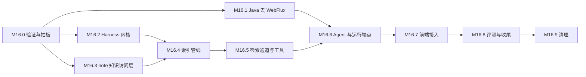

# AI 模块重构里程碑（M16.x）

> 文档版本：v0.1（草案） | 创建 2026-11-12 | 状态：**未开工，待 [README](./README.md) 的 D1–D17 拍板**
> 关联文档：[调研报告](./AI_RESEARCH.md) · [总体方案](./AI_REFACTOR_PLAN.md) · [知识检索方案](./KNOWLEDGE_RETRIEVAL_PLAN.md)
>
> 本文是执行计划：每个里程碑的任务、验收标准与依赖。设计取舍在两份方案里，这里不重复。
> 开工后，执行结果、与方案的偏差、验收记录都回写到本文对应的里程碑下面。

---

## 0. 总览

| 里程碑 | 内容 | 主要改动面 | 依赖 | 粗估（人日） |
|---|---|---|---|---|
| M16.0 | 技术验证与拍板 | 一次性验证脚本，不进主干 | — | 3–4 |
| M16.1 | Java 去 WebFlux，改用虚拟线程 | `services/ai` 及连带模块 | M16.0 | 5–6 |
| M16.2 | Python 工程化与 Harness 内核 | `ai-service/` | M16.0 | 7–8 |
| M16.3 | note 的知识访问层 | `services/note` | M16.0 | 6–7 |
| M16.4 | 索引管线 | `ai-service/indexing` | M16.2、M16.3 | 7–8 |
| M16.5 | 检索通道与工具 | `ai-service/retrieval`、`tools` | M16.4 | 6–7 |
| M16.6 | 知识检索 Agent 与运行端点 | `ai-service/agents`、`services/ai` | M16.1、M16.5 | 5–6 |
| M16.7 | 前端接入 | `apps/web` | M16.6 | 4–5 |
| M16.8 | 评测、压测与收尾 | 评测集、文档 | M16.7 | 5 |
| M16.9 | 清理 | 旧端点、旧依赖 | M16.8 之后一个版本 | 2 |

工期是按一个熟悉本仓库的开发者估的粗略数字，没有经过实际拆分验证，合计约 50–58 人日。
M16.1、M16.2、M16.3 三项互不依赖，可以并行。

### 通用约定

- **分支**：每个里程碑从 `dev` 切一个 `feat/ai-<描述>` 分支，完成后 `--no-ff` 合并回 `dev`（`README.md`「Git 工作流」）。
  本批方案文档按用户要求直接提交在 `dev` 上，不代表实施也这样做。
- **提交粒度**：一次提交只动一个服务或一个包，Java、Python、前端的改动分开提交；提交说明用中文。
- **测试**：每个里程碑的改动都附带单测。修缺陷时先写复现它的失败用例，再改代码（`CLAUDE.md`「测试要求」）。
- **契约**：改 Controller 之前先写 OpenSpec 提案；改完跑 `pnpm openapi:generate`，把 `openapi/specs/*.json` 一起提交。
- **配置**：运行时配置改 Nacos 的 Data ID（`infra/docker/nacos/configs/`），不改 `application.yml`。
- **数据库**：迁移脚本放 `infra/sql/migrations/`，同步更新 `infra/sql/anynote.sql`，手动执行。
- **每个里程碑结束时 `dev` 可运行**：`pnpm services:build`、`mvn test`、`pnpm test`、`pnpm typecheck` 全绿。

---

## M16.0 技术验证与拍板

**目标**：把两份方案里标了「待核对」的假设变成事实，把 D1–D17 定下来。验证脚本是一次性的，不进主干。

**任务**

- [ ] 拍板 D1–D17，结果回写 [README](./README.md) 的决策表
- [ ] **虚拟线程**：写一个最小的 Spring MVC 服务（与 `services/ai` 相同的 Boot 版本、连接池、驱动），
      用 `SseEmitter` 转发一个模拟上游的流；按[总体方案 §4.6](./AI_REFACTOR_PLAN.md#46-配置与验收) 的场景压到 2000 条并发流，
      打开 `-Djdk.tracePinnedThreads=full`，记录每个库的钉住情况、平台线程数、每连接内存
- [ ] 确认 `RestClient` 加 `@LoadBalanced` 能按 Nacos 服务名解析到 Python 实例，并能流式读取响应体
- [ ] 确认 Druid 实际生效的版本，统一根 pom 与 BOM 里的两个版本属性
- [ ] **Elasticsearch 8.7**：可索引的向量维度上限、带过滤条件的近邻搜索、`cjk` 分析器对中文的切分效果；
      在 384MB 堆下灌入约 5 万个片段，观察内存与查询延迟
- [ ] **Python 环境**：在选定的解释器版本上装齐在线进程的依赖；确认 `nacos-sdk-python` 的注册、心跳、注销与配置监听可用；
      核对现有 `requirements.txt` 在本机默认解释器上的安装情况
- [ ] **PDF 解析**：拿仓库已有的几份资料和几份有代表性的 PDF（双栏、带表格、带公式、扫描件），
      比较候选解析库在标题识别、表格、速度、许可证上的差异
- [ ] **嵌入与重排模型**：按 D3 的方向各选两个候选，用一个小样本比较中文检索效果、维度、延迟、成本
- [ ] **数据核对**：是否存在不属于任何知识库的笔记；慕课的 `data_scope` 实际取值分布；资料两种默认权限串各占多少
- [ ] 把调研报告 §2.3 里标「静态」的缺陷在真实栈上复现一遍，记录现象

**验收**

- 一份验证记录回写到本节：每项的结论、数据、对方案的影响
- 方案里因为验证结果需要调整的地方已经修订，文档版本升到 v0.2
- D1–D17 全部有结论

---

## M16.1 Java 去 WebFlux，改用虚拟线程

**目标**：AI 链路上的 Java 模块不再依赖 WebFlux；现有功能在旧的对外契约下恢复可用。
这一步**不改对外行为**（路径、请求体、事件格式都不变），Java 仍然调用 Python 现有的对话端点，以便与 Python 侧的重建解耦。

**任务**

先写失败用例（对应调研报告 §2.3 的编号）：

- [ ] 第 1 条：新会话与续聊都能取到登录用户
- [ ] 第 13 条：不在请求线程上发出的 Feign 调用带内部签名头
- [ ] 第 14 条：流结束时的落库不在转发线程的事务里，且一定执行

`services/ai`：

- [ ] `pom.xml` 去掉 `spring-boot-starter-webflux` 与 `reactor-test`
- [ ] Controller 改成同步返回值；流式端点返回 `SseEmitter`，并用注解显式声明 `text/event-stream` 的响应结构
- [ ] Service 改成同步签名；登录用户与令牌封装成参数显式传递
- [ ] 新增 `HarnessClient`（`RestClient`），替换 `AIFastApiChatService` 里的 `WebClient`
- [ ] 流式转发按[总体方案 §4.4](./AI_REFACTOR_PLAN.md#44-长连接的写法) 实现：短事务开启、无事务转发、短事务落库、断线后读完上游
- [ ] 并发限制：每用户与全局的运行数、访问数据库的并发数，各一个信号量
- [ ] 删除 `RequiresChatConversationPermissionsAspect`，改用通用的 `@RequiresPermissions`；`RequiresWhisperTaskPermissionsAspect` 改成前置校验
- [ ] Whisper 状态流：响应式 Redis 订阅换成监听容器加阻塞队列
- [ ] 线程池：`ioExecutor` 换成虚拟线程执行器；删除没有注册的 `DataScopeFilter`、`RagController` 里的测试端点
- [ ] 删除占位的 `src/test/java/Test.java`，补齐单测

连带模块：

- [ ] `anynote-api-ai`：删除 `RagService`（连同它在自动配置清单里的那一行）与 webflux 依赖
- [ ] `anynote-common-ai-fastapi`：模块删除，父 pom 与 BOM 里的声明一并去掉
- [ ] `services/note`：`DocServiceImpl` 的 PDF 问答改为废弃，抛出带说明的业务异常；删除 `WebClientConfig` 与 webflux 依赖
- [ ] `services/file`、`job`、`manage`：删除只为 `RagService` 注入而存在的 `WebClientConfig`
- [ ] `anynote-common-datascope`：删除 `aspect/webflux/RequiresPermissionsAspect`
- [ ] `anynote-common-security-servlet`：`FeignRequestInterceptor` 对所有调用加内部签名
- [ ] `anynote-common-core`：清理 `ServletUtils` 里残留的 import

改名（D9 通过时）：

- [ ] 模块 `anynote-modules-ai-nio`、服务名 `anynote-ai-nio`、包 `com.anynote.ai.nio` 改为不带「nio」的名字
- [ ] `ServiceNameConstants`、网关路由（保留 `/api/aiNio/**` 别名）、OpenAPI 聚合路由、compose、Nacos Data ID 同步
- [ ] 新前端与 CLI 的域映射（`apps/web/src/lib/api/openapi.ts`、`apps/cli/src/core/api.ts`）切到 `/api/ai`；CLI 的生成物重新生成
- [ ] 文档里的旧名同步：`CLAUDE.md`、`README.md`、`.claude/context/backend.md`

配置：

- [ ] Nacos：`spring.threads.virtual.enabled`、运行与上游超时、并发限制
- [ ] Python 服务名收拢到一处配置；删除 `sys_config.AI_SERVER_ADDRESS` 与 `anynote.ai-fastapi.address` 两个旧入口及文档里的引用

**验收**

- [总体方案 §4.6](./AI_REFACTOR_PLAN.md#46-配置与验收) 的六项全部通过
- `FRONTEND_MILESTONES.md` M7.6 第 1 条关闭并回写
- `pnpm openapi:generate` 输出干净并提交 baseline。线上行为不变，但生成的 spec 会变：
  流式端点的 `ServerSentEvent*` 包装 schema 由显式声明的事件 schema 取代，另有服务改名带来的差异；逐项核对差异都在预期之内

---

## M16.2 Python 工程化与 Harness 内核

**目标**：`ai-service/` 具备可测试的 Harness 内核、内部鉴权、容器化与 CI。用一个不带工具的最小 Agent 走通端到端。

**任务**

工程化：

- [ ] 固定解释器版本；依赖拆成在线、索引、Whisper 三组并生成锁文件
- [ ] 目录按[总体方案 §5.2](./AI_REFACTOR_PLAN.md#52-目录结构) 重组；现有的对话、PDF 问答、Whisper 代码移到过渡期目录，行为不变
- [ ] 配置收拢到 `Settings` 与 `get_settings()`，去掉模块级的全局变量；非敏感的可调项接 Nacos 配置（D4）
- [ ] 内部签名校验的依赖项，所有内部接口挂上；删除启动时打印密钥的代码
- [ ] Nacos：注册、心跳、关闭时注销、实例元数据带版本；`/healthz`
- [ ] `infra/Dockerfile.ai-service`；compose 增加在线进程服务（dev 与 prod 两套覆盖文件同步）
- [ ] `.github/workflows/test.yml` 增加 Python job

Harness 内核（不依赖 FastAPI）：

- [ ] 运行状态机、五阶段循环、预算、无进展检测
- [ ] 中间件机制与挂载点
- [ ] Context Builder、分层编译、Context Manifest、大结果外置、历史压缩
- [ ] 工具注册表、行动面（校验、身份绑定、策略、执行、观察）、错误分类
- [ ] 事件模型与 SSE 输出；`trace.*` 事件
- [ ] 验证器框架（规则在 M16.6 填充）
- [ ] 模型接入层：逻辑名目录、OpenAI 兼容适配器、四种超时、重试、用量
- [ ] 脚本化的假模型，供内核测试使用

接口：

- [ ] `POST /internal/v1/runs`（事件流）、取消、健康检查
- [ ] 一个不带工具的最小 Agent，证明循环、事件、取消、超时可用

**验收**

- `pytest` 通过；内核的四类确定性测试（状态迁移、中间件顺序、预算与边界、行动面）都有用例
- 用假模型跑通：正常完成、工具参数错误后修正、工具超时、预算耗尽、调用方取消，各自产生预期的事件序列
- 不带内部签名的请求被拒绝
- 容器能启动、能注册到 Nacos、关闭时注销
- 在线进程的镜像里没有 torch

---

## M16.3 note 的知识访问层

**目标**：note 服务成为检索范围、可读性、正文读取、变更游标的唯一提供方。

**任务**

- [ ] OpenSpec 提案：内部端点的路径、请求与响应
- [ ] 用单测把现有的三套权限判定行为固定下来（笔记、资料、慕课），覆盖各角色与各权限串
- [ ] 新增 `KnowledgeAccessService`：替指定用户判定、批量判定；现有三个判定函数改为调用它，行为不变
- [ ] 权限矩阵用例表（JSON），Java 单测读取它
- [ ] 按 D10、D16 落实慕课与超管的口径
- [ ] 各实体的导出与读取：笔记、资料、慕课、条目、字幕（经 file 服务读取）、任务、知识库
- [ ] 内部端点（全部 `@InnerAuth`）：检索范围、批量可读性、正文、目录与大纲、结构化查询、变更游标、导出、资料索引状态回写
- [ ] 变更记录表与迁移脚本；在各写路径上与业务写入同事务地插入变更记录
      （清单见[知识检索方案 §5.2](./KNOWLEDGE_RETRIEVAL_PLAN.md#52-变更感知)，实施时用全文搜索补全）
- [ ] 任务提交与退回改笔记权限时记录变更
- [ ] `DocMessageListener`：删除调用不存在端点的索引代码；「重新索引」改为插入变更记录
- [ ] 结构化查询的命名查询与参数校验

**验收**

- `mvn test -pl note` 通过；新增的 Service 与端点都有单测
- 权限矩阵用例全部通过；重构前后现有判定的行为一致
- 每一类写操作都能在变更游标里查到对应记录；事务回滚时不留记录
- 不带内部签名访问这些端点被拒绝；带签名但不带用户令牌访问需要用户身份的端点被拒绝
- `pnpm openapi:generate` 输出干净，baseline 已提交

---

## M16.4 索引管线

**目标**：内容变更后，派生索引在可预期的时间内更新；可以全量重建与核对。

**任务**

- [ ] 索引 worker 入口与部署（compose 服务、环境契约里的网络与文件系统限制）
- [ ] note 内部端点的客户端（带内部签名）
- [ ] 适配器与源文档模型；第一批：知识库、笔记、资料
- [ ] 解析：Markdown、PDF（子进程，限制内存与时间）、SRT、纯文本
- [ ] 切分：按结构、带标题路径、不重叠
- [ ] Elasticsearch：三个索引的 mapping、版本化索引名与别名、批量写入
- [ ] 向量计算（可关闭）；嵌入模型与切分规则的版本记入 `kn_meta`
- [ ] 增量：按游标拉取、版本比对（正文与元数据分开）、删除与权限收紧的处理
- [ ] 水位与索引延迟指标；资料索引状态回写
- [ ] 全量重建命令；按知识库的核对任务
- [ ] 第二批适配器：慕课、条目、字幕、视频总结、任务
- [ ] 第三批（D11 通过时）：知识库通知，含 notify 服务的内部导出端点

**验收**

- 单测覆盖：每个适配器、每种解析器、切分规则、版本比对、删除处理
- 在一套固定的评测语料上全量重建后，核对任务报告零差异
- 修改一篇笔记后，在设定的延迟内能检索到新内容；只改权限时不重新计算向量
- 删除一个实体后，它的片段在索引里不再可被召回
- 关闭向量计算时管线照常完成
- 扫描版 PDF 被标记为无法提取文本，状态回写正确

---

## M16.5 检索通道与工具

**目标**：七个只读工具可用，返回统一的证据结构，权限两段都生效。

**任务**

- [ ] 检索范围的获取与缓存（每次运行一次）；预过滤条件的生成
- [ ] 全文召回、语义召回、条目级召回
- [ ] 查询特征分析；倒数排名融合；去重与每实体限量；重排（可关闭）；相邻片段扩展
- [ ] 第二段权限确认（批量）；丢弃比例指标；索引滞后标记
- [ ] 证据结构与去重
- [ ] 七个工具：`kb_list`、`kb_outline`、`kb_search`、`kb_grep`、`kb_read`、`kb_query`、`kb_related`
- [ ] 各通道不可用时的降级行为
- [ ] Python 侧读取同一份权限矩阵用例，验证预过滤口径
- [ ] 检索层评测的运行器与第一版数据集（不调用对话模型）

**验收**

- 单测覆盖：融合排序、查询特征分析、预过滤条件、证据去重、每个工具的成功与失败路径
- 权限矩阵用例在 Java 与 Python 两侧都通过
- 检索层评测：权限泄漏为零；期望证据前十召回率达到 M16.0 之后定下的基线
- 关闭嵌入服务时 `kb_search` 仍返回全文结果；停掉 Elasticsearch 时其余工具按设计降级

---

## M16.6 知识检索 Agent 与运行端点

**目标**：对外提供运行端点与新的事件协议；知识检索 Agent 端到端可用；PDF 问答恢复。

**任务**

Python：

- [ ] Agent 契约、指令、上下文策略三个文件
- [ ] 首轮预取中间件
- [ ] 验证器规则：引用有效性、原文片段核对、空证据时的结果类型
- [ ] 输出过滤：去掉外部链接与图片
- [ ] 未找到与需澄清两种结果的处理

`services/ai`：

- [ ] OpenSpec 提案：运行端点、事件结构、旧端点的保留期限
- [ ] 数据库迁移：会话与消息的新增列、运行记录表、运行事件表
- [ ] `POST /v1/agent/runs`、取消、查询；事件转发与过滤（`trace.*` 只落库不转发）
- [ ] 落库：助手消息、引用、运行记录、Trace；Trace 的定期清理任务
- [ ] 每日次数限制沿用现有配置项
- [ ] `POST /rag/query/docs/v1` 实现为范围限定到单个资料的运行
- [ ] `POST /chat/completions` 改为内部走同一套事件流再映射成旧格式（D14）
- [ ] 会话详情返回引用

**验收**

- 真实栈上：全库范围、单知识库范围、单资料范围各走通一次问答，回答带可定位的引用
- 证据为空时返回「未找到」并列出查过的范围
- 用另一个用户的身份提问，看不到无权内容，事件里也没有
- 浏览器中途断开后重新进入会话，能看到完整回答
- 取消后上游的模型调用停止
- `mvn test -pl ai` 与 `pytest` 通过；`pnpm openapi:generate` 输出干净并提交 baseline

---

## M16.7 前端接入

**目标**：新前端用上新的事件协议与引用。

**任务**

- [ ] `pnpm openapi:generate` 取得新类型
- [ ] `lib/ai/sse.ts` 解析新事件；`use-chat-stream` 适配；保留中途切页不丢消息的行为
- [ ] 聊天页（桌面与移动）：范围选择、进度展示、引用编号与引用列表
- [ ] 引用跳转：笔记到小节、资料到页、视频到时间点；桌面与移动各自生成链接
- [ ] PDF 问答页接新端点
- [ ] 知识库页面的问答入口
- [ ] 资料列表展示索引状态（含「无法提取文本」）
- [ ] 单测：事件解析、hooks、引用链接生成
- [ ] Playwright 用例：一次带引用的问答、一次未找到、一次 PDF 问答

**验收**

- `pnpm test`、`pnpm typecheck`、`pnpm check` 通过
- `pnpm --filter web bundle:budget` 通过
- 新增的端到端用例在真实栈上通过

---

## M16.8 评测、压测与收尾

**目标**：用数据确认质量与容量，把文档与配置收拢到最终状态。

**任务**

- [ ] 评测语料生成脚本与完整数据集（十一类场景都有题）
- [ ] 评分器：要点覆盖、引用准确、无依据陈述、正确拒答
- [ ] 消融实验：只用全文、加语义、加重排、加首轮预取、片段长度、分词器；据此确定各项的默认开关
- [ ] 校准预算数值与验收线，回写两份方案
- [ ] 在真实的 Python 上游下重跑并发压测，记录整条链路的瓶颈
- [ ] 注入对抗用例全部通过
- [ ] 文档同步：`CLAUDE.md`（仓库定位、后端服务一览、Python 规范、上下文文档导航）、
      `README.md`（目录结构、启动步骤、环境变量、测试命令）、`.claude/context/backend.md`、`.claude/context/api-contracts.md`
- [ ] 逐文件的改动清单：`docs/changelist/<完成日期>-ai-refactor.md`
- [ ] 本文各里程碑的验收记录补全

**验收**

- 评测结果达到校准后的验收线；权限泄漏为零
- 文档里没有指向已删除或已改名对象的引用（按 `CLAUDE.md`「文档维护约定」逐项搜索）

---

## M16.9 清理

**目标**：过渡期保留的东西退役。在 M16.8 合并并稳定一个版本之后执行。

**任务**

- [ ] 删除 `POST /chat/completions` 等旧端点的兼容映射与 `apps/web` 里的旧解析代码
- [ ] 删除 `ai-service/` 过渡期目录里的旧对话与 PDF 问答代码；移除 LangChain、Chroma 等不再使用的依赖
- [ ] 删除网关的 `/api/aiNio/**` 别名
- [ ] 删除 `services/note` 里已废弃的 PDF 问答端点
- [ ] 确认 `a_rag_log` 等旧表不再写入，决定归档或保留

**验收**

- 依赖清单里没有不再使用的库
- 全仓搜索不到旧端点、旧服务名的引用
