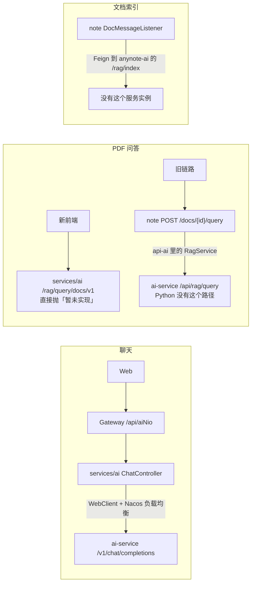

# AI 模块重构调研报告

> 文档版本：v0.1 | 调研日期 2026-11-12 | 基线：`dev` @ `6365728`
> 关联文档：[README](./README.md) · [总体方案](./AI_REFACTOR_PLAN.md) · [知识检索方案](./KNOWLEDGE_RETRIEVAL_PLAN.md) · [里程碑](./AI_MILESTONES.md)
> 参考：AI Agent Handbook（本机 `D:\code\ai-agent-handbook`，提交 `754ec0c`），下称「白皮书」，引用按章节号

---

## 0. 调研口径

- 本报告的全部结论来自**静态阅读**代码、建表 SQL 与配置文件，**没有启动运行栈验证**。
  §2.3 的缺陷凡是标「静态」的，实施时要先写出复现它的失败用例再改（`CLAUDE.md`「测试要求」）。
- 证据格式为 `文件路径:行号`。行号对应上面的基线提交。
- 配置里的密钥、口令一律没有抄进本文。

---

## 1. 结论摘要

1. **现有 AI 链路大半是断的。** §2.3 列了 15 条缺陷，其中第 1–4、13、15 条会让聊天、PDF 问答、文档索引、
   语音转写这几条链路直接不可用。「登录用户取不到」这一条已经在 `FRONTEND_MILESTONES.md` M7.6 第 1 条被真实浏览器验证过。
   所以这次不是在一条能跑的链路上做优化，而是重建。
2. **`services/ai` 名义上是 WebFlux，实际跑在 Servlet 栈上。** 它同时引了 `spring-boot-starter-webflux` 和
   带 `spring-boot-starter-web` 的 `anynote-common-swagger`，Spring Boot 在两者并存时选 Servlet。
   代码按 Reactor 写，容器按 Tomcat 跑，两头的好处都没拿到，M7.6 的缺陷正是这个错位造成的。
3. **现在的「RAG」只覆盖 PDF 一种实体，而且每问一次就把整份 PDF 重新下载、解析、向量化一遍。**
   笔记、慕课、任务都不在检索范围内。
4. **知识库里有可检索文本的实体共 8 类**（§4.1），正文分散在 MySQL 的 `TEXT` 列和对象存储两处；
   权限有三套互不相同的写法（§4.2），检索必须在一个地方把它们收拢。
5. **仓库里已经有 Elasticsearch 8.7 和笔记索引**，但笔记搜索只搜得到本人创建的笔记，慕课索引依赖的 Canal 在 compose 里没有部署。
   全文检索的底座是现成的，缺的是统一的语料模型和权限口径。

---

## 2. AI 模块现状

### 2.1 组成

| 部件 | 位置 | 规模 | 职责 |
|---|---|---|---|
| Java AI 服务 | `services/ai`（artifact `anynote-modules-ai-nio`，服务名 `anynote-ai-nio`，端口 9065） | 约 3400 行，`ChatServiceImpl` 602 行 | 会话与消息、SSE 转发、Whisper 任务、慕课视频总结、翻译 |
| AI 的 Feign 契约 | `services/api/anynote-api-ai` | 6 个 Feign 接口 + 1 个带业务逻辑的 `RagService` | 被 note / file / job / manage 依赖 |
| Python 接入件 | `services/common/anynote-common-ai-fastapi` | 1 个类（`WebClientConfig`） | 只提供一个 `WebClient` Bean |
| Python AI 服务 | `ai-service/` | 约 1400 行 | 模型调用、PDF 问答、Whisper 转写 |
| 前端 | `apps/web/src/features/ai/**`、`apps/web/src/lib/ai/sse.ts` | — | 聊天、PDF 问答、工作流画布 |

Python 侧的关键依赖（`ai-service/requirements.txt`）：`fastapi>=0.115`、`langchain==0.3.4`、`chromadb==0.5.15`、
`torch==2.5.0`、`sentence-transformers==3.2.1`、`openai-whisper`、`nacos-sdk-python==1.0.0`、`pydantic>=2.6`。

### 2.2 现有链路

- 聊天：Java 用带 `@LoadBalanced` 的 `WebClient.Builder`（`services/ai/.../config/WebclientConfig.java:12-16`）
  请求 `configService.getAIServerAddress() + "/v1/chat/completions"`（`.../fastapi/AIFastApiChatService.java:73-82`）。
  地址来自 `sys_config.AI_SERVER_ADDRESS`，初始值是 `http://anynote-langchain`（`infra/sql/sys_config.sql:40`）。
  结合负载均衡的客户端来看，这是一个 Nacos 服务名；Python 注册时用的服务名取自环境变量 `NACOS_SERVICE_NAME`，仓库里没有给出取值。Python 启动时用 `nacos-sdk-python` 注册实例并每 10 秒发一次心跳
  （`ai-service/core/nacos.py:19-23`、`ai-service/app.py:20-24`）。**这就是要求 5 所说的「现在的接入方式」。**
- 模型选择：按字符串前缀分派，`ollama_xxx` / `openai_xxx` / `deepseek_xxx`（`ai-service/utils/model_util.py:24-32`）。
- 流式格式：Python 吐 OpenAI 风格的 `choices[0].delta.content`，Java 再包成
  `ResData<{status, message, conversationId}>` 发给前端（`apps/web/src/lib/ai/sse.ts:7-11`）。

### 2.3 已核对的缺陷

| # | 现象 | 证据 | 影响 | 核对方式 |
|---|---|---|---|---|
| 1 | 需要登录用户的端点全部取不到用户 | `ChatServiceImpl.java:258-259` 用 `Mono.deferContextual` 读 `LOGIN_USER`；往 Reactor 上下文写这个值的 `ContextWebFilter` 在 `anynote-common-security-reactive` 里，只有 gateway 依赖它（`services/gateway/pom.xml:39`）；它还带着「非 Servlet 且非网关」的生效条件（`SpringWebfluxCondition`），现在没有任何服务满足 | 聊天、会话列表等全部失败 | M7.6 第 1 条已实测（`docs/refactor/FRONTEND_MILESTONES.md:690`） |
| 2 | 三个 Feign 客户端指向不存在的服务 | `RemoteRagService` / `RemoteChatConversationService` / `RemoteTranslateService` 的目标是 `ServiceNameConstants.AI_SERVICE = "anynote-ai"`；实际注册名是 `anynote-ai-nio`（`services/ai/src/main/resources/bootstrap.yml:9`、`infra/docker-compose.yaml:244`） | 文档索引、会话权限校验、文档名翻译都走到熔断回退 | 静态 |
| 3 | `/rag/index` 与 `/chat/conversations/{id}/permissions` 两个端点不存在 | `services/ai` 的 6 个 Controller 里没有这两个路径 | 即使改对服务名，#2 的前两个调用仍是 404；`n_doc.index_status` 只会停在「失败」 | 静态 |
| 4 | PDF 问答两个入口都不通 | 新前端请求 `services/ai` 的 `/rag/query/docs/v1`（`apps/web/src/features/ai/use-chat-stream.ts:130`），该端点直接抛「暂未实现」（`RagController.java:63-66`）；旧链路经 note 请求 Python 的 `/api/rag/query`（`services/api/anynote-api-ai/.../RagService.java`），而 Python 只有 `/api/rag/query/v2`（`ai-service/controller/rag_controller.py:15`） | PDF 问答不可用 | 静态 |
| 5 | PDF 问答每次都从头建索引 | `rag_service.py:45-64`：下载 PDF → 解析 → 切分 → 写进进程内的 `chromadb.Client()`，没有持久化；`:155` 每个请求新起一个 `ProcessPoolExecutor`；`:101` 运行时联网执行 `hub.pull("rlm/rag-prompt")` | 慢、贵、离线不可用，换个实例就全丢 | 静态 |
| 6 | Python 服务没有鉴权 | 鉴权中间件整段被注释（`ai-service/app.py:51-69`），启动时还把 `TOKEN` 打到标准输出（`:97`） | 能连到 8000 端口的任何人都能直接调模型 | 静态 |
| 7 | Python 的流式端点占线程 | 端点是同步函数加同步生成器（`ai-service/controller/chat_controller.py:25`），Starlette 把它放进线程池跑 | 每条流占一个线程，Python 这一头的并发上限就是线程池大小 | 静态 |
| 8 | 笔记搜索只搜得到自己的 | `NoteServiceImpl.java:258-261` 唯一的范围条件是 `createBy = 当前用户`，按知识库成员放行的逻辑整段被注释（`:263-277`） | 共享给我的笔记搜不到 | 静态 |
| 9 | 搜索用到的 `all` 字段没有定义 | 笔记与慕课搜索都查 `all` 字段（`NoteServiceImpl.java:280`、`MoocServiceImpl.java:501`），全仓没有索引 mapping | 新环境上搜索结果恒为空，或依赖某台机器上手工建过的 mapping | 静态 |
| 10 | 慕课索引没有数据来源 | `CanalMoocListener` 消费 `canal-topic`（`.../listener/CanalMoocListener.java:33-36`），但 `infra/` 下的 compose 里没有 Canal 容器 | 慕课索引不会更新 | 静态 |
| 11 | AI 模块没有测试 | Java 只有一个 22 行的占位 `services/ai/src/test/java/Test.java`；`ai-service/` 没有 `tests/` 目录；`.github/workflows/test.yml` 的四个 job（java / web / cli / deployment）里没有 Python | 重构没有安全网 | 静态 |
| 12 | Python 运行环境没有固定下来 | 本机 `python --version` 为 3.14.6，`requirements.txt` 钉的是 `numpy==1.26.4`、`torch==2.5.0` 这类早于 3.14 发布的版本（能否装上没有实测，M16.0 核对）；仓库里没有 `ai-service` 的 Dockerfile，compose 不含该服务 | 只能靠开发者各自的虚拟环境跑，环境不可复现 | 静态 |
| 13 | 不在请求线程上发出的 Feign 调用不带内部签名 | `FeignRequestInterceptor.java:31-72`：加签名头的代码写在「当前线程有请求」的分支里；消息监听线程和线程池线程上没有当前请求 | `DocMessageListener` 调 file 的 `@InnerAuth` 端点、`AIFastApiChatService.java:61-66` 在线程池里上报用量，都会被 `InnerAuthAspect` 以签名校验失败拒绝 | 静态 |
| 14 | 流结束时的落库跑在网络事件循环线程上 | `ChatServiceImpl.java:327-329` 在 `doFinally` 里做阻塞式的数据库写入，之前没有切换线程 | 一条流收尾时会卡住同一个事件循环上的其他流 | 静态推断 |
| 15 | Whisper 流式端点路径对不上 | Java 请求 `/api/whisper`（`WhisperServiceImpl.java:144`），Python 只有 `/v1/audio/transcriptions`（`whisper_controller.py:10`） | `POST /whisper` 404；经 `WHISPER_CONFIG.baseUrl` 提交任务的那条路径不受影响 | 静态 |

另外两处不算缺陷但会影响设计：

- `RagService` 是一个放在**契约模块** `anynote-api-ai` 里的 `@Component`，并且登记在该模块的自动配置清单里，
  内部用 `WebClient` 加 `CountDownLatch` 把流式调用阻塞成同步。
  任何依赖 `anynote-api-ai` 的服务（note / file / job / manage）都会因此带上 WebFlux，还得各自提供一个 `WebClient` Bean 供它注入。
- `anynote.ai-fastapi.address` 这个配置项（`AIFastApiProperties`、`AI_FASTAPI_ADDRESS` 环境变量）已经没有任何代码读取
  （`AIFastApiChatService.java:38` 的注入被注释），真正生效的是 `sys_config` 那一条。两套配置并存容易让人改错地方。

---

## 3. WebFlux 依赖面

### 3.1 汇总表

| 模块 | 是否声明 webflux | 用到 Reactor 的代码 | 迁移到 MVC + 虚拟线程的处理 |
|---|---|---|---|
| `services/ai` | 是（`pom.xml:36-39`），另有 `reactor-test` | 19 个文件：5 个 Controller、4 组 Service 的接口与实现（Chat / Rag / Whisper / LlmStatistics）、两个权限切面、`AIFastApiChatService`、`WebclientConfig`、`DataScopeFilter`、`WhisperListener` | **本期主体**，逐文件改写（方案 §4.3） |
| `services/api/anynote-api-ai` | 是（`pom.xml:30`） | `RagService`、`RemoteMoocVideoFallbackFactory` | **本期**：`RagService` 移出契约模块后删除依赖，连带解除 note / file / job / manage 的传递依赖 |
| `services/common/anynote-common-ai-fastapi` | 是（`pom.xml:21`） | `WebClientConfig` | **本期**：模块并入 `services/ai` 后删除 |
| `services/note` | 是（`pom.xml:77`） | `WebClientConfig`、`DocServiceImpl`（PDF 问答） | **本期**：PDF 问答改由 AI 服务承接后删除依赖 |
| `services/file`、`job`、`manage` | 经 `anynote-api-ai` 传递 | 各一个 `WebClientConfig`；业务代码里没有使用方，它们提供的 Bean 只被随 `anynote-api-ai` 自动装配进来的 `RagService` 注入 | **本期**：`RagService` 删除后一并删除这三个配置类 |
| `services/common/anynote-common-datascope` | 否（代码引用） | `aspect/webflux/RequiresPermissionsAspect` | **本期**：它只在「非 Servlet 且非网关」时生效，而除网关外的 8 个服务都在 Servlet 栈上，现在就没有任何服务满足，删除 |
| `services/common/anynote-common-core` | 否 | `ServletUtils` 里残留的 import、`SpringWebfluxCondition`、`SpringWebfluxContextConstants` | 清理 import；后两个类 notify 还在用，随 notify 一起处理 |
| `services/notify` | 是（`pom.xml:37`） | 6 个文件，同样是 `Mono.deferContextual` 读 `LOGIN_USER` 的写法（`NoticeServiceImpl.java:135`） | **不在本期**：不属于 AI 模块。它同样跑在 Servlet 栈上，按 §3.2 的推断也取不到登录用户（未验证）；可以照本期的做法另开一批（决策 D8） |
| `services/gateway` | `spring-cloud-starter-gateway` | 5 个文件 | **不动**：Spring Cloud Gateway 本身建立在 WebFlux 上 |
| `services/common/anynote-common-security-reactive` | 是 | 4 个文件 | **不动**：只有 gateway 依赖它。其中三个带 `SpringWebfluxCondition` 的类（`ContextWebFilter`、`InnerAuthWebfluxAspect`、`LogAspectWebFlux`）在网关里也不生效，是否清理另议 |

### 3.2 `services/ai` 实际运行在 Servlet 栈

- `services/ai/pom.xml:14-17` 依赖 `anynote-common-swagger`，后者引入 `spring-boot-starter-web`
  与 `springdoc-openapi-starter-webmvc-ui`（`services/common/anynote-common-swagger/pom.xml:15-24`）。
- 全仓只有 gateway 显式声明了 `web-application-type: REACTIVE`（`services/gateway/src/main/resources/bootstrap.yml:8`）。
- 所以 `services/ai` 里返回 `Mono` / `Flux` 的 Controller 是被 Spring MVC 当作异步返回值处理的，
  请求线程上没有任何过滤器往 Reactor 上下文里放登录用户。§2.3 第 1 条的根因就在这里。
- 同理，`anynote-common-datascope` 里生效的是 Servlet 版权限切面（`@Conditional(SpringMvcCondition.class)`），
  它把权限写进查询参数的 `params`，而 `ChatServiceImpl.java:133` 去 Reactor 上下文里读，同样读不到。

### 3.3 虚拟线程与版本现状

- 全仓没有任何虚拟线程相关的配置或代码（搜索 `threads.virtual`、`newVirtualThreadPerTaskExecutor`、`Thread.ofVirtual` 均无结果）。
- 版本：Java 21、Spring Boot 3.3.4、Spring Cloud 2023.0.3、Spring Cloud Alibaba 2023.0.3.4、MyBatis-Plus 3.5.9
  （`services/pom.xml:35-52`、`services/bom/pom.xml:14-26`）。运行镜像是 `eclipse-temurin:21-jre-alpine`（`infra/Dockerfile.local:4`）。
- Druid 版本有两个来源：根 pom 的属性是 1.2.15（`services/pom.xml:52`），BOM 里是 1.2.21（`services/bom/pom.xml:24`），
  `services/ai/pom.xml` 显式写了 `${druid.version}`。本机 Maven 仓库里只解析出了 1.2.15，所以实际生效的是它。
- 本机 Maven 仓库里解析到的其他相关版本：`mysql-connector-j` 8.3.0、`tomcat-embed-core` 10.1.30、
  `spring-cloud-commons` 4.1.4（其中已经带有给 `RestClient.Builder` 做负载均衡的处理器）、
  `elasticsearch-java` 8.13.4（客户端比 8.7.0 的服务端新）。
- Feign 没有声明 okhttp 或 hc5 客户端，用的是默认实现。
- `services/ai` 与 `services/common` 的主代码里没有 `synchronized`。
- `REFACTOR_PLAN.md:116` 在选定 Spring Boot 3.3 时就写明了理由是虚拟线程可以取代 Reactor，这次是把那个决定兑现。

---

## 4. 知识库实体盘点

### 4.1 实体与正文位置

| 实体 | 表（`infra/sql/anynote.sql` 行号） | 可检索的文本 | 正文在哪 | 现状 |
|---|---|---|---|---|
| 知识库 | `n_knowledge_base`（322） | `name`、`detail`（≤500 字） | MySQL | — |
| 笔记 | `n_note`（466）+ `n_note_text`（673） | `title`、`content`（Markdown） | MySQL，`TEXT` 列，上限 64KB | 已有 ES 索引 `note` |
| 资料（PDF） | `n_doc`（295）→ `f_file`（244） | `name`、PDF 正文 | 对象存储；**没有任何地方保存解析后的文本** | `index_status` 字段存在，但索引链路是断的 |
| 慕课 | `n_mooc`（373） | `title`、`mooc_description`（≤2000 字） | MySQL | ES 索引 `mooc` 只有标题，且没有数据来源 |
| 慕课条目 | `n_mooc_item`（398）+ `n_mooc_item_text`（422） | 条目 `title`；文档类条目的 `item_text` | MySQL，`TEXT` 列 | 条目是树：章节（0）/ 视频（1）/ 文档（2） |
| 视频字幕与转写 | `n_mooc_video_item_info`（443）、`a_whisper_task_text`（222） | SRT 字幕、转写全文 | 字幕在对象存储（`srt_object_name`），转写全文在 MySQL | Whisper 完成后回写 |
| 视频总结 | `n_mooc_video_item_info.video_summarize`、`a_mooc_video_summarize`（97） | 模型生成的总结 | MySQL | 属于模型生成内容，可信度低于原始字幕 |
| 笔记任务 | `n_note_task`（596） | `task_name`、`task_describe`（≤3000 字） | MySQL | 提交记录在 `n_note_task_submission_record`（647），是结构化数据 |

不作为一期语料、但要说明去向的：

| 对象 | 为什么不进语料 |
|---|---|
| 笔记历史 `n_note_history`（548） | 是同一篇笔记的旧版本，进了索引会和当前版本互相抢排名。任务提交引用的是某个历史版本，这一点放在结构化查询里处理 |
| 视频 `n_video`（738）、视频文件夹 | 导出的表是空的（建表语句没有 `AUTO_INCREMENT` 值），上传端点直接抛「暂未实现」（`VideoController.java:40`）。适配器接口预留，功能上线后接入 |
| 知识库分组 `n_knowledge_base_group`（348） | 只有分组名，且笔记表里没有分组字段 |
| 知识库通知 `ntc_notice`（802） | 有标题和正文，但归 notify 服务管。是否纳入见决策 D11 |
| 成员关系 `n_user_knowledge_base`（707） | 是权限数据，不是内容。只用于算检索范围 |

### 4.2 权限模型

**知识库成员**：`n_user_knowledge_base.permissions`，1 管理 / 2 编辑 / 3 阅读 / 4 无权限。

**内容级权限串**：笔记、资料、慕课都有 `permissions char(5)`，五位依次是
作者、知识库管理员、同知识库成员、其他用户、匿名用户，每位取 7（管理）/ 6（编辑）/ 4（阅读）/ 0（无）。

三类实体的判定各写了一遍，口径并不一致：

| 实体 | 判定代码 | 逻辑 |
|---|---|---|
| 笔记 | `NoteServiceImpl.getNotePermissions`（`:470-511`） | 超管直接给管理；作者取第 1 位；非成员取第 4 位；库管理员取第 2 位；编辑成员取第 3 位；阅读成员在第 3 位非 0 时给阅读。**分支互斥**，命中一条就返回 |
| 资料 | `DocServiceImpl.getDocPermissions`（`:200-250`） | 匿名取第 5 位；超管给管理；其余情况在作者位、库管理员位或成员位、其他用户位之间**取最大值** |
| 慕课（详情） | `@RequiresPermissions("n:mooc:read")`，走通用规则引擎 `PermissionServiceImpl.getPermission`（`services/common/anynote-common-datascope/.../PermissionServiceImpl.java:123-153`），规则行在 `infra/sql/sys_permission_rule.sql:54` | 按 `n_mooc.permissions` 判定，各适用位**取最大值**，并且其他用户位、匿名位对所有人都生效 |
| 慕课（列表） | `MoocMapper.xml:77-92` | 是成员，并且 `data_scope = 3`，或自己创建，或（库管理员且 `data_scope = 2`） |

默认值也不统一：

- 笔记创建时写死 `70000`，只有作者可见（`NoteServiceImpl.java:191`）；提交任务后改成 `44000`，库管理员可读（`:217`）；
  提交被退回时改回 `70000`（`NoteTaskServiceImpl.java:640`）。除此之外全仓没有修改笔记权限的入口，
  这个缺口在 `docs/collab/notes-collab-merge-plan.md` 里已经登记过。
- 资料有两处创建代码，分别写 `70000` 与 `77400`（`DocServiceImpl.java:118`、`:163`）。
- 慕课创建时写 `77400`（`MoocServiceImpl.java:127`）。

**对检索的含义**：

1. 一位普通成员在共享知识库里能检索到的，主要是资料、慕课和自己的笔记。别人的笔记在现行权限下本来就看不到，检索不能绕开这一点。
2. 慕课的两套口径给出的结论不同：新前端建慕课时传 `dataScope: 1`（M7.6 第 2 条的规避做法），按列表规则只有创建者看得到，
   按详情规则（`77400`）成员可读。检索会把正文交给模型，以哪套为准必须先定，见决策 D10。
3. 现有判定函数都从当前请求的令牌里取用户（`tokenUtil.getLoginUser()`），没有「替某个用户判定」的形态，也没有批量形态。
   检索一次要判几十个候选，这两个形态都要补。

### 4.3 已有的检索能力

| 能力 | 位置 | 说明 |
|---|---|---|
| 笔记全文搜索 | `GET /notes/search` → `NoteServiceImpl.searchNote`（`:253-323`） | ES 索引 `note`，带高亮；范围只有本人创建（§2.3 第 8 条） |
| 慕课搜索 | `GET /moocs/search` → `MoocServiceImpl.searchMooc`（`:484-522`） | ES 索引 `mooc`，只有标题；先用 SQL 算出可见的慕课 id 再过滤 |
| ES 部署 | `infra/docker-compose-middleware.yaml:117-142` | 8.7.0，单节点，关闭安全，堆 384MB，端口只绑定本机回环 |
| 向量库 | 无 | compose 里没有任何向量数据库；Chroma 只以进程内模式出现在 Python 代码里 |

### 4.4 变更事件

| 实体 | 现有信号 | 缺口 |
|---|---|---|
| 笔记 | `note_topic` 上的 `GENERATOR_NOTE_INDEX` 与 `DELETE_NOTE_INDEX`，新建、保存、协同写回、删除都会发（`NoteServiceImpl.java:203`、`:242`，`NoteChangePublisher.java:59`），并且在事务提交之后才发 | 任务提交与退回改权限时不发 |
| 资料 | `doc_topic` 上的 `RAG_INDEX`（`DocServiceImpl.java:173`、`:389`） | 删除不发；消费方是断的 |
| 慕课、条目、字幕、任务、知识库 | 没有应用层事件（慕课依赖未部署的 Canal） | 全部要补 |

---

## 5. 白皮书要点与本项目的对应

### 5.1 Harness 是什么

白皮书 §3.1.1 的定义：Harness 是模型之外，围绕 Agent Loop 组织上下文、能力、状态、环境与控制机制，
并把模型判断转化为可执行、可恢复、可验证的任务过程的代码、配置和执行逻辑。三点澄清对本项目都适用：

- **它不是一段更长的系统提示词。** 现在的 `ai-service` 恰好只有提示词和一次模型调用，
  没有任务状态、没有工具注册、没有预算、没有完成验证。
- **它不等于某个框架。** 选不选 LangChain、LangGraph 是实现手段（决策 D1）。
- **它不是 Runtime。** 进程怎么承载、长连接怎么撑住是 Runtime 的事。在本项目里，
  Java 侧的虚拟线程和 Python 侧的 asyncio 属于 Runtime，不属于 Harness。

§3.1.2 列出开发 Harness 要落实的八类对象：Agent Contract、Execution、Context & State、Capability、
Environment、Control、Interaction、Quality。方案 §3 逐项给出落点。

§3.1.3 区分了三种路径控制方式：步骤在设计时就确定的用 Workflow，要根据中间结果动态决定的交给 Agent，
主流程稳定而局部判断复杂的用 Hybrid。知识检索「查到的够不够、要不要换个查法」取决于中间结果，要交给 Agent 判断；
而索引构建和每次提问的第一轮检索是步骤固定的，不需要模型参与。所以一期整体上是第三种。

### 5.2 五项设计原则（§2.1.3）

| 原则 | 对本项目的要求 |
|---|---|
| 模型与 Harness 解耦 | 模型接入收拢到一层，Agent 逻辑里不出现厂商名。现在按字符串前缀分派模型的写法要改 |
| 编排层与 Runtime 解耦 | Harness 内核不依赖 FastAPI，也不依赖某一种流式传输 |
| 状态外置，执行实例可替换 | 会话、任务记录、事件、索引都放在进程之外。现在把向量库放在进程内存里的做法违反这一条 |
| 自主性与权限、可验证性匹配 | 一期 Agent 只给只读工具，所以不需要审批和沙箱；但每次读取都要有明确的身份和权限依据 |
| 可观测、安全、评估是运行前提 | Trace、内部鉴权、评测集与功能同批交付，不留到上线之后 |

白皮书同一节还有一句对控制范围很有用的话：暂时不需要的能力可以不建设，但要写明在什么条件下必须补齐。
方案 §3.9 按这个要求列了「本期不建设」清单。

### 5.3 检索相关要点（「多种检索方案」的出处）

| 白皮书章节 | 要点 | 本方案的落点 |
|---|---|---|
| §8.5.4 | 向量、全文、结构化过滤各有盲区，要多路召回、统一重排，并按查询特征调整各路权重 | 全文通道、语义通道、融合与重排 |
| §8.5.4 及第 27 章塔斯汀案例 | 业务事实用受控的结构化查询补齐；统计口径由接口参数决定，不让模型从明细里推算 | 结构化查询通道 |
| §5.2、§5.3、§5.4 | 大结果留在窗口之外，需要时用搜索、范围读取、分页取回；稳定文档先用索引定位，再读原始来源 | 目录导航与范围读取通道 |
| §4.3.3、FDE 专题 | 探索类任务用 `read` 与 `grep` 这类工具就够；动手前先做字面检索定位 | 文内精确匹配通道 |
| §8.5.5、§8.6.1 | 图谱适合跨实体多跳问题，按验证过的路由规则启用；需求不持续时先从常规检索做起 | 一期只做既有结构关系的遍历，图谱留到二期并写明触发条件 |
| §8.5.2、§8.5.3 | 解析要保留标题层级和表格；切片带父级标题；增量更新记录源版本和索引水位，新版本建好再切换 | 结构化解析、切分规则、索引水位表 |
| §15.8.2 | 关键词适合名称、错误码、确定术语；向量适合语义；**向量和模型增强是可选能力，不启用时关键词检索也要能工作** | 全文通道是基线，语义通道可整体关闭 |
| §15.8.3、§5.1、§5.6 | 相关性决定排序，使用资格决定能不能出现；先按身份缩小范围再检索，过滤在分页之前完成；不能先跨范围召回再提醒模型别泄露 | 两段式权限 |
| §5.4 | 知识接口返回结构化证据：内容、来源与稳定标识、版本、权限范围、检索原因与分数、时效、引用 | 证据包结构 |
| §8.5.6 | 回答能回溯到文档、段落和版本 | 引用与定位符 |
| §8.7.2 | 权威事实与派生视图分开；派生索引可以最终一致，但要知道新鲜度和对应的源版本 | MySQL 与对象存储是权威，ES 是派生 |
| §6.4.4 | 检索到的文档是不可信输入，不能改变指令和工具集 | 指令与数据分离、输出过滤 |
| §4.6.2 | 模型只能申请完成，由 Harness 依据证据提交完成 | 引用校验与「没找到就明说」 |
| §6.6.2、第 21 章 | 单步、轨迹、最终结果三层评测；黄金集的字段结构 | 评测方案 |

### 5.4 不照搬的部分

- 白皮书用 AgentScope、Lakebase、Higress、AgentCore 等产品举例。本方案取它们背后的责任划分和契约，不引入这些产品。
- 沙箱、多 Agent 协作、Agent 注册中心、AI 网关独立部署、自进化，是为有副作用的长任务和多团队平台准备的。
  一期是一个只读的、分钟级以内的问答 Agent，这些都不建设。
- 白皮书 §3.2 的 Harness 代码示例是 AgentScope 的 Java 版。要求 5 已经定了 Python，所以不沿用那套 API。

---

## 6. 调研结论对方案的约束

1. Java 侧的迁移范围以「AI 链路上所有带 WebFlux 的模块」为界，网关不动，notify 另议。
2. 笔记、资料、慕课的权限判定必须留在 note 服务里。Python 不能自己读库判权限，否则就有了第四套口径。
3. 语料至少覆盖 §4.1 的 8 类实体，并且用同一个模型描述，新增实体时只加适配器。
4. 全文检索以现有 ES 为底座，新建索引，不改动现有的 `note` / `mooc` 索引和两个搜索端点。
5. 资料的解析文本要有地方落（派生索引里），不能再每问一次解析一次。
6. 慕课、条目、字幕、任务、知识库的变更事件要在 note 服务的写路径上补发，不依赖 Canal。
7. Python 服务要补内部鉴权、测试、容器化，并固定解释器版本。
8. 对外的流式契约要重新定义：现在的 `{status, message, conversationId}` 表达不了进度、工具调用和引用。
