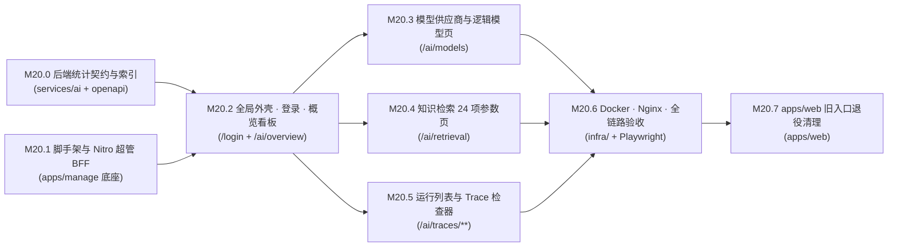

# Anynote 服务管理后台执行里程碑（M20）

> 文档版本：v1.0 | 创建 2026-11-27
> 配套方案：[`README.md`](./README.md)、[`MANAGE_PLAN.md`](./MANAGE_PLAN.md)
> 分支与提交约束：严格遵循 [`CLAUDE.md`](../../CLAUDE.md) 与 [`README.md` Git 工作流](../../README.md#git-工作流)（自 `dev` 切出 `feat/manage-console` 或按子阶段分支开发，**跨语言 / 跨服务改动拆分为独立原子中文 commit**，禁止 `Co-Authored-By`）。

---

## 里程碑依赖关系总览

> 说明：`M20.0`（Java 后端增量）与 `M20.1`（Nuxt 工程底座与 BFF）互不阻塞；`M20.2` 跑通全局外壳后，`M20.3`、`M20.4`、`M20.5` 三个业务模块相互独立，可串行或并行推进。

---

## M20.0 后端统计接口契约与索引补齐

**目标**：以最小非破坏性增量补齐管理后台概览看板所需的聚合统计接口与数据库索引，刷新 OpenAPI baseline。

**任务清单**

- [x] 编写 OpenSpec 提案 `.claude/openspec/changes/2026-11-27-agent-run-admin-stats.md`
- [x] 新增数据库迁移 `infra/sql/migrations/2026-11-27-agent-run-started-index.sql`（为 `a_agent_run` 添加联合索引 `idx_agent_run_started_outcome(started_at, outcome)`），同步更新 `infra/sql/anynote.sql`
- [x] 在 `services/ai` 新增命名强类型 VO：`AgentRunAdminStatsVO`、`AgentRunOutcomeCountVO`、`AgentRunModelBucketVO`、`AgentRunTimeBucketVO`（完整标注 `@Schema`，禁用 `Map<String, Object>`）
- [x] 在 `AgentRunAdminController` / `AgentRunAdminService` 实现 `GET /v1/admin/agent-runs/stats`（含 `SystemAdminGuard` 校验、时间跨度 `≤ 90 天` 校验、`HOUR`/`DAY` 分桶及 P95 计算）
- [x] 将 `SystemAdminGuard.ADMIN_ONLY_MESSAGE` 统一为 `"只有系统管理员可以访问管理接口"` 并同步既有单测断言
- [x] 编写 JUnit 5 + Mockito 纯单测（覆盖非超管拦截、空数据集零值返回、跨度超限报错、按小时/按天聚合与 P95 计算）
- [x] 启动网关与 `anynote-ai`，执行 `pnpm openapi:generate` 更新并核对 `openapi/specs/ai.json`

**验收标准**

- `cd services && mvn test -pl ai` 全绿
- `pnpm openapi:check` 零未提交漂移，`openapi/specs/ai.json` 仅包含预期新增路径与 schema

**建议提交拆分**

1. `docs(openspec): 新增 Agent 运行管理统计接口契约提案`
2. `feat(ai): 新增管理端 Agent 运行聚合统计接口与时间索引`
3. `chore(openapi): 同步管理端运行统计接口 OpenAPI 契约`

---

## M20.1 `apps/manage` 工程脚手架与 Nitro 超管 BFF

**目标**：建立符合 Monorepo 门禁规范的 Nuxt 4 + Nuxt UI v4 应用骨架，走通超管专属认证与网关安全代理。

**任务清单**

- [x] 初始化 `apps/manage`（Vue 3.5 + Nuxt 4 `ssr: false` + `@nuxt/ui` v4 + `tailwindcss` v4 + `@nuxt/icon` 本地 Lucide 图标集 + `@tanstack/vue-query` + `openapi-fetch` + `zod` v4）
- [x] 接入 Monorepo：更新 `pnpm-workspace.yaml`、`turbo.json`（`.output/**` 产物声明）、`biome.json`（忽略 `apps/manage`，由 `apps/manage` 内 `@nuxt/eslint` 承接 `turbo lint`）并同步 `pnpm-lock.yaml`
- [x] 封装浏览器侧 typed API 客户端（`app/lib/api/client.ts`），对接 `@anynote/api-client` 与 `@anynote/api-core`
- [x] 实现 Nitro BFF 路由与工具：
  - [x] `server/routes/healthz.get.ts`
  - [x] `server/utils/{cookies,http,refresh,backend,proxy-allowlist}.ts`（Cookie 键名 `manage_at` / `manage_rt`）
  - [x] `POST /api/auth/login`（`Origin` 校验 + 调 `/login` + 调 `/user/mine` 核验 `ADMIN_X` + 非超管立即调 `/logout` 销票并返回 `403/A0301`）
  - [x] `GET /api/auth/me`（单飞刷新恢复会话 + 在位复核 `ADMIN_X`，失权立即销票清 Cookie）
  - [x] `POST /api/auth/logout`
  - [x] `ALL /api/proxy/[...path]`（写请求 `Origin` 校验 + 路径段穿越拦截 + `/ai/v1/admin/**` 前缀白名单 + 401 单飞刷新重放）
- [x] 编写 Nitro BFF 全分支 Vitest 单元测试与 `test/select.ts` 弹层测试辅助函数

**验收标准**

- 全仓 `pnpm lint`、`pnpm --filter manage typecheck`（`nuxt typecheck` / `vue-tsc`）、`pnpm --filter manage test` 全绿
- 单测覆盖登录准入、非超管立即销票、并发刷新单飞锁、代理白名单阻断等全部安全不变式

---

## M20.2 全局控制台外壳、超管登录页与 AI 概览看板

**目标**：完成后台视觉框架、登录闭环与首屏概览看板（`/login` + `/ai/overview`）。

**任务清单**

- [x] 搭建 `layouts/auth.vue` 与 `layouts/default.vue`（`UDashboardGroup` + 可折叠 `UDashboardSidebar` + 顶栏面包屑 + `UCommandPalette` 快捷导航 + 深浅色切换 + 超管退出菜单）
- [x] 实现全局路由中间件 `middleware/auth.global.ts` 与会话状态 `useAdminSession`
- [x] 实现 `/login` 页面（表单校验、`A0301` 非超管专有阻断提示、同源安全 `redirect` 回跳）
- [x] 实现 `/ai/overview` 页面（`24h / 7d / 30d` 切换、6 张核心指标卡、`@unovis/vue` 运行趋势与模型占比图表、最近异常运行直达列表、空状态与错误重试态）
- [ ] 补齐登录流、路由守卫与概览页 Composable / 组件单测（Schema 与纯函数 53 例已绿，Composable/组件级待补）

**验收标准**

- `pnpm --filter manage test` 与 `typecheck` 通过
- 本地连接网关验证：普通账号登录被拒且 Redis 无残留令牌；超管登录后正常渲染概览看板，深浅双色切换无样式闪烁或弹层白底问题

---

## M20.3 模型供应商 CRUD 与逻辑模型配置页（`/ai/models`）

**目标**：完整交付供应商管理与三大逻辑模型运行时绑定界面。

**任务清单**

- [ ] 迁移并针对 Vue + Zod v4 精炼模型供应商与逻辑模型校验纯函数（`app/lib/schemas/model-provider.ts`）
- [ ] 实现 `useModelProviders` 与 `useLogicalModels` Query / Mutation composables
- [ ] 实现供应商表格 `ProviderTable.vue`、新增/编辑抽屉 `ProviderFormSlideover.vue`（只写 API Key、模型标签编辑、`processReasoningMaxChars` 校验、出境与启用开关）及带「逻辑模型引用关系预检警告」的删除确认弹窗
- [ ] 实现通用逻辑模型配置卡 `LogicalModelCard.vue`（覆盖 `agent_main`、`fast`、`embedding`，含供应商-模型联动选择、`supportsVision`、推理格式与回传方式、向量维度与重建提示、数据出境冲突实时阻断）
- [ ] 编写 Schema、Composables 与组件交互单测（含 `USelect` / `USelectMenu` 深浅色弹层真实交互断言）

**验收标准**

- 全部新增单测通过；验证编辑供应商留空 API Key 不覆盖旧密文、选择禁出境供应商时阻断保存并展示准确提示

---

## M20.4 知识检索 24 项参数配置页（`/ai/retrieval`）

**目标**：交付知识检索运行参数管理页，正式关闭 `AI_MILESTONES.md` M16.5 的「检索参数管理页面待补」项。

**任务清单**

- [ ] 定义 24 项检索参数元数据表（分组、标签、说明、默认值、上下界、步进）与交叉校验 Schema（`app/lib/schemas/retrieval-setting.ts`）
- [ ] 实现 `useRetrievalSettings` Query / Mutation
- [ ] 实现 `/ai/retrieval` 五分组参数卡片、与系统默认值差异徽章、单字段还原默认、「重置全部为推荐默认值」与未保存修改离开路由守卫（`onBeforeRouteLeave`）
- [ ] 编写参数边界校验、交叉校验（`searchDefaultLimit <= searchMaxLimit`、`grepContextDefault <= grepContextMax`）与表单提交单测

**验收标准**

- 单测全绿；首次读取（`version = 0`）正常展示默认值，修改保存后版本号递增，越界输入在前端即时拦截

---

## M20.5 Agent 运行监控列表与完整 Trace 深度检查器（`/ai/traces/**`）

**目标**：交付完整的 Agent 运行可观测工作台，正式关闭 `AGENT_TRACE_VIEW_PLAN.md` 的 M17.5。

**任务清单**

- [ ] 实现 Trace 归并纯函数库 `app/lib/trace/`：
  - [ ] `buildTraceTimeline.ts`：按轮次组织模型轮、工具调用、多模态派遣与回答校验，计算瀑布图起止偏移与首字/生成分段时长
  - [ ] `resolveContextBlobs.ts`：聚合 `trace.blob` 事件按哈希解引用还原 `trace.context` 各层原文
- [ ] 实现 `/ai/traces` 列表页（URL Query 同步的多维筛选栏、分页 `UTable`、状态与耗时标识）
- [ ] 实现 `/ai/traces/[runId]` 详情工作台：
  - [ ] `afterSeq` 自动循环拉齐整次运行事件流 composable（带上限保护与加载进度）
  - [ ] 顶部运行摘要与 `a_agent_trace_access` 留痕提示条
  - [ ] `TraceWaterfall.vue` 瀑布时间轴（支持点击选中与区间框选聚焦）
  - [ ] `TraceRoundList.vue` 按轮折叠虚拟化轨迹表（`@tanstack/vue-virtual`）
  - [ ] `TraceInspector.vue` 六标签检查器（概要 / 9 层上下文原文 / 思考与草稿 / 工具参数与复核前 Top-20 候选诊断 / 原始 JSON 树 / `ProcessCompareView.vue` 用户实际可见视图并排对比）
- [ ] 编写归并纯函数复杂边界单测（含模型中断重试、多轮工具、哈希缺失降级、大结果截断标识）与检查器组件单测

**验收标准**

- 单测全绿；能够完整回放脚本化多轮推理与工具调用运行，准确对比内部未脱敏 Trace 与用户脱敏过程视图，且每次查看在 `a_agent_trace_access` 产生审计记录

---

## M20.6 Docker 容器化、Nginx 模板与全链路验收

**目标**：对齐 `apps/web` 完成生产级容器化编排、真实栈 Playwright E2E 与深浅色视觉走查。

**任务清单**

- [ ] 新增 `infra/Dockerfile.manage`、`infra/Dockerfile.manage.dockerignore`、`infra/manage/start.mjs`、`infra/manage/config.mjs`（附 `config.mjs` 启动校验单测）
- [ ] 更新 `infra/docker-compose.yaml`、`infra/docker-compose.dev.yaml`、`infra/docker-compose.prod.yaml`（及可选 `docker-compose.manage-dev.yaml`），同步更新 `infra/tests/test_compose.py` 与 `README.md` / `docs/deployment-network.md`（并同步 `CLAUDE.md` 对应说明）
- [ ] 更新 `infra/nginx/nginx.conf` 补充 `manage.YOUR_DOMAIN` 站点模板
- [ ] 编写 `apps/manage/e2e/` Playwright 端到端测试套件（超管准入与非超管阻断、供应商与逻辑模型配置、检索参数保存、概览看板与 Trace 详情检查器）
- [ ] 执行 Docker 镜像干净构建验证（校验 `pnpm-lock.yaml` `--frozen-lockfile` 无漂移）与真实浏览器深浅双色视觉验收（含下拉弹层展开态截图留档）

**验收标准**

- `docker compose --env-file infra/.env.dev.local -f infra/docker-compose.yaml -f infra/docker-compose.dev.yaml build anynote-manage-web` 成功，容器启动后 `/healthz` 健康
- `pytest infra/tests/test_compose.py` 通过
- `pnpm --filter manage test:e2e` 全绿；深浅两套主题真实浏览器检查通过

---

## M20.7 `apps/web` 模型供应商分区退役与收尾

**目标**：在 `apps/manage` 完成全量验收后，按决策 D5 干净移除用户端重复管理入口并归档文档状态。

**任务清单**

- [ ] 从 `apps/web` 移除 `providers` 设置分节、`src/features/model-providers/**` 及移动端对应入口
- [ ] 更新 `apps/web` 受影响的设置页单测与 Playwright E2E 用例
- [ ] 运行 `pnpm --filter web test`、`pnpm --filter web typecheck`（确认未引入新错误）、`pnpm --filter web bundle:budget`
- [ ] 回写 `docs/manage/README.md`、`docs/ai-refactor/AI_MILESTONES.md`（标记 M16.5 待补页面与 M17.5 已由 M20 完成）及 `CLAUDE.md` 状态，撰写 `docs/changelist/<日期>-manage-console-phase1.md`

**验收标准**

- `apps/web` 普通用户与管理员登录均不再出现「模型供应商」分节，`apps/web` 单测与体积预算门禁通过
- `apps/manage` 成为平台唯一超管入口，全仓文档引用无悬空指针
