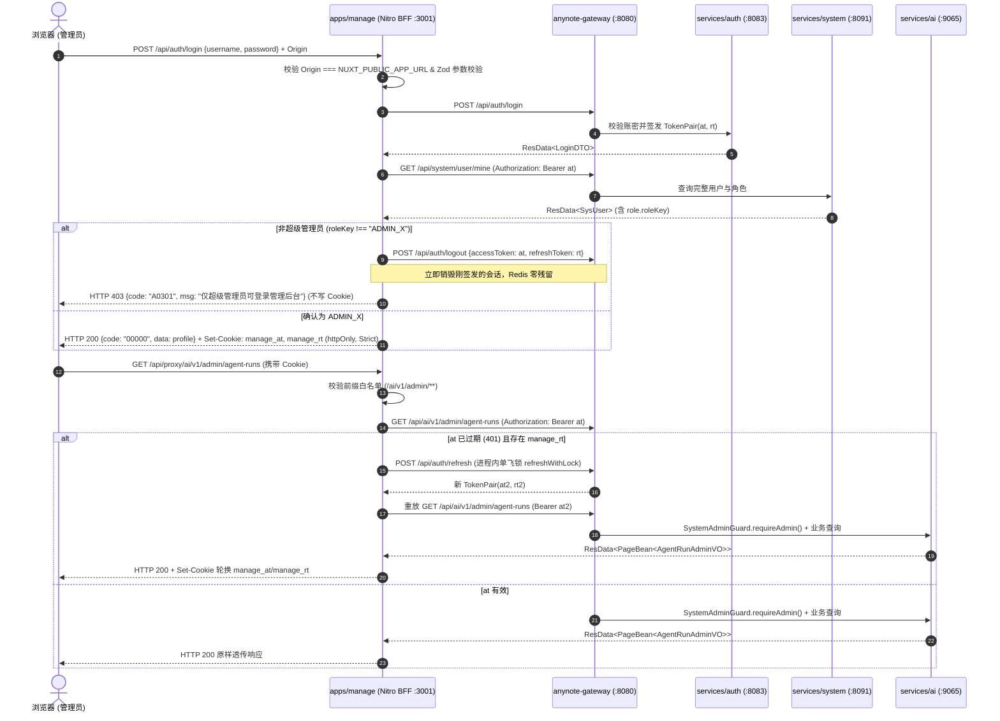
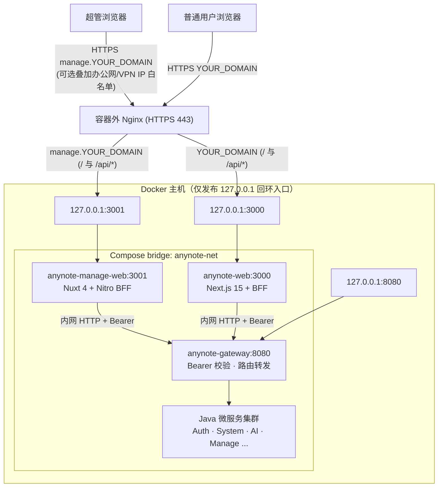

# Anynote 服务管理后台技术方案（Vue 3 + Nuxt 4 + Nuxt UI v4）

> 文档版本：v1.0 | 创建 2026-11-27 | 状态：**已拍板（D1–D6 全部确认）**
> 摘要与决策记录见 [`README.md`](./README.md)，分阶段实施拆解见 [`MANAGE_MILESTONES.md`](./MANAGE_MILESTONES.md)。

---

## 1. 背景、定位与设计原则

### 1.1 为什么要独立建设 `apps/manage`

当前 Anynote 的产品前端 `apps/web`（Next.js 15 + React 19）承担面向终端用户的知识库、TipTap 笔记编辑、PDF 阅读与 AI 对话；此前为应急支持 AI 模块联调，临时在 `/settings/providers` 挂载了仅对 `ADMIN_X` 显示的模型供应商页面，且后续还积压了「24 项知识检索运行参数」（M16.5）、「Agent 完整 Trace 监控台」（M17.5）以及 `services/manage` 下的用户封禁、全站知识库巡检、缓存治理与系统配置等平台级能力。

继续把系统管理功能塞入用户端 `apps/web` 存在三重结构性矛盾：

1. **安全边界混杂**：完整 Trace 包含复核前检索候选、系统提示词、工具原始返回等未脱敏数据，与普通用户共享同一站点入口和 BFF 代理池会扩大意外暴露面，也无法在反向代理层对管理后台单独施加办公网/VPN IP 访问限制。
2. **首屏预算与交互形态冲突**：`apps/web` 受严格的首屏体积门禁约束（桌面 `≤ 310KB`、移动 `≤ 250KB`），且规定桌面与移动端设置分节对等维护；而后台管理重度依赖多维数据表格、参数矩阵表单、瀑布时间轴、JSON 检查器与统计图表，属于典型的桌面宽屏高信息密度控制台。
3. **平台演进解耦**：独立为 `apps/manage` 后，可采用 **Vue 3.5 + Nuxt 4 + Nuxt UI v4** 快速构建标准化后台治理界面，与 `apps/web` 通过 `packages/api-client` 和 `packages/api-core` 在契约层解耦协作、独立发版部署。

### 1.2 核心设计原则

- **契约唯一（OpenAPI Contract-First）**：严禁手写 `fetch` / `axios` 直调后端，所有后端接口类型均由 `openapi/specs/*.json` 派生至 `@anynote/api-client`。
- **零信任凭据隔离（Nitro BFF）**：JWT（`manage_at` / `manage_rt`）仅存 `httpOnly` + `SameSite=Strict` Cookie；浏览器端 Vue 代码永远拿不到明文令牌，模型供应商 API Key 只写不回显。
- **双重超管门禁**：前端中间件拦导航、Nitro BFF 拦会话与代理、网关 `AuthFilter` 与后端 `SystemAdminGuard` 拦接口，任一层发现非 `ADMIN_X` 立即阻断。
- **容器与部署同构**：完全对标 `apps/web` 的多阶段离线契约编译、构建配置一致性自检（`start.mjs` + `config.mjs`）、非 root 最小权限运行与外部 Nginx 反代模型。

---

## 2. 仓库现状盘点与后端契约基线

### 2.1 第一阶段已就绪的后端表与接口（零破坏性复用）

经核对 `services/ai` 与 `infra/sql/anynote.sql`，第一阶段所需的四大核心域在后端已具备坚实的生产级实现：

| 功能模块 | 数据库表 | 后端 Controller 与端点（网关前缀 `/api/ai`） | 鉴权与审计现状 |
|---|---|---|---|
| **模型供应商管理** | `a_model_provider`（AES-GCM 密文存储 `api_key_cipher`，主密钥仅在 `ANYNOTE_AI_CREDENTIAL_KEY`） | `ModelProviderAdminController`：<br/>`GET /v1/admin/model-providers`<br/>`GET /v1/admin/model-providers/{providerKey}`<br/>`POST /v1/admin/model-providers`<br/>`PUT /v1/admin/model-providers/{providerKey}`<br/>`DELETE /v1/admin/model-providers/{providerKey}` | `SystemAdminGuard.requireAdmin()`（校验 `ADMIN_X`）；外部 VO 不含密钥字段，更新时 `apiKey` 留空保留原密文 |
| **逻辑模型绑定** | `a_logical_model`（含 `dimensions`、`reasoning_format`、`reasoning_passthrough`、`supports_vision`） | `ModelProviderAdminController`：<br/>`GET /v1/admin/model-providers/logical/{logicalName}`<br/>`PUT /v1/admin/model-providers/logical/{logicalName}`<br/>（`logicalName` 限 `agent_main` / `fast` / `embedding`） | `SystemAdminGuard.requireAdmin()`；`snapshot()` 每次实时查库，运行中 loop 用旧快照、新运行立即生效 |
| **知识检索参数** | `a_retrieval_setting`（单行表 `id=1`，24 项融合/权重/截断/重排参数） | `RetrievalSettingAdminController`：<br/>`GET /v1/admin/retrieval-settings`<br/>`PUT /v1/admin/retrieval-settings` | `SystemAdminGuard.requireAdmin()`；未保存过时返回默认参数且 `version=0`，整体更新必填并做越界校验 |
| **Agent 运行与 Trace** | `a_agent_run`、`a_agent_run_event`（永久保留）、`a_agent_trace_access`（查看留痕） | `AgentRunAdminController`：<br/>`GET /v1/admin/agent-runs`（分页筛选）<br/>`GET /v1/admin/agent-runs/{runId}`（摘要 + 用户可见过程视图）<br/>`GET /v1/admin/agent-runs/{runId}/events`（按 `afterSeq` 游标读取完整 Trace） | `SystemAdminGuard.requireAdmin()`；读取详情与事件时自动向 `a_agent_trace_access` 写入管理员查看审计记录 |

### 2.2 跨框架共享包现状核查

- `packages/api-client/`：仅含 `openapi-typescript` 派生的 `.ts` 类型声明文件（`auth.ts`、`system.ts`、`note.ts`、`file.ts`、`ai.ts`、`notify.ts`），**100% 纯 TypeScript 类型，零运行时与框架依赖**，`apps/manage` 可直接引用。
- `packages/api-core/`：依赖仅有 `zod: ^4.4.3` 与 `openapi-fetch: ^0.17.0`，导出的 `RES_CODE`、`ApiError`、`unwrapEnvelope`、`flattenedDtoQuerySerializer`、`pageBeanSchema` **完全不含 React 代码**，`apps/manage` 可在浏览器端与 Nitro 服务端直接复用。
- 二期展望：`services/manage`（`:18092`，网关 `/api/manage/**`，已在网关 `AuthFilter` 强制要求 `ADMIN_X`）目前尚未加入 `openapi/generate.sh` 的 `services` 数组及网关 `openapi-*` 路由；这不影响第一阶段（一期接口全在 `ai`、`auth`、`system` 三份已有 spec 内），二期接入系统管理模块时按标准流程补入 `manage.json` 即可。

---

## 3. 技术栈选型与 Monorepo 工程化架构

### 3.1 Vue + Nuxt 生态技术栈矩阵

| 分层 | 选型与版本基线 | 选型依据与职责 |
|---|---|---|
| **应用框架** | **Vue `^3.5` + Nuxt `^4.x`** | 采用 Nuxt 4 标准目录结构（`app/` 放前端界面、`server/` 放 Nitro BFF 路由，物理隔离前后端代码防止服务端模块泄入客户端包）；开启 `ssr: false` + `nitro: { preset: 'node-server' }`（决策 D6） |
| **UI 组件与主题** | **`@nuxt/ui` `^4.x` + `tailwindcss` `^4.x`** | Nuxt UI v4 已将原付费 Nuxt UI Pro（含 `UDashboardGroup`、`UDashboardSidebar`、`UDashboardPanel`、`UDashboardNavbar`、`UPageCard`、`UTable`、`UCommandPalette`、`UTree`、`USlideover`）合并为统一开源包；底层基于 **Reka UI** 无障碍原语与 **Tailwind CSS v4** CSS-first 引擎，弹层天然具备语义背景/前景色 Token 与完备键盘导航，从根源满足仓库「禁用原生 `<select>` / `<option>`」规范 |
| **图标体系** | **`@nuxt/icon` + `@iconify-json/lucide`** | 本地打包 Lucide 图标集（构建期离线解析，运行时容器绝不外连 Iconify CDN，适配内网与严格 CSP 环境） |
| **服务端状态管理** | **`@tanstack/vue-query` `^5.x`** | 与 `apps/web` 的 TanStack React Query 保持完全一致的缓存失效、分页与乐观更新模式，统一采用 `use<X>Query` / `use<X>Mutation` 命名与 Query Key 工厂 |
| **契约请求与校验** | **`openapi-fetch` `^0.17` + `zod` `^4.4` + `@anynote/api-{client,core}`** | 复用全仓统一客户端底座；Zod v4 原生支持 Standard Schema，可直接传入 Nuxt UI v4 的 `<UForm :schema="...">` 驱动表单校验，无需额外 resolver 适配层 |
| **客户端状态与工具** | **`@vueuse/core` + Nuxt `useState` / `pinia`** | 仅存放非敏感纯 UI 状态（侧栏折叠宽度、主题模式、Trace 检查器分栏尺寸、常用筛选偏好） |
| **数据可视化与虚拟化** | **`@unovis/vue` + `@tanstack/vue-virtual`** | `@unovis/vue` 是 Nuxt UI v4 Dashboard 生态推荐的轻量模块化图表库（按需摇树优化，承载概览看板趋势图与分布图）；`@tanstack/vue-virtual` 保障单次运行上千条 Trace 事件时的 60fps 滚动体验 |
| **代码检查与类型检查** | **`@nuxt/eslint` + `vue-tsc` `^2.x`** | 完整覆盖 `.vue` 单文件组件模板与 TypeScript 严格模式类型检查 |
| **单元与端到端测试** | **`vitest` `^4.1` + `@nuxt/test-utils` + `@vue/test-utils` + `@playwright/test`** | 对齐仓库强制测试门禁：Nitro 路由直接测 handler 函数、Composable 套 `VueQueryPlugin` 测分支、桌面端 Chromium 跑全链路 E2E |

### 3.2 为什么采用 `ssr: false` + Nitro `node-server`（决策 D6 详解）

在 Nuxt 4 中，`ssr: false` **并不等于纯静态托管（`nuxt generate`）**。当构建预设保持默认的 `node-server` 时，产物 `.output/server/index.mjs` 依然是一个完整的 Node.js Nitro 服务器：

1. **服务端能力一分不少**：`/api/auth/login`、`/api/auth/me`、`/api/auth/logout`、`/api/proxy/[...path]` 全部在 Nitro 服务端进程执行，`httpOnly` Cookie 读写、`ANYNOTE` 网关内网寻址（`http://anynote-gateway:8080`）、单飞 Token 刷新锁与 `Origin` 防护与 Next BFF 完全等价。
2. **避免无意义的后台 SSR 开销**：管理后台所有业务页均受超管登录保护，无任何搜索引擎收录诉求（反而需加 `noindex`）。关闭页面级 SSR 可彻底避免重型交互组件（瀑布时间轴、JSON 树、图表、虚拟滚动表）的水合不一致（Hydration Mismatch），并显著降低容器内存占用。

### 3.3 `apps/manage` 目录结构设计

遵循 Nuxt 4 原生 `app/` + `server/` 分层约定：

```text
apps/manage/
├── app/                              # 浏览器端源码（无法 import server/ 下任何模块）
│   ├── assets/css/
│   │   └── main.css                  # @import "tailwindcss"; @import "@nuxt/ui"; + 语义设计变量
│   ├── components/
│   │   ├── layout/                   # AppSidebar.vue, AppTopbar.vue, AdminUserMenu.vue
│   │   ├── shared/                   # StatCard.vue, EmptyState.vue, QueryErrorState.vue, JsonTreeView.vue
│   │   └── ai/
│   │       ├── overview/             # 概览 KPI 卡组、调用量与耗时趋势图、异常运行速览表
│   │       ├── models/               # ProviderTable.vue, ProviderFormSlideover.vue, LogicalModelCard.vue
│   │       ├── retrieval/            # RetrievalGroupCard.vue, RetrievalDiffBadge.vue
│   │       └── traces/               # TraceFilterBar.vue, TraceWaterfall.vue, TraceRoundList.vue,
│   │                                 # TraceInspector.vue, ProcessCompareView.vue
│   ├── composables/
│   │   ├── auth/                     # useAdminSession.ts, useAdminLogout.ts
│   │   └── ai/                       # useModelProviders.ts, useLogicalModels.ts,
│   │                                 # useRetrievalSettings.ts, useAgentRuns.ts, useAgentRunTrace.ts
│   ├── layouts/
│   │   ├── auth.vue                  # 登录页极简居中外壳
│   │   └── default.vue               # UDashboardGroup + UDashboardSidebar + UDashboardPanel 外壳
│   ├── lib/
│   │   ├── api/                      # client.ts（封装 openapi-fetch 指向 /api/proxy/*）, query-keys.ts, errors.ts
│   │   ├── schemas/                  # auth.ts, model-provider.ts, retrieval-setting.ts, agent-trace.ts
│   │   └── trace/                    # Trace 事件流归并纯函数：buildTraceTimeline.ts, resolveContextBlobs.ts
│   ├── middleware/
│   │   └── auth.global.ts            # 全局客户端路由守卫：未登录跳 /login，已登录访问 /login 跳 /ai/overview
│   ├── pages/
│   │   ├── index.vue                 # 重定向至 /ai/overview
│   │   ├── login.vue                 # 超管登录页（layout: 'auth'）
│   │   └── ai/
│   │       ├── overview.vue          # AI 运行概览看板
│   │       ├── models.vue            # 模型供应商与逻辑模型配置
│   │       ├── retrieval.vue         # 知识检索 24 项参数配置
│   │       └── traces/
│   │           ├── index.vue         # Agent 运行监控列表
│   │           └── [runId].vue       # 单次运行完整 Trace 深度检查器
│   ├── plugins/
│   │   └── vue-query.ts              # 注册 VueQueryPlugin（默认 retry: false, staleTime: 30_000）
│   ├── app.config.ts                 # Nuxt UI v4 主色、圆角、组件语义覆写配置
│   └── app.vue                       # <UApp> 根包裹器（承载全局 Toast / Modal / Slideover / Tooltip）
├── server/                           # Nitro 服务端 BFF（仅运行在 Node 容器内）
│   ├── api/
│   │   ├── auth/
│   │   │   ├── login.post.ts         # 登录 + ADMIN_X 强校验 + 非超管即刻销票
│   │   │   ├── logout.post.ts        # 撤销当前会话令牌 + 清除 manage_at/manage_rt
│   │   │   └── me.get.ts             # 会话恢复 + 自动刷新 + ADMIN_X 在位复核
│   │   └── proxy/
│   │       └── [...path].ts          # 统一网关代理：Origin 校验、路径白名单、Bearer 转换、401 单飞刷新重放
│   ├── routes/
│   │   └── healthz.get.ts            # 容器轻量健康检查端点（返回 200 {"status":"ok"}）
│   └── utils/
│       ├── backend.ts                # 服务端直连 Gateway 的 openapi-fetch 实例（authClient, systemClient）
│       ├── cookies.ts                # manage_at / manage_rt httpOnly Cookie 读写与 JWT exp 提取
│       ├── http.ts                   # checkOrigin, authResponse, readAuthResult, 统一错误响应
│       ├── proxy-allowlist.ts        # 允许代理的后端路径前缀白名单守卫
│       └── refresh.ts                # globalThis.__anynoteManageRefreshInflight 进程级单飞刷新锁
├── e2e/                              # Playwright 桌面端 E2E 用例
├── test/                             # 测试辅助工具（含 Reka UI USelect 弹层交互断言辅助 selectThemedOption）
├── eslint.config.mjs                 # @nuxt/eslint 扁平化配置
├── nuxt.config.ts
├── package.json
├── tsconfig.json
└── vitest.config.ts
```

### 3.4 Monorepo 协同与静态门禁衔接

1. **`pnpm-workspace.yaml`**：新增 `- "apps/manage"`。
2. **`turbo.json`**：`tasks.build.outputs` 扩充为 `[".next/**", "!.next/cache/**", ".output/**", "!.output/cache/**", "dist/**"]`，让 Turborepo 正确识别 Nuxt 构建产物。
3. **Biome 与 `@nuxt/eslint` 分工边界（避坑关键）**：
   - 仓库根使用的 `@biomejs/biome@^1.9.0` 对 `.vue` SFC `<template>` 语法（如 `v-model`、具名插槽缩写 `#item`）支持尚不完整，直接扫描 `.vue` 会产生误报或破坏模板格式。
   - **处理规则**：在根 `biome.json` 的 `files.ignore` 中加入 `"apps/manage"`；`apps/manage/package.json` 定义 `"lint": "eslint ."`（基于 `@nuxt/eslint` 同时检查 `.vue` 与 `.ts`），由根 `pnpm lint`（`turbo lint`）统一调度执行；`pnpm check` / `pnpm format` 保持对其它 TS/React 包生效且互不干扰。
4. **下拉框与深色主题门禁对齐**：
   - 继承 `CLAUDE.md` 强制约束：`apps/manage` 内**严禁出现原生 `<select>` / `<option>`**，一律使用 Nuxt UI v4 的 `<USelect>` 或 `<USelectMenu>`（底层 Reka UI Portal 渲染，挂 `bg-default` / `bg-elevated` 与 `text-default` 语义 Token）。
   - 提供 `apps/manage/test/select.ts` 封装真实指针序列打开弹层并断言选项容器具备非透明语义背景色，组件单测与真实浏览器深浅双态验收一并执行。

---

## 4. 认证、超管准入与 Nitro BFF 安全设计

### 4.1 完整认证与代理时序



### 4.2 安全细则与边界控制

1. **独立 Cookie 命名与属性**：
   - Cookie 键名定为 `manage_at` 与 `manage_rt`（区别于用户端的 `at` / `rt`），即使在本地开发同为 `localhost` 不同端口（Cookie 按 RFC 6265 不区分端口！）时，**管理员在 `localhost:3000` 与 `localhost:3001` 同时打开也不会互相覆盖或串改对方的刷新令牌**。
   - 属性固定：`httpOnly: true`、`sameSite: 'strict'`、`path: '/'`、`secure` 在非本地 HTTP 开发环境下恒为 `true`（仅信任服务端环境变量 `DEPLOYMENT_ENV`，绝不信任请求头降级），`expires` 从 `jose.decodeJwt()` 的 `exp` 解析。
2. **会话期动态撤权防御（`/api/auth/me`）**：
   - 页面初始化与窗口重新聚焦核验 `/api/auth/me` 时，Nitro 用当前 `manage_at` 调 `GET /api/system/user/mine`。
   - 一旦发现 `status !== 0`（账号停用）或 `role?.roleKey !== 'ADMIN_X'`（管理员角色被撤销），BFF 立即主动调后端 `/api/auth/logout` 吊销令牌、下发 `Clear-Cookie`，并返回 HTTP 403 + `A0301`，前端全局守卫立即清空 Query 缓存并退回 `/login`。
3. **BFF 代理最小权限白名单（`server/utils/proxy-allowlist.ts`）**：
   - 与用户端需要代理大量笔记/文件/聊天接口不同，管理后台只应访问管理域接口。在 `/api/proxy/[...path]` 增加显式路径前缀白名单：
     - **第一阶段放行**：`^/ai/v1/admin(/|$)`
     - **第二阶段按模块扩充**：`^/manage(/|$)`、`^/system/(config|role|user)(/|$)`
   - 任何不在白名单内的代理请求（例如尝试经管理后台调普通聊天流或内部端点 `/internal/**`）在 Nitro 层直接拦截返回 `HTTP 403 / A0301`，不进入网关。
4. **CSRF / Origin 严格校验**：
   - 所有非 `GET`/`HEAD` 请求（含 `/api/auth/login`、`/api/auth/logout` 与 `/api/proxy/**` 写操作）强制比对 `request.headers.get('origin') === new URL(config.public.appUrl).origin`，不匹配一律返回 `403 ("请求来源不受信任")`。
5. **精简端点面**：
   - `apps/manage` **不实现** `/api/auth/register`、`/api/auth/cli-token`、`/api/auth/cli-exchange`、`/api/auth/collab-token`、`/api/auth/exchange`。

---

## 5. 信息架构（IA）、全局外壳与第一阶段功能详设

### 5.1 全局导航与信息架构（兼顾一期与二期）

采用 Nuxt UI v4 的 `UDashboardGroup` + `UDashboardSidebar`（支持折叠为图标栏与 `⌘K` 全局命令面板快捷跳转）+ `UDashboardPanel` 桌面宽屏布局（基准视口 `1280×800` 及以上，最小支持 `1024px`）：

```text
Anynote Admin Console（左上品牌标识 + 环境徽标 PROD / DEV）
├── AI 服务治理（第一阶段实现）
│   ├── 运行概览          /ai/overview       [看板 KPI · 趋势图 · 异常运行直达]
│   ├── 模型与供应商      /ai/models         [供应商目录 CRUD · 三大逻辑模型运行时绑定]
│   ├── 知识检索参数      /ai/retrieval      [24 项融合/权重/窗口/重排参数配置]
│   └── 运行轨迹 (Trace)  /ai/traces         [多维筛选列表 · 瀑布时间轴 · 逐轮全量检查器]
│
├── 平台与系统设置（第二阶段预留，一期菜单不渲染或以规划态架构解耦）
│   ├── 用户与权限        /system/users      [对接 services/manage ManageUserController]
│   ├── 知识库巡检        /system/bases      [对接 services/manage ManageKnowledgeController]
│   ├── 系统参数配置      /system/configs    [对接 sys_config：MinIO/注册开关/全局配额]
│   ├── 缓存与在线会话    /system/caches     [对接 services/manage ManageCacheController]
│   └── 接口统计与运维    /system/ops        [对接 ManageApiStatistics + Nacos/XXL-Job 入口]
│
└── 底部栏：深浅主题切换 · 当前超管账号卡片 · 安全退出登录
```

### 5.2 超管登录页（`/login`）

- **界面形态**：居中单卡片面板，明确展示「Anynote 服务管理后台 · 仅限超级管理员登录」安全标识，无注册与第三方跳转链接。
- **交互细节**：
  - `<UForm>` + Zod 校验用户名与密码非空；提交期间按钮锁定防连点。
  - 精细化错误反馈：`A0301` 专有高亮警告框提示「当前账号不是超级管理员，无法进入管理后台（已自动注销本次登录尝试）」；账密错误提示后端原信息；`502` 提示认证服务暂不可用。
  - 登录成功后读取安全校验过的同源 `redirect` 参数（仅允许 `/` 开头的站内相对路径，防开放重定向）跳转，默认落 `/ai/overview`。

### 5.3 模块一：AI 运行概览看板（`/ai/overview`）

对接新增的 `GET /v1/admin/agent-runs/stats`（见 §6.1）与 `GET /v1/admin/agent-runs`（取最近异常运行）：

1. **顶部工具栏**：时间窗口分段切换器（`近 24 小时` / `近 7 天`（默认）/ `近 30 天`）+ 手动刷新按钮（显示数据更新时刻）。
2. **核心指标卡片行（6 格）**：
   - **总运行次数**：总数 + 运行中（`RUNNING`）实时计数徽标
   - **运行成功率**：成功完成占比 + 失败/超时/取消次数拆解提示
   - **Token 总消耗**：总 Token 数，副标题拆解 `输入 / 输出 / 推理（Reasoning）Token`
   - **首字响应耗时（TTFT）**：平均值与 `P95` 毫秒/秒（基于 `firstOutputMs`）
   - **端到端总耗时**：平均值与 `P95` 秒数（基于 `durationMs`）
   - **工具调用强度**：单次运行平均工具调用次数（基于 `toolCalls`）
3. **图表分析区（`@unovis/vue`）**：
   - 左卡（占 2/3 宽）：**运行量与结果状态堆叠柱状/折线趋势图**（按小时或按天分桶，区分正常完成、未找到、失败、已取消）。
   - 右卡（占 1/3 宽）：**模型与供应商调用分布环图/条形图**（展示各 `provider + model` 的调用次数与 Token 占比）。
4. **近期异常运行速览表**：自动筛选当前时间窗内最近 10 条非成功终态的运行记录，点击行直接进入 `/ai/traces/[runId]` 排障。

### 5.4 模块二：模型供应商与逻辑模型配置（`/ai/models`）

完整承接并升级原 `apps/web` 的模型配置能力，采用上下双工作区或页内锚点结构：

1. **上半区：模型供应商目录（`ModelProviderAdminController`）**
   - `UTable` 展示列：展示名 + 基地址（`baseUrl`）、唯一标识（`providerKey`）、协议（`OpenAI 兼容`）、模型标签组（`UBadge` 折叠展示）、数据出境许可徽章（`允许出境` / `禁止出境`）、思考截断上限（`processReasoningMaxChars`）、状态（`启用` / `停用`）、更新时间、操作（编辑 / 删除）。
   - **新增/编辑侧边抽屉（`USlideover`）**：
     - 字段：`providerKey`（编辑态只读）、`displayName`、`protocol`（固定 `openai_compatible`）、`baseUrl`（严格校验 `http://` 或 `https://`）、`apiKey`（密码框带显隐切换；新增必填，编辑留空提示「留空则保留现有加密凭据」）、模型列表（支持标签化 Tag 输入或逗号分隔批量粘贴，自动去重）、`processReasoningMaxChars`（整数 `500–200000`，默认 `8000`）、`dataEgressAllowed` 开关、`enabled` 开关。
   - **删除保护提示**：打开删除确认弹窗时，前端自动比对下方三张逻辑模型当前是否绑定了该 `providerKey`；若存在绑定，弹窗内显式高亮警告「当前供应商正被逻辑模型 `[agent_main]` 绑定，删除后新发起的对话将无法启动」。
2. **下半区：运行时逻辑模型绑定（3 张并列/网格 `UPageCard`）**
   - 覆盖 `agent_main`（主对话模型）、`fast`（会话历史压缩模型）、`embedding`（知识向量索引模型）。
   - **智能联动与防呆校验**：
     - 选择供应商后，模型下拉框（`USelectMenu`）自动列出该供应商登记的 `models` 供一键选取，同时允许手动输入未预登记的模型 ID。
     - `agent_main` 专属显示「支持页面图像输入（`supportsVision`）」开关；`agent_main` 与 `fast` 显示「推理输出格式（`none` / `reasoning_content` / `reasoning` / `think_tag`）」与「推理回传方式（`none` / `empty` / `original`）」。
     - `embedding` 专属显示「向量维度（`1–2048`，留空自动探测）」输入框，并在卡片顶部常驻温和提示：「修改向量模型或维度后，需在索引 Worker 执行 `rebuild` 重建物理索引方可生效」。
     - **数据出境硬阻断**：当所选供应商 `dataEgressAllowed === false` 且启用开关打开时，即时渲染醒目的 `UAlert` 警告并阻断提交，文案严格对齐后端契约。

### 5.5 模块三：知识检索参数配置（`/ai/retrieval`）

对接 `GET/PUT /v1/admin/retrieval-settings`，将单行表 `a_retrieval_setting` 的 24 个扁平字段组织为符合检索工程直觉的 **5 组结构化参数卡**：

| 分组卡片 | 包含字段与合法值域 | 交互辅助设计 |
|---|---|---|
| **1. 召回规模与 RRF 融合** | `rrfK`（`1–1000`，默认 `60`）、`channelCandidates`（`10–200`，默认 `50`）、`shortKeywordChars`（`1–20`，默认 `4`） | 显示 RRF 公式说明 $\text{score} = \sum \frac{w_i}{k + \text{rank}_i}$，直观解释 `rrfK` 增大对头部排名平滑的作用 |
| **2. 查询类型通道权重（0.00–5.00）** | 关键词型：`keywordLexicalWeight`（`1.5`）/ `keywordSemanticWeight`（`0.5`）<br/>完整问句：`questionLexicalWeight`（`1.0`）/ `questionSemanticWeight`（`1.2`）<br/>其余默认：`defaultLexicalWeight`（`1.0`）/ `defaultSemanticWeight`（`1.0`）<br/>条目级通道：`itemWeight`（`0.8`） | 以「查询类别 × 全文/语义权重」矩阵表格排布，步进 `0.05`，偏离系统默认值时在字段旁显示 `默认: x.xx` 一键还原小按钮 |
| **3. 语料权威性系数（0.00–5.00）** | `authorityOriginal`（原始内容，默认 `1.0`）、`authorityTranscript`（字幕转写，默认 `0.9`）、`authorityGenerated`（AI 生成总结，默认 `0.7`） | 并排展示三档系数相对高低条 |
| **4. 片段去重、邻居扩展与阅读预算** | `maxChunksPerEntity`（`1–10`，默认 `3`）、`searchDefaultLimit`（`1–50`，默认 `10`）、`searchMaxLimit`（`1–50`，默认 `20`）、`neighborWindow`（`0–3`，默认 `1`）、`neighborMaxChars`（`0–20000`，默认 `6000`）、`readMaxChars`（`500–20000`，默认 `2000`） | 交叉校验：`searchDefaultLimit` 不得大于 `searchMaxLimit` |
| **5. 原文查找（`kb_grep`）与重排开关** | `grepMaxHits`（`1–200`，默认 `50`）、`grepContextDefault`（`0–5`，默认 `2`）、`grepContextMax`（`0–10`，默认 `5`）、`grepKbCandidates`（`1–50`，默认 `20`）、`rerankEnabled`（布尔开关，默认 `false`） | 交叉校验：`grepContextDefault` 不得大于 `grepContextMax` |

- **页头状态栏**：展示当前配置版本号 `version`（`version === 0` 时标记「当前使用系统内置默认参数，尚未落库修改」）、最近保存时间，以及「重置全部为推荐默认值（填入表单待确认）」与「保存变更（对新发起的运行立即生效）」吸底/吸顶操作栏（有未保存修改时离开路由触发确认守卫）。

### 5.6 模块四：Agent 运行监控与完整 Trace 检查器（`/ai/traces` & `/ai/traces/[runId]`）

完全落地并深化 [`AGENT_TRACE_VIEW_PLAN.md`](../ai-refactor/AGENT_TRACE_VIEW_PLAN.md) §3.3 与 §5.8 的设计：

#### 5.6.1 运行监控列表（`/ai/traces`）

- **筛选栏（与 URL Query 双向绑定）**：`runId` 前缀搜索、`userId` 精确筛选、`outcome` 结果下拉（`USelect`：全部 / 正常回答 / 未找到 / 失败 / 已取消 等）、开始时间区间选择器、每页条数（`20` / `50` / `100`）。
- **列表列定义**：运行标识（前 8 位等宽字体 + 一键复制完整 ID）、开始时间、用户 ID、会话 ID、Agent 版本、模型与供应商（`provider / model`）、状态与结果徽章、首字耗时（`firstOutputMs`）、总耗时（`durationMs`）、Token（总计 / 推理）、工具调用次数（`toolCalls`）。

#### 5.6.2 单次运行完整 Trace 深度检查器（`/ai/traces/[runId]`）

进入页面并发请求 `GET /v1/admin/agent-runs/{runId}` 与 `GET /v1/admin/agent-runs/{runId}/events?afterSeq=0&limit=500`；若返回条数等于 `500`，客户端自动沿最大 `seq` 继续循环拉取直至拿全整次运行的所有事件（单次运行通常几十至几百条，设硬上限保护如最多拉取 `5000` 条并提示截断）。

页面采用 **四层专业诊断工作台布局**：

1. **顶部摘要与合规提示条**：
   - 展示 `runId`、`userId`、`conversationId`、Agent 版本、绑定模型/供应商、运行起止时间、总耗时、首字延迟、总 Token（输入 / 输出 / 推理）与最终 `outcome`。
   - 固定展示合规审计角标：「完整 Trace 含未脱敏原文与检索诊断，本次查阅已自动记录至系统审计日志（`a_agent_trace_access`）」。
2. **交互式瀑布时间轴（Waterfall Timeline）**：
   - 按事件真实时间戳与 `durationMs` 在水平时间轴上投影每一轮 `模型调用（深浅两段分别代表首字前等待 TTFT 与流式生成阶段）` 以及每一次 `工具执行（kb_list / kb_search / kb_read / kb_view_doc 等）`。
   - 支持点击任一色块联动选中下方对应轨迹行，支持鼠标拖拽框选时间子区间聚焦排障慢调用。
3. **左下主面板：按轮次组织的虚拟化轨迹列表（`TraceRoundList.vue`）**：
   - 纯函数 `buildTraceTimeline(events)` 将扁平的 `seq` 事件序列归并为树形轮次结构：
     - `第 N 轮 · 模型调用`（源自 `trace.model` + 关联同轮 `trace.context`）：显示上下文层数/Token 数、思考字数、草稿字数、尝试次数（含重试）、首字与总耗时。
     - `↳ 工具调用 · <toolName>`（源自 `trace.action`）：显示参数摘要、命中/证据数、复核前候选数与第二段权限丢弃数（如有）、状态与耗时。
     - `↳ 多模态图像注入`（源自 `trace.visual`）：显示 `dispatchId`、页码与图像尺寸/哈希元数据（不含图片字节）。
     - `回答校验`（源自 `trace.verify`）：通过或未通过缺口及 `repairHint`。
   - 工具栏支持一键「全部折叠/展开轮次」、按关键字过滤事件内容、以及 `@tanstack/vue-virtual` 虚拟滚动。
4. **右下检查器面板：6 标签页深度透视（`TraceInspector.vue`）**：
   - **概要**：当前选中节点的耗时、Token 明细、状态迁移、错误类别与错误原文（`errorMessage`）。
   - **上下文输入（原文还原）**：解析 `trace.context` 清单，用整场运行各 `trace.context` 事件携带的 `attributes.blobs`（按内容哈希索引，同一哈希整场只写一次）将上下文逐层还原为可读原文，标注每层的来源、版本号、Token 数与权限依据。
   - **模型输出**：完整展示本轮 `思考全文（reasoning）`、`正文草稿/过程说明（draft）` 与发起的 `tool_calls` 结构。
   - **工具与检索诊断**：展示完整调用参数、未截断前的原始返回结果（超出 `trace-result-max-chars` 时显示后端截断标记）、登记的 `evidenceIds`；当工具为 `kb_search` 时，以专门的子表格展示 `diagnostics.top`（第二段权限复核前的 Top-20 RRF 融合候选、通道分数与被权限复核丢弃的条目高亮），辅助排查「搜不到是因为召回差还是因为无权限」。
   - **原始 JSON**：带语法高亮、层级折叠与一键复制的原始事件 JSON 树。
   - **用户可见视图对比（核心安全核验器）**：将详情接口返回的 `AgentRunAdminDetailVO.process`（落库的用户侧投影视图）与完整 Trace 并排渲染，方便管理员直观确认未授权条目名称、内部错误原文与复核前候选均未泄露至用户界面。

---

## 6. 第一阶段后端最小契约增量（OpenAPI Contract-First）

### 6.1 新增只读运行统计接口（决策 D4）

遵循仓库规约，开工前先在 `.claude/openspec/changes/` 提交提案，严禁使用 `Map<String, Object>`，全部定义为带 `@Schema` 注解的强类型 VO：

- **端点**：`GET /v1/admin/agent-runs/stats`（位于 `services/ai` 的 `AgentRunAdminController`）
- **权限**：`systemAdminGuard.requireAdmin()`（仅 `ADMIN_X`，只读聚合不触发单条隐私内容查阅，不写 `a_agent_trace_access`）
- **查询参数**：
  - `startedFrom`（可选，ISO-8601 下界，默认当前时间往前 7 天）
  - `startedTo`（可选，ISO-8601 上界，默认当前时间；跨度上限校验 `≤ 90 天`，超出抛 `A0160` 防止大跨度慢查询）
  - `granularity`（可选枚举：`HOUR` | `DAY`；未传时跨度 `≤ 48h` 默认 `HOUR`，否则 `DAY`）
- **强类型响应结构 `ResData<AgentRunAdminStatsVO>`**：
  - `totalRuns: Long`、`runningRuns: Long`、`succeededRuns: Long`、`failedRuns: Long`、`cancelledRuns: Long`
  - `promptTokens: Long`、`completionTokens: Long`、`reasoningTokens: Long`、`totalTokens: Long`
  - `avgDurationMs: Long`、`p95DurationMs: Long`、`avgFirstOutputMs: Long`、`p95FirstOutputMs: Long`、`avgToolCalls: Double`
  - `outcomes: List<AgentRunOutcomeCountVO>`（`{ outcome: String, count: Long }`）
  - `models: List<AgentRunModelBucketVO>`（`{ provider: String, model: String, runs: Long, totalTokens: Long }`）
  - `series: List<AgentRunTimeBucketVO>`（`{ bucketStart: Date, totalRuns: Long, succeededRuns: Long, failedRuns: Long, totalTokens: Long, avgDurationMs: Long }`）

### 6.2 数据库索引与既有小瑕疵同步完善

1. **新增统计查询索引**：当前 `a_agent_run` 仅有 `uk_agent_run_id`、`idx_agent_run_user(user_id, run_id)` 与 `idx_agent_run_conversation(conversation_id)`，缺少按 `started_at` 范围扫描的索引！在 `infra/sql/migrations/` 新增幂等迁移脚本（并同步 `infra/sql/anynote.sql`）：
   ```sql
   ALTER TABLE `a_agent_run`
     ADD INDEX `idx_agent_run_started_outcome` (`started_at`, `outcome`);
   ```
   该索引同时加速现有的 `GET /v1/admin/agent-runs` 时间范围列表筛选与新增的 `/stats` 聚合查询。
2. **统一 `SystemAdminGuard` 提示文案**：将 `SystemAdminGuard.ADMIN_ONLY_MESSAGE` 从早期的 `"只有系统管理员可以管理模型供应商"` 收敛为通用文案 `"只有系统管理员可以访问管理接口"`（同步更新关联 JUnit 断言），消除检索参数与 Trace 接口报错文不对题的遗留问题。

---

## 7. Docker 容器化与 Nginx 部署方案（对标 `apps/web`）

### 7.1 生产与本地部署网络拓扑



### 7.2 多阶段镜像构建（`infra/Dockerfile.manage`）

严格镜像 [`infra/Dockerfile.web`](../../infra/Dockerfile.web) 的四段式结构（以仓库根为构建上下文，配套 `infra/Dockerfile.manage.dockerignore` 排除宿主机 `node_modules`、`.nuxt`、`.output`、`.next` 与凭据文件）：

1. **`dependencies` 阶段**（`node:22.23.2-bookworm-slim` + `pnpm@9.15.0`）：
   - 仅拷贝根 `package.json`、`pnpm-lock.yaml`、`pnpm-workspace.yaml`、`apps/manage/package.json`、`packages/api-client/package.json`、`packages/api-core/package.json`、`packages/tsconfig`。
   - **不引入** `packages/editor-core`，减少无关依赖安装体积；使用 `--mount=type=cache,id=anynote-manage-pnpm,target=/pnpm/store` 执行 `pnpm install --frozen-lockfile`。
2. **`source` 阶段**：
   - 拷贝 `apps/manage`、`packages/api-client/tsconfig.json`、`packages/api-core`、`openapi/specs`。
   - 构建期离线从入库 `openapi/specs/*.json` 生成 `packages/api-client/src/*.ts`（无需连接运行中后端）。
3. **`development` 阶段**（供 `docker-compose.manage-dev.yaml` HMR 使用）：
   - `ENV NODE_ENV=development HOST=0.0.0.0 PORT=3001`，执行 `pnpm --filter manage dev --host 0.0.0.0 --port 3001`。
4. **`build` 阶段**：
   - 接收构建参数 `ARG NUXT_PUBLIC_APP_URL=http://localhost:3001`，执行 `pnpm --filter manage build` 生成独立自包含的 `.output/`（Nitro 已按依赖追踪打包所需 `node_modules`），并写出 `manage-build-config.json` 记录构建期内联的 `NUXT_PUBLIC_APP_URL`。
5. **`runtime` 阶段**：
   - 干净的 `node:22.23.2-bookworm-slim`，`ENV NODE_ENV=production HOST=0.0.0.0 PORT=3001`。
   - 仅拷贝 `/workspace/apps/manage/.output`、`manage-build-config.json` 以及启动自检脚本 `infra/manage/start.mjs` 与 `infra/manage/config.mjs`。
   - `start.mjs` 在 `await import('./.output/server/index.mjs')` 前调用 `validateManageContainerConfig(process.env, built)`：
     - 校验 `NUXT_PUBLIC_APP_URL` 与镜像构建时完全一致（不一致立即退出报错提示重新 build，防止客户端与服务端 `Origin` 错位）；
     - 生产模式（`DEPLOYMENT_ENV=production`）强制要求 `NUXT_PUBLIC_APP_URL` 为无路径的 `https://` Origin，且不得与主站 `NEXT_PUBLIC_APP_URL` 同源冲突；
     - 校验 `NUXT_INTERNAL_API_URL`（或 `INTERNAL_API_URL`）为合法的 HTTP(S) 网关地址。
   - 以非特权 `USER node` 启动，`EXPOSE 3001`。

### 7.3 Docker Compose 三套环境编排

| 文件 | 服务 `anynote-manage-web` 关键配置 |
|---|---|
| `infra/docker-compose.yaml` | `build: { context: .., dockerfile: infra/Dockerfile.manage, target: runtime }`；`cap_drop: [ALL]`、`security_opt: [no-new-privileges:true]`、`read_only: true`、`tmpfs: [/tmp:size=64m]`；`INTERNAL_API_URL: http://anynote-gateway:8080`；宿主机端口 `"${MANAGE_WEB_BIND_IP:-127.0.0.1}:${MANAGE_WEB_PORT:-3001}:3001"`；`depends_on: anynote-gateway (service_healthy)`；`healthcheck` 探测 `http://127.0.0.1:3001/healthz` |
| `infra/docker-compose.dev.yaml` | `restart: "no"`；固定构建参数与环境变量 `NUXT_PUBLIC_APP_URL: http://localhost:3001`、`DEPLOYMENT_ENV: development`（与 `anynote-web` 固定 `http://localhost:3000` 对齐） |
| `infra/docker-compose.prod.yaml` | `restart: unless-stopped`；强制必填 `${NUXT_PUBLIC_MANAGE_URL:?请配置管理后台 HTTPS 站点来源}`；仅暴露 `127.0.0.1:3001:3001` 回环口供宿主机 Nginx 反代。同步更新 `infra/tests/test_compose.py` 的生产端口断言集为 `{"anynote-web", "anynote-manage-web", "anynote-collab", "anynote-gateway"}` |

### 7.4 外部 Nginx 独立子域配置（`infra/nginx/nginx.conf`）

在 [`infra/nginx/nginx.conf`](../../infra/nginx/nginx.conf) 新增 `anynote_manage_frontend` 上游与 `manage.YOUR_DOMAIN` 站点块，**严格遵守文件顶部的自包含与 `proxy_set_header` 继承规则**（location 内绝不单写 `proxy_set_header`）：

```nginx
upstream anynote_manage_frontend {
    server 127.0.0.1:3001;
    keepalive 16;
}

server {
    listen 80;
    server_name manage.YOUR_DOMAIN;
    return 301 https://$host$request_uri;
}

server {
    listen 443 ssl;
    http2 on;
    server_name manage.YOUR_DOMAIN;
    ssl_certificate /path/to/cert/fullchain.pem;
    ssl_certificate_key /path/to/cert/privkey.pem;
    ssl_protocols TLSv1.2 TLSv1.3;
    ssl_session_cache shared:SSL:10m;
    ssl_session_timeout 1d;

    # 管理后台专属安全响应头：禁止被任何 iframe 嵌套、禁止搜索引擎抓取与索引、不外泄 Referer
    add_header Strict-Transport-Security "max-age=31536000" always;
    add_header X-Content-Type-Options nosniff always;
    add_header X-Frame-Options DENY always;
    add_header Referrer-Policy no-referrer always;
    add_header X-Robots-Tag "noindex, nofollow" always;
    client_max_body_size 10M;

    # 生产建议：取消下方注释以仅允许企业办公网或运维 VPN 网段访问管理后台
    # allow 10.0.0.0/8;
    # deny all;

    proxy_http_version 1.1;
    proxy_set_header Host $http_host;
    proxy_set_header X-Real-IP $remote_addr;
    proxy_set_header X-Forwarded-For $proxy_add_x_forwarded_for;
    proxy_set_header X-Forwarded-Proto $scheme;
    proxy_set_header Connection '';

    # /api/auth/* 与 /api/proxy/* 均进 Nitro BFF，严禁直连 Gateway
    location /api/ {
        proxy_pass http://anynote_manage_frontend;
        proxy_buffering off;
        proxy_cache off;
        gzip off;
        proxy_read_timeout 120s;
        proxy_send_timeout 60s;
    }

    location / {
        proxy_pass http://anynote_manage_frontend;
        proxy_read_timeout 60s;
        proxy_send_timeout 60s;
        proxy_buffering off;
    }
}
```

---

## 8. `apps/web` 模型供应商分区退役方案（决策 D5）

为避免在迁移窗口期出现管理真空，严格执行**「先立后破」**时序：只有当 `apps/manage` 完成真实栈 E2E 验收（M20.6）后，才在独立里程碑 M20.7 执行 `apps/web` 清理：

1. **路由与导航清理**：
   - 从 `apps/web/src/features/settings/sections.ts` 的 `SettingsSection` 与 `SETTINGS_SECTIONS` 中移除 `"providers"`。
   - 删除移动端路由 `apps/web/src/app/(mobile)/m/settings/providers/`（如存在）及 `mobile/settings-sections.ts` 中的对应项；桌面端访问已下线的 `/settings/providers` 时按 `isSettingsSection` 既有逻辑回落/404。
   -保留普通用户个人的 `/settings/ai`（浏览器本地默认对话模型偏好）。
2. **代码与测试清理**：
   - 删除 `apps/web/src/features/model-providers/**`（组件、hooks、schemas 与对应 `__tests__`）。
   - 更新 `apps/web/src/features/settings/components/settings-page.tsx` 及桌面/移动端设置页单测与 Playwright 用例（如 `AGENT_TRACE_VIEW_E2E.md` 中若引用页面路径，改为走管理端 API 或 `apps/manage` 路由）。
   - 重跑 `pnpm --filter web test` 与 `pnpm --filter web bundle:budget` 确认全绿且体积进一步下降。

---

## 9. 测试、性能与安全验收标准

### 9.1 强制单元测试矩阵（Vitest）

| 被测层级 | 必测用例与边界场景 |
|---|---|
| **Nitro BFF（`server/**`）** | 1. `ADMIN_X` 正常登录写 `manage_at`/`manage_rt` 且响应不含明文 token<br/>2. 普通角色登录返回 `403/A0301`、无 `Set-Cookie`、且断言已调用后端 `/logout` 销票<br/>3. 写请求 `Origin` 不匹配返回 `403`<br/>4. `refreshWithLock` 10 个并发失效请求只触发 1 次后端 `/refresh`<br/>5. `/api/auth/me` 检测到角色降权或停用时主动销票并清 Cookie<br/>6. `/api/proxy/[...path]` 拦截非白名单路径（如 `/note/notes`、`/ai/internal/v1/runs`）与 `..` 路径穿越 |
| **Schema 与纯函数（`app/lib/**`）** | 1. 模型供应商与逻辑模型校验（URL 合法性、思考截断字数 `500..200000`、向量维度 `1..2048`、`dataEgressAllowed` 出境阻断、供应商被引用检测）<br/>2. 24 项检索参数的上下界校验、交叉约束（`default <= max`）与默认值 diff 计算<br/>3. `buildTraceTimeline`：乱序/跨轮事件归并、TTFT 与生成阶段切分、`trace.context.attributes.blobs` 哈希池上下文还原、缺省/截断容错 |
| **Composables（`app/composables/**`）** | 打桩 `openapi-fetch` 客户端，验证各 Query / Mutation 成功拆包、业务错误码（如 `A0160`、`A0301`）异常映射、保存成功后对应 Query Key 精确失效 |
| **关键 UI 组件** | 供应商抽屉表单、逻辑模型卡片、检索参数分组卡、Trace 检查器 Tab 切换与用户可见视图对比；**所有 `USelect` / `USelectMenu` 使用真实指针序列验证弹层开启与深浅色语义背景/前景类** |

### 9.2 端到端与容器验收（Playwright + Docker）

1. **准入安全闭环**：未登录访问 `/ai/models` 重定向 `/login` → 普通账号登录被拒且浏览器无 `manage_at` Cookie → `ADMIN_X` 账号登录进入 `/ai/overview` → 退出登录后后退无法再看受保护数据。
2. **AI 配置闭环**：新增/编辑/删除测试供应商 → 切换 `agent_main` 推理格式与视觉开关并刷新核验持久化 → 修改检索参数 `rrfK` 保存后版本号 `+1`，点击恢复默认并保存生效。
3. **Trace 监控闭环**：在真实栈或种子运行数据上筛选运行列表 → 点进详情看到瀑布时间轴、逐轮上下文原文、工具参数与检索候选诊断、以及与用户视图并排对比 → 数据库 `a_agent_trace_access` 新增对应查看审计行。
4. **视觉与容器门禁**：真实浏览器对 `/login`、`/ai/overview`、`/ai/models`、`/ai/retrieval`、`/ai/traces/[runId]` 五页完成**深色与浅色双主题截图核对**（含至少一处展开态下拉弹层）；`docker compose` 构建 `anynote-manage-web` 成功并通过 `/healthz` 健康检查，锁文件 `--frozen-lockfile` 零漂移。
