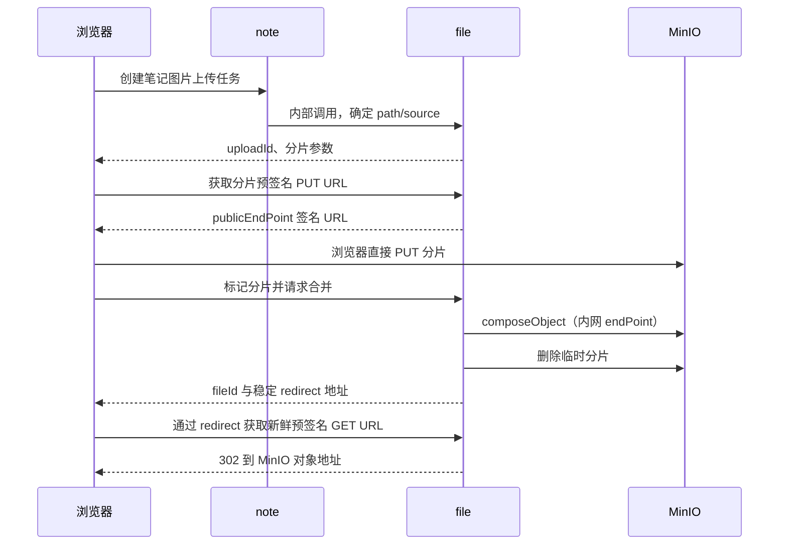

# Anynote MinIO 替换 RustFS 调研报告

> 调研日期：2026-11-11  
> 状态：**调研完成，有条件推荐；尚未启动 RustFS 做实机验证，待 PoC 与拍板**  
> 范围：Anynote 当前 MinIO 对象存储链路、Compose/Nginx 部署、存量数据迁移与回滚  
> 关联文档：[MINIO_PLAN.md](./MINIO_PLAN.md) · [MINIO_MILESTONES.md](./MINIO_MILESTONES.md) · [deployment-network.md](../deployment-network.md)

## 0. 摘要

### 0.1 结论

**建议推进 RustFS PoC，并优先考虑“保留现有 MinIO SDK、新建 RustFS 实例、通过 S3 复制数据、验证后切换”的方案。**

Anynote 的对象存储调用集中在 file 插件和少量 AI 服务代码中，主要使用标准 S3 数据面能力。业务 API、数据库对象名和前端稳定访问地址都可以保持不变，因此代码改造量较小。

真正的风险不在普通上传下载，而在以下四点：

1. MinIO SDK 的 `composeObject` 分片合并能否在 RustFS 上完整工作；
2. MinIO 专有 CORS 环境变量、健康检查和初始化命令不能直接照搬；
3. 存量数据必须通过 S3 复制，不能让 RustFS 直接接管 MinIO 数据目录；
4. RustFS 虽然已发布 1.0 GA，但 GA 时间较短，生产切换仍需灰度、备份和回滚演练。

### 0.2 总体评估

| 维度 | 评估 | 说明 |
|---|---|---|
| 业务代码改造量 | 低 | 第一阶段可保留 Java/Python MinIO SDK 与 `FilePlugin` 接口 |
| 基础 S3 兼容性 | 较高 | 常规对象操作、预签名 GET/PUT、path-style 均有官方兼容测试 |
| 关键链路兼容性 | 待验证 | `composeObject` 依赖 Multipart Upload / UploadPartCopy，是首要 PoC 项 |
| 数据迁移风险 | 中 | 需要新卷、复制、最终停写、校验和回滚设计 |
| 运维改造成本 | 低至中 | 涉及 Compose、初始化、健康检查、CORS、Nginx 和监控 |
| 生产成熟度 | 中 | 已 GA，但不能把厂商“生产就绪”声明等同于本项目验证结果 |
| 性能收益 | 未知 | 必须用 Anynote 实际文件大小与并发模型压测，不能预设 RustFS 更快 |

### 0.3 明确不推荐的方案

- **不推荐**直接停止 MinIO 后用当前 RustFS 正式镜像打开原 MinIO 数据目录。
- **不推荐**在迁移同期将 Java SDK 全面改成 AWS SDK、重命名所有配置并重构业务代码。
- **不推荐**仅切换 Nginx upstream 而不处理最终增量数据和回滚期间的新写入。
- **不推荐**使用 `latest` 或未经验证的 Alpha 版本进行生产迁移。

## 1. 背景与调研问题

### 1.1 替换动机

截至本次调研：

- MinIO 官方 GitHub 仓库明确标注 **“THIS REPOSITORY IS NO LONGER MAINTAINED”**，社区版转为仅源码分发；
- 当前仓库 Compose 默认使用 `minio/minio:latest`，不利于可重复部署和受控升级；
- RustFS 使用 Apache 2.0 许可证，提供 S3 兼容数据面和 MinIO 迁移指南，可作为自建对象存储候选。

如果替换动机仅是“Rust 实现应当更快、更省内存”，依据尚不充分。当前负载以笔记图片、文档、PDF 和分片上传为主，性能还可能受浏览器、Nginx、网络和业务服务影响，需要实测后再把性能列为收益。

### 1.2 本次回答的问题

1. 现有业务代码是否可以不改或少改？
2. 预签名直传、双 Endpoint、分片合并和稳定图片地址是否兼容？
3. Compose、初始化、CORS、Nginx 和健康检查需要改什么？
4. 存量数据如何迁移、验证和回滚？
5. 哪些条件未满足时不应上线？

### 1.3 非目标

- 不在本报告中设计完整的 RustFS 多节点生产集群；
- 不评估华为 OBS 插件的删除或改造；
- 不预设必须迁移到 AWS SDK；
- 不给出未经基准测试的性能倍数或资源节省比例；
- 不将本报告视为已经完成兼容性、安全或生产验收。

## 2. Anynote 当前对象存储链路

### 2.1 业务调用链



此外还有两类调用：

- file 服务中转上传：PDF 转存、Whisper、封面等，通过 `multipartFileUpload` 写对象；
- `ai-service/core/minio.py`：Python MinIO SDK 的简单 `put_object` / `get_object`。

### 2.2 代码与部署依赖

| 依赖 | 当前位置 | 替换影响 |
|---|---|---|
| Java MinIO SDK 与插件 | `services/file/src/main/java/com/anynote/file/plugin/impl/MinIOFilePlugin.java` | 第一阶段保留，直接连接 RustFS 做兼容验证 |
| 双 Endpoint | `MinIOConfig.endPoint` / `publicEndPoint` | 架构继续保留；内网地址改为 RustFS，公开域名可不变 |
| 显式 region | 客户端与 `MINIO_SITE_REGION` | 改为 `RUSTFS_REGION`，仍保持 `us-east-1` |
| 预签名 GET/PUT | `MinIOFilePlugin.java:145` | RustFS 官方有覆盖，但必须真实请求验证 |
| 服务端分片合并 | `MinIOFilePlugin.java:331` | **最高优先级兼容风险** |
| Compose 单节点单卷 | `infra/docker-compose-middleware.yaml:231` | 新 RustFS 服务与新数据卷，不能复用 MinIO 卷 |
| MinIO 专有 CORS | `infra/docker-compose-middleware.yaml:244` | 改为桶级 CORS 配置 |
| MinIO 健康检查 | `infra/docker-compose-middleware.yaml:253` | `/minio/health/live` 改为 `/health/ready` |
| mc 初始化 | `minio-init`，`infra/docker-compose-middleware.yaml:259` | 建桶、私有策略、ILM 逐项验证；不得假设 `mc admin` 兼容 |
| Nginx 独立 OSS 域名 | `infra/nginx/nginx.conf:205` | 保留 `oss.YOUR_DOMAIN` 与 Host 透传，切换 upstream |
| path-style 白名单 | `infra/nginx/nginx.conf:260` | 保持 `/anynote/`，桶名变化时同步修改 |
| Python 简单读写 | `ai-service/core/minio.py` | 原则上只需更换 Endpoint 与凭据配置 |

### 2.3 可以保持不变的业务契约

只要目标端保持相同的 bucket、basePath、对象 key 和公开域名，以下契约不需要变化：

- `FilePlugin` 接口及 `OSS_TYPE=MIN_IO` 的运行时选择；
- 文件表中的 `objectName`；
- 笔记正文中的 `/api/proxy/file/objects/{fileId}/redirect` 稳定地址；
- 上传任务、签名、标记、合并等业务 API；
- BFF 302 透传逻辑；
- 浏览器公开入口 `oss.YOUR_DOMAIN`。

因此，本次迁移理论上**不改变 OpenAPI 契约，也不需要数据库结构或笔记正文迁移**。

> `MIN_IO`、`MIN_IO_CONFIG` 等名称在第一阶段会具有“兼容 S3 后端”的历史含义。是否改成通用 S3 命名应另开重构，不与数据迁移捆绑。

## 3. RustFS 当前事实与边界

### 3.1 版本与许可快照

截至 2026-11-11 核对：

- RustFS 使用 Apache 2.0；
- 1.0.0 GA 发布于 2026-09-16；
- GitHub 最新正式版本为 **1.0.5**，发布于 2026-11-10，非 Pre-release；
- 1.0.5 发布说明包含分段上传、授权、滚动升级、读取仲裁等多项修复，说明项目活跃，也说明近期版本仍在快速修补重要边界。

PoC 可以当前 1.0.x 为基线，实施前必须重新核对 Release。生产应固定**已验证版本和镜像摘要**，不能使用 `latest`。

### 3.2 官方 S3 兼容范围

RustFS 官方矩阵说明其覆盖常见 S3 工作流，但并非完整复刻 AWS S3 或 MinIO：

- 已覆盖常用 bucket/object、List、Range、条件请求、元数据和标签；
- 已覆盖预签名 GET/PUT 的部分签名与请求用例；
- 已覆盖核心 Multipart Upload 工作流；
- 仅覆盖部分分片复制、校验和及对象属性行为；
- 部分 Multipart Upload 列表与分片查询边界不在默认兼容门禁；
- ACL 授权明确不支持，canned ACL 也只有部分兼容；
- Bucket 访问日志和 Ownership Controls 尚未完整支持；
- MinIO 管理 API 是独立兼容面，不能从 S3 数据面兼容推导；
- 加密对象格式不能假设可在 MinIO 与 RustFS 间直接移植。

当前 Anynote 使用预签名 PUT 而非 POST Object 表单上传，也不依赖 ACL，因此上述部分缺口不直接影响主链路。

## 4. 逐项兼容性评估

| 当前能力 | RustFS 判断 | 风险 | 必须采取的动作 |
|---|---|---:|---|
| Put/Get/Head/Delete/List | 官方兼容矩阵已覆盖常用操作 | 低 | 用现有 SDK 做真实往返测试 |
| 预签名 PUT | 已有测试，包括 CORS 场景 | 中低 | 验证 Host、region、路径和浏览器 PUT |
| 预签名 GET | 已有测试 | 中低 | 验证 redirect 后的真实读取与过期行为 |
| path-style | RustFS 默认支持 | 低 | 保持 `/bucket/key` 与 Nginx 白名单 |
| 双 Endpoint | 属于客户端架构，可复用 | 低 | 内网调用与公开签名地址继续分离 |
| region | 支持 `RUSTFS_REGION` | 低 | 客户端与服务端统一 `us-east-1` |
| `composeObject` | 依赖 Multipart Upload / UploadPartCopy；边界并非全部纳入门禁 | **高** | 原样运行现有分片合并集成测试，并补边界用例 |
| 5 MiB 非末片限制 | 属于 S3 Multipart 语义 | 中 | 验证 5 MiB + 小尾片、多个分片及错误路径 |
| CORS | 支持桶级 CORS；MinIO 环境变量不可移植 | 中 | 使用 PutBucketCors，验证 OPTIONS/PUT/GET |
| 建桶与私有策略 | S3 能力可覆盖 | 中低 | 验证初始化，匿名访问必须 403 |
| 生命周期 ILM | 有生命周期测试，但规则行为需按目标版本验证 | 中 | 仅在配置了 `MINIO_ILM_PREFIX` 时迁移并实测 |
| `mc` 数据面命令 | 官方迁移指南使用 alias/ls/mirror/diff/stat/cp | 中低 | 可用于复制与检查 |
| `mc admin` | 不能视为兼容接口 | 中 | 不作为 RustFS 管理方案 |
| 健康检查 | RustFS 使用 `/health/ready` | 低 | 修改 Compose 与 Nginx 健康路径 |
| STS AssumeRole | 插件中存在未被调用的私有旧代码 | 当前无阻塞 | 若未来启用，单独验证，不纳入本次迁移承诺 |
| Python put/get | 常见 S3 数据面 | 低 | 修改独立 AI 服务配置并做读写冒烟 |

### 4.1 最关键的 PoC：复用现有集成测试

`MinIOFilePluginIntegrationTest` 已有五项真实 MinIO 测试：

1. 预签名 PUT 实际上传；
2. 两片对象 `composeObject` 合并、内容一致和分片清理；
3. 服务端中转上传；
4. 私有桶匿名 403 与预签名 GET；
5. 签名 region 一致。

测试 Endpoint 已支持通过 `ANYNOTE_MINIO_ENDPOINT` 等环境变量覆盖，见：

- `services/file/src/test/java/com/anynote/file/plugin/impl/MinIOFilePluginIntegrationTest.java:50`
- 分片合并用例：同文件 `:148`

因此第一轮不需要先重写测试框架，可直接将同一测试打到 RustFS。只有这些测试通过后，才进入真实数据迁移阶段。

> 单元测试只能证明 URL 拼接和配置逻辑，不能证明 RustFS 接受签名或正确执行分片合并。

## 5. 方案比较

| 方案 | 做法 | 优点 | 缺点与风险 | 结论 |
|---|---|---|---|---|
| A. 直接替换二进制/挂载旧卷 | 停止 MinIO，让 RustFS 读取原目录 | 表面改造少 | 当前正式版本官方不推荐；数据格式和元数据迁移边界不可靠 | **否决** |
| B. 保留 SDK，双实例复制切换 | 新 RustFS 卷，S3 复制，验证后改 Endpoint/upstream | 业务改动最小、源端可保留、回滚路径清晰 | 需要最终停写与数据校验 | **推荐** |
| C. 同时换 AWS SDK 并做通用 S3 重构 | 改插件、DTO、枚举、配置和测试 | 长期命名与生态更中性 | 扩大爆炸半径；换 SDK也不能弥补服务端 API 缺口 | 后续单独立项 |
| D. 直接切华为 OBS | 使用现有另一插件 | 减少本地存储运维 | 改变网络、成本、安全和部署模型，不是本次 RustFS 目标 | 不在本方案内 |

## 6. 推荐目标架构

```text
                           ┌──────────────────────┐
浏览器 ── 预签名 PUT/GET ─>│ oss.YOUR_DOMAIN      │
                           │ Nginx：原样透传 Host │
                           └──────────┬───────────┘
                                      │
                                      ▼
Java file ── 内网 S3 ────────────> RustFS S3 :9000
Python AI ── 内网 S3 ────────────> 新 rustfs-data 卷
```

### 6.1 保持不变

- 现有 MinIO Java/Python SDK；
- file 插件抽象与上传 API；
- bucket、basePath、对象 key；
- `publicEndPoint=https://oss.YOUR_DOMAIN`；
- Nginx Host 透传、path-style、请求体大小与签名日志保护；
- 私有桶和稳定 redirect 地址。

### 6.2 必须调整

- 新服务使用独立名称与新数据卷，例如 `rustfs` / `rustfs-data`；
- 使用 `RUSTFS_ADDRESS`、`RUSTFS_REGION`、`RUSTFS_ACCESS_KEY`、`RUSTFS_SECRET_KEY` 等正式配置；
- 健康检查切换为 `/health/ready`；
- CORS 改为桶级配置，生产只允许实际前端 Origin；
- 初始化只依赖已验证的 S3 数据面能力，不把 `mc admin` 当通用接口；
- 内部 `MIN_IO_CONFIG.endPoint` 在切换时指向 RustFS；
- Nginx `anynote_oss` upstream 与公开健康路径同步切换；
- 镜像固定到验证过的版本与摘要。

### 6.3 高可用边界

当前 Compose 是单节点单卷。换成单节点 RustFS **不会自动获得高可用**。

官方迁移指南指出：

- 单盘池自动使用 `EC:0`，没有冗余；
- 文档中的生产多节点多磁盘拓扑至少使用四台服务器；
- 多节点容器部署不能使用默认 Docker bridge 网络；
- 生产还需独立规划 XFS/磁盘、负载均衡、TLS、备份、修复和扩容。

因此“对象存储引擎替换”和“对象存储高可用改造”应拆成两个项目。

## 7. 推荐迁移流程

### 阶段 0：生产现状盘点

先确认真实生产环境，而不是仅根据仓库默认值推断：

- MinIO 实际版本、数据量、对象数、最大对象与分片分布；
- bucket、basePath、region 和凭据使用情况；
- 是否开启版本控制、Object Lock、SSE/KMS、事件通知、bucket/site replication；
- 是否配置 `MINIO_ILM_PREFIX`；
- 是否存在未完成的分片上传任务；
- 可接受的停写窗口和回滚时间目标。

若实际启用版本历史、对象锁、外部 KMS 或复制，普通 `mc mirror` 不构成完整迁移，需要专项方案。

### 阶段 1：隔离 PoC

1. 使用空卷启动固定版本 RustFS；
2. 建桶并设置私有策略、region 和 CORS；
3. 将现有五项集成测试指向 RustFS；
4. 补真实浏览器 CORS 与完整上传 E2E；
5. 验证 PDF 转存、Whisper、封面等服务端中转路径；
6. 做基础性能、资源占用、重启持久化和备份恢复测试。

任一核心链路失败时，先停止生产迁移，不用“兼容 S3”替代实测结论。

### 阶段 2：双实例部署与预复制

1. 备份 MinIO 数据与服务配置；
2. 保持 MinIO 正常运行，RustFS 使用独立临时 Endpoint；
3. 对每个 bucket 执行预复制，例如使用 `mc mirror --overwrite`；
4. 不使用 `--remove`，避免误删目标对象；
5. 预应用桶策略、CORS 和必要的生命周期配置；
6. 创建最小权限应用账号，不让业务长期使用 root 凭据。

大数据量下预复制可缩短最终停写窗口，但它不能替代最终停写和最后一次增量复制。

### 阶段 3：最终停写与增量同步

1. 禁止上传、覆盖、合并和删除等写操作；
2. 等待进行中的 Multipart/分片任务完成，或明确中止；
3. 停止前一轮 watch/持续同步进程，执行受控的最终复制；
4. 最终复制完成后不再允许源端出现新写入。

仅切换 Nginx 而不停写会造成 MinIO/RustFS 双端数据分叉。

### 阶段 4：数据校验与切换

至少校验：

- bucket 与对象数量；
- 对象大小；
- 抽样对象 SHA-256；
- 用户元数据、Content-Type 和标签抽样；
- 私有桶匿名访问仍为 403；
- 现有对象可通过 file redirect 正常读取。

分片布局变化可能使 ETag 改变，因此不能只比较 ETag。`mc diff` 无输出也不等于逐字节校验。

切换动作：

1. 将内部 `endPoint` 从 MinIO 改为 RustFS；
2. 按当前配置加载机制刷新 `sys_config` 到 Redis，并重启所需服务；
3. 将 Nginx `anynote_oss` upstream 切到 RustFS；
4. 保持公开 Host、bucket、basePath、region 不变；
5. 执行完整上传、合并、读取、删除和中转上传冒烟；
6. 确认无持续签名、CORS、404 或 5xx 后恢复写入。

### 阶段 5：观察与源端保留

- 保留 MinIO 程序、配置和原始数据卷；
- 观察上传成功率、读取延迟、分片合并失败率、存储容量和资源占用；
- 观察期内持续验证备份与恢复；
- 只有在验收与保留期结束后，才另行评审源端退役，不在本报告中执行删除。

## 8. 回滚方案

### 8.1 RustFS 尚未接收新写入

可以直接：

1. 将内部 Endpoint 和 Nginx upstream 切回 MinIO；
2. 恢复原配置并刷新缓存；
3. 验证读写；
4. 保留 RustFS 副本用于问题分析。

### 8.2 RustFS 已接收新写入

**不能直接切回。** 必须先：

1. 停止写入；
2. 找出 RustFS 上新增、覆盖和删除的对象；
3. 将需要保留的新增/更新对象反向同步到 MinIO，并处理删除语义；
4. 重新做数量、大小和抽样哈希校验；
5. 再切回 MinIO。

否则 MinIO 会缺少切换后的新对象或保留已删除对象。回滚演练必须覆盖这一场景，而不是只验证 DNS/Nginx 可以切回。

## 9. 验收门禁

### 9.1 P0：兼容与业务功能

- [ ] 现有五项 `MinIOFilePluginIntegrationTest` 在 RustFS 全绿；
- [ ] 真实浏览器完成 OPTIONS、预签名 PUT、分片标记、合并、redirect GET；
- [ ] 小于 5 MiB 的单片文件正常；
- [ ] 5 MiB + 小尾片、多分片大文件正常；
- [ ] 中文、空格、特殊字符对象 key 正常；
- [ ] 同 key 覆盖、重复标记、失败中止等边界行为符合预期；
- [ ] PDF 转存、Whisper、封面等服务端中转上传正常；
- [ ] 历史对象与历史笔记 redirect 正常；
- [ ] 匿名对象读取为 403；
- [ ] 前端 `notes-image-upload` 相关 E2E 与桌面完整 E2E 通过；
- [ ] 生产等效的独立 OSS 域名、TLS 和 Nginx 路径实测通过。

### 9.2 P0：数据与回滚

- [ ] 源/目标对象数量与大小一致；
- [ ] 抽样 SHA-256 一致，元数据与 Content-Type 满足业务需要；
- [ ] 最终停写期间无遗漏写入；
- [ ] 容器重启后数据仍在；
- [ ] 备份恢复实测成功；
- [ ] 未写入场景回滚成功；
- [ ] 已写入场景的反向增量同步与回滚成功。

### 9.3 P1：性能与运维

- [ ] 记录 MinIO/RustFS 同口径 PUT、GET、compose 的吞吐与 p95/p99；
- [ ] 记录 CPU、内存、磁盘 I/O 与恢复资源消耗；
- [ ] 日志、容量、健康检查和告警可观测；
- [ ] 预签名 query 不进入访问日志；
- [ ] 镜像版本与摘要固定，升级和回退步骤明确；
- [ ] 生产不再使用默认凭据或长期 root 业务凭据；
- [ ] CORS 不使用生产通配符，Console 与管理面不公开。

## 10. 风险登记表

| 风险 | 影响 | 缓解措施 |
|---|---|---|
| `composeObject` 行为不兼容 | 分片上传主链路失败 | 作为第一道 PoC 门禁；失败则停止切换并单独评估替代实现 |
| CORS 配置遗漏或重复 | 浏览器直传/读取失败 | 桶级 CORS + 真实浏览器 + 生产域名验证；Nginx 不重复加头 |
| 直接复用 MinIO 数据卷 | 数据不可读或元数据丢失 | 使用新卷，通过 S3 复制，源端保持不变 |
| 最终增量遗漏 | 切换后对象缺失 | 停写、完成/中止在途任务、最终复制和校验 |
| 版本/对象锁/KMS 被普通 mirror 忽略 | 历史或合规语义丢失 | 阶段 0 盘点；存在时使用专项迁移，不按普通 bucket 处理 |
| RustFS 写入后直接回滚 | 新数据丢失或删除语义回退 | 停写并反向同步后再回滚 |
| 近期版本快速修复重要缺陷 | 生产稳定性不确定 | 固定验证版本、灰度、观察、备份和受控升级 |
| 单节点被误认为高可用 | 磁盘/主机故障仍导致不可用 | 单独规划多节点与冗余，不把替换镜像当 HA |
| 性能预期未经验证 | 迁移收益不成立 | 同口径基准测试，不引用厂商营销数字作为项目结论 |
| `latest` 漂移 | 部署不可重复、意外升级 | 固定 Release 与镜像摘要 |

## 11. 预计改动面

若 PoC 证明 MinIO SDK 兼容，改动主要集中在：

- `infra/docker-compose-middleware.yaml` 及相关 Compose override；
- `infra/.env.example` 与部署环境变量说明；
- `infra/nginx/nginx.conf`；
- `infra/sql/sys_config.sql` 和 `infra/docker/mysql/init/source/sys_config.sql` 的新环境 seed；
- `docs/deployment-network.md`、README 启动/生产说明；
- 集成测试的 RustFS 执行说明，必要时增加独立测试配置；
- 本报告对应的实施里程碑与验收记录。

原则上不需要修改业务 Controller、OpenAPI、前端上传协议和数据库结构。若实际 PoC 迫使业务代码变更，应重新评估改造范围，不再按“低风险基础设施替换”处理。

## 12. 最终建议与决策条件

### 建议推进的情况

- 希望摆脱 MinIO 当前维护与分发状态；
- 接受一次短暂停写切换；
- 当前生产确实以普通私有 bucket、当前对象和常见 S3 操作为主；
- 现有五项集成测试、浏览器 E2E、数据校验和回滚演练全部通过。

### 暂缓切换的情况

- `composeObject` 或浏览器预签名链路未通过；
- 要求零停机，但没有双写、可靠增量同步或一致性设计；
- 使用版本历史、Object Lock、外部 KMS、复制等高级能力但尚未专项验证；
- 只有性能预期，没有基准数据；
- 无法保留 MinIO 源端或无法安排可验证的回滚路径。

**推荐下一步仅批准隔离 PoC，不直接批准生产替换。**  
PoC 通过后，再为 Compose 改造、数据迁移和真实生产域名验收建立独立里程碑。

## 13. 资料来源

### 13.1 本仓库依据

- [MinIO 修复方案](./MINIO_PLAN.md)
- [MinIO 已实施链路与验收记录](./MINIO_MILESTONES.md)
- `services/file/src/main/java/com/anynote/file/plugin/impl/MinIOFilePlugin.java`
- `services/file/src/test/java/com/anynote/file/plugin/impl/MinIOFilePluginIntegrationTest.java`
- `infra/docker-compose-middleware.yaml`
- `infra/nginx/nginx.conf`
- `ai-service/core/minio.py`

### 13.2 外部资料（2026-11-11 核对）

- [RustFS S3 兼容性矩阵](https://docs.rustfs.com/zh/reference/s3-compatibility)
- [RustFS S3 协议与已知差异](https://docs.rustfs.com/en/administration/protocols/s3)
- [当前推荐的 MinIO → RustFS 迁移指南](https://rustfs.com/blog/migrating-from-minio-to-rustfs-a-technical-guide/)
- [RustFS Docker 安装](https://docs.rustfs.com/installation/docker/)
- [RustFS 多节点多磁盘安装](https://docs.rustfs.com/en/installation/linux/multiple-node-multiple-disk)
- [RustFS 1.0.0 GA 公告](https://rustfs.com/blog/announcing-rustfs-1-0-0-ga/)
- [RustFS GitHub Releases](https://github.com/rustfs/rustfs/releases/latest)
- [MinIO 官方 GitHub 仓库状态](https://github.com/minio/minio)

> 外部兼容性与“生产就绪”内容主要来自项目官方资料。本报告未进行独立源码审计、安全审计、性能复测或真实数据迁移，所有生产结论均以第 9 节实测门禁为准。
