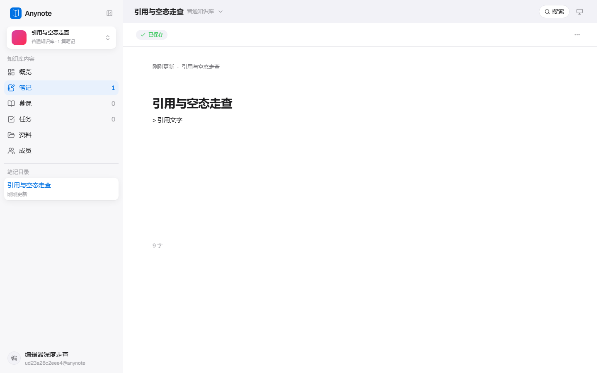
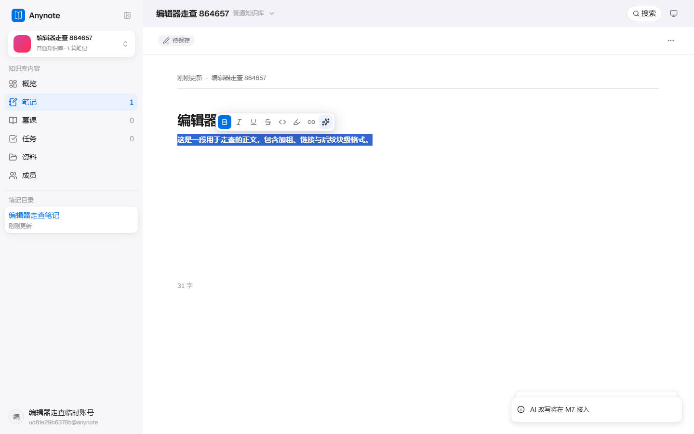
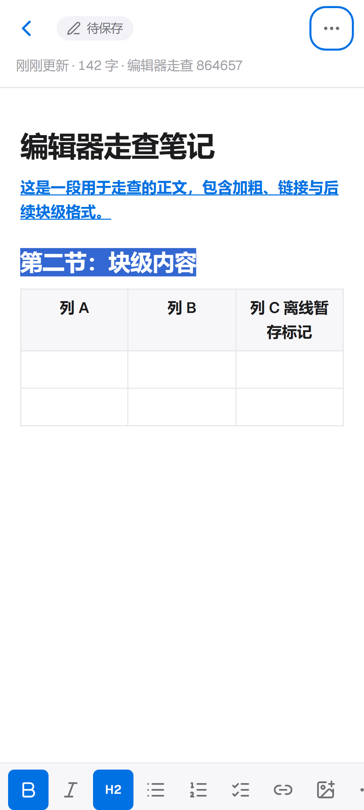
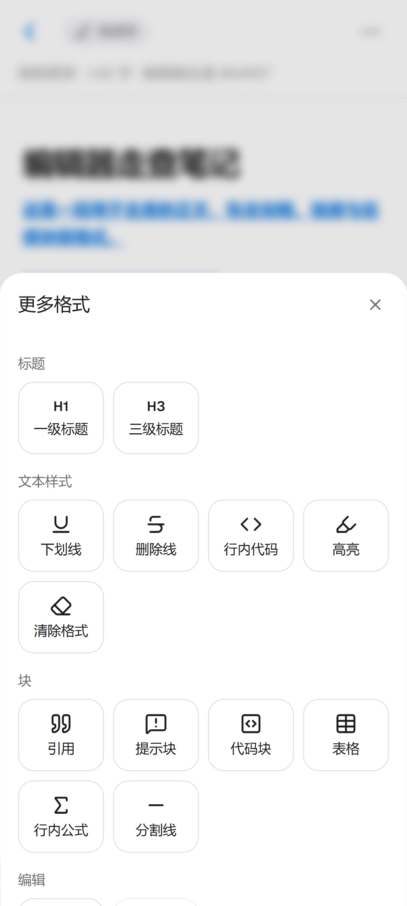
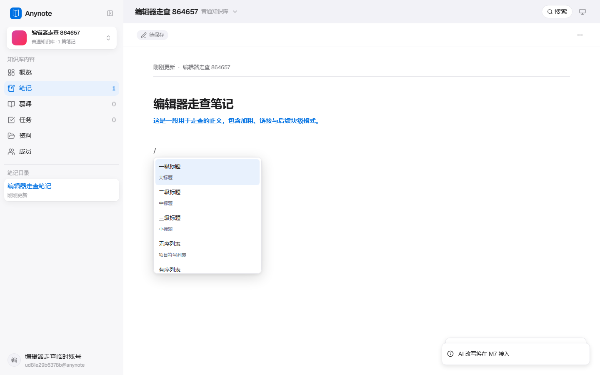
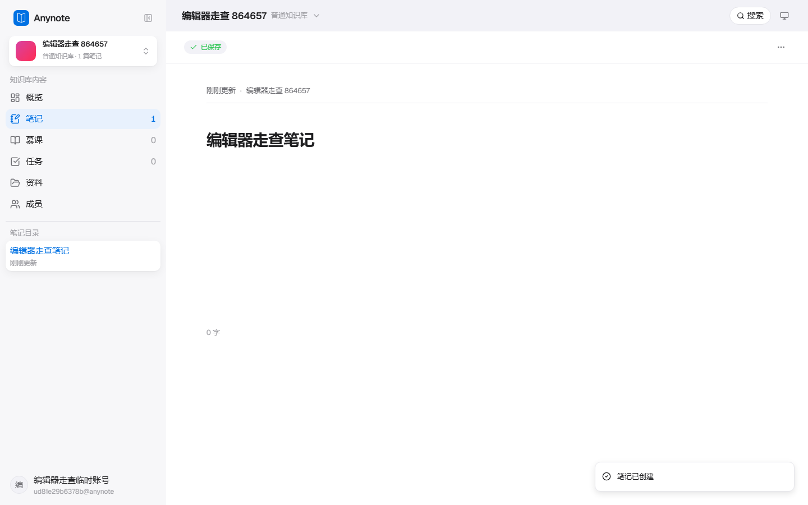
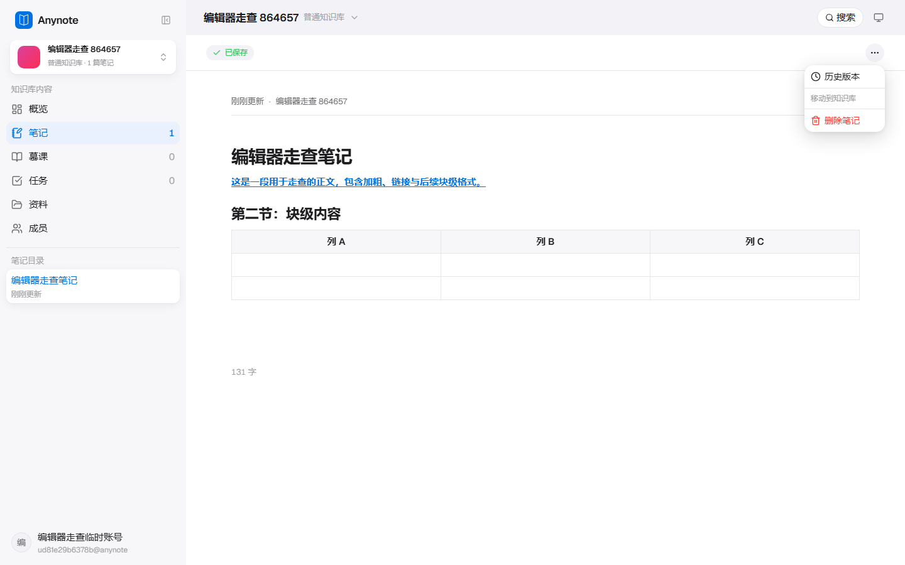

# 笔记编辑器 UI、交互走查报告

- **走查日期**：2026-11-11
- **走查对象**：`apps/web` 新前端笔记编辑器（TipTap），含桌面端与移动端
- **代码版本**：`dev` @ `f8ac0c2`
- **运行环境**：本机 Docker 全栈，生产构建，`https://192.168.3.90:3000`
- **浏览器**：Chromium（Playwright 1.63.0）
- **视口**：桌面 1440×900；移动端 393×851、补充窄屏 360×800
- **主题**：浅色、深色、跟随系统
- **证据目录**：[editor-audit-2026-11-11](editor-audit-2026-11-11/)

## 1. 结论

新建笔记、正文编辑、自动保存、标题同步、历史版本入口、离线恢复、删除取消、深浅色和移动端基础格式操作均可用。

本次记录 **7 项产品发现**：**P1 × 1、P2 × 3、P3 × 3**；另有 **1 项环境阻塞**。其中「引用块保存后退化」会破坏用户已输入的内容结构，且 2026-09-14 已有记录，本次确认仍存在。**在该问题关闭前，不建议将笔记编辑器判定为验收通过。**

| 编号 | 级别 | 发现 | 状态 |
|---|---|---|---|
| E-01 | P1 | 引用块刷新后退化为普通段落，正文显示字面量 `>` | 已修复（2026-11-12，网关改为按字段过滤） |
| E-02 | P2 | 桌面「AI 改写」仍是 M7 占位提示，入口文案和行为均已过期 | 已修复（2026-11-12，移除入口） |
| E-03 | P2 | 360px 视口下「更多格式」仅露出 16px，且没有横滑提示 | 已修复（2026-11-12，入口固定 + 渐隐） |
| E-04 | P2 | Slash 菜单只有视觉高亮，缺少选项角色和激活项语义 | 已修复（2026-11-12，补 listbox/option/aria-activedescendant） |
| E-05 | P3 | 桌面与移动端链接编辑都使用原生 `window.prompt` | 已修复（2026-11-12，改用 Dialog / Sheet） |
| E-06 | P3 | 新建笔记没有「输入 / 唤起命令」空态引导 | 已修复（2026-11-12，H1 后挂空态提示） |
| E-07 | P3 | 只有一个知识库时，操作菜单仍显示空的「移动到知识库」分组 | 已修复（2026-11-12，空组整组隐藏） |
| B-01 | 环境 | MinIO 主机名无法解析，图片上传成功链路无法验收 | 未处理（环境问题，不在本次修复范围） |

级别口径：P1 = 内容结构损失或核心链路严重受损；P2 = 关键交互误导、能力难以发现或明显可访问性缺口；P3 = 不阻断任务但影响一致性、引导或视觉质量。

## 2. 范围与依据

### 2.1 已走查范围

- 新建知识库、新建笔记、首个 H1 即标题
- 正文输入、自动保存、刷新留存、离线暂存与联网恢复
- 桌面选区气泡菜单、Slash 过滤与键盘操作、表格插入
- 移动端贴底工具栏、「更多格式」弹层、窄屏横滑
- 笔记操作菜单、历史版本入口、桌面删除确认、移动端两段删除确认
- 浅色 / 深色、长文内部滚动、移动端页面横向溢出
- 图片上传及其加载反馈（受 B-01 环境阻塞）

### 2.2 设计与实现依据

- `apps/web/e2e/reference/p04-editor-light.png`
- `apps/web/e2e/reference/p06-editor-dark.png`
- `apps/web/e2e/reference/p09-editor-mobile-light.png`
- `apps/web/e2e/reference/p11-editor-mobile-dark.png`
- `docs/ui/ui-supplement/M-09-doc-workspace.png`
- `docs/changelist/2026-09-14-editor-title-as-h1.md`

## 3. 发现详情

### E-01 · P1 · 引用块刷新后退化为普通段落

**复现步骤**

1. 新建笔记，在正文输入 `> 引用文字`。
2. 确认页面已渲染为引用块，并等待状态变为「已保存」。
3. 刷新页面。

**预期**：刷新后仍是引用块，文字和结构均不变。

**实际**：

- 刷新前 `blockquote` 数量为 1；刷新后降为 0。
- 页面改为普通段落，并显示字面量 `> 引用文字`。
- 即文字仍在，但用户选择的块级结构丢失。

**证据**

| 刷新前 | 刷新后 |
|---|---|
|  |  |

**代码核查**：`services/gateway/src/main/java/com/anynote/gateway/filter/XSSFilter.java:90` 对整个请求体执行 `EscapeUtil.clean(bodyStr)`，与 `>` 被转义后破坏 Markdown 块语法的现象一致。`docs/changelist/2026-09-14-editor-title-as-h1.md` 已记录同一问题，本次为再次复现，不是新引入回归。

**建议**：不要用整包 HTML 转义代替结构化 XSS 防护；按字段和渲染边界制定安全口径。补充引用块及 `<`、`>`、`&` 的真实保存—刷新端到端用例，修复后经安全评审再验收。

### E-02 · P2 · 「AI 改写」仍展示过期的 M7 占位行为

**复现步骤**

1. 桌面端选中一段正文。
2. 在气泡菜单点击 Sparkles 图标（可访问名为「AI 改写（M7 接入）」）。

**实际**：仅提示「AI 改写将在 M7 接入」。当前里程碑资料已标记 M7 完成，且 Slash 菜单已有「AI 续写」入口；此处会让用户误以为功能可用，又暴露内部迭代编号。

**证据**：

**代码位置**：`apps/web/src/components/editor/core/bubble-menu.tsx:78`

**建议**：若本期不支持改写，移除入口；若必须保留，使用明确的未开放状态和用户文案，不出现「M7」。不要在同一编辑器里让「AI 续写可用」与「AI 改写将在旧里程碑接入」并存。

### E-03 · P2 · 360px 下「更多格式」被裁切，且没有可横滑提示

**实测数据**

| 视口 | 工具栏 clientWidth / scrollWidth | 「更多格式」位置 | 初始状态 |
|---|---|---|---|
| 393px | 393 / 392 | 完全在可视区内 | 正常 |
| 360px | 360 / 392 | left = 344，right = 384 | 仅露出 16 / 40px |

工具栏同时隐藏了滚动条，也没有边缘渐隐、箭头或其他提示。用户很难发现需要横滑，而「更多格式」恰好包含代码块、表格、分割线、撤销等 15 个命令。

**证据**

- 
- 横滑后弹层本身可正常使用：

**代码位置**：

- `apps/web/src/styles/mobile.css:58-79`：单行横滑、隐藏滚动条、40px 固定按钮
- `apps/web/src/components/editor/core/mobile-toolbar-groups.ts:37-46`：常驻命令与末位「更多」

**建议**：将「更多格式」固定在工具栏右端，仅让前面的命令进入横向滚动区，并给固定区增加分隔与渐隐。补充 320、360、375、393px 下「更多入口完整可见」的几何断言；现有 393px 用例覆盖不到此问题。

### E-04 · P2 · Slash 菜单缺少激活项的可访问性语义

**实际**：方向键与 Enter 可以正常选择命令，但 DOM 核查结果为：

- 菜单容器 `role = null`，列表 `role = null`
- `aria-selected="true"` 的选项数量为 0
- 编辑器 `aria-activedescendant = null`
- 当前项仅通过 `.is-selected` 改变背景色

因此视觉用户能看到高亮，辅助技术却无法可靠获知当前激活的是哪一项。本次未进行真实读屏器测试，此项是 DOM 语义核查结论。

**证据**：

**代码位置**：`apps/web/src/components/editor/core/slash-menu.tsx:77-93`

**建议**：为选项提供稳定 id，采用 `listbox / option` 与 `aria-selected`，并在保留编辑器输入焦点的前提下关联 `aria-controls`、`aria-activedescendant`；无结果状态可提供适度的 `aria-live` 播报。补键盘与语义断言，不只断言 `.is-selected`。

### E-05 · P3 · 链接编辑使用原生 prompt，两端体验断裂

**复现步骤**：桌面在气泡菜单点「链接」，或移动端在底部工具栏点「链接」。

**实际**：两端均捕获到浏览器原生 `prompt`，标题为「链接地址」，默认值为 `https://`。功能可以完成，但原生弹窗与应用对话框 / 动作表视觉不一致，也无法提供行内 URL 校验、明确的「移除链接」动作和移动端适配。

**代码位置**：

- `apps/web/src/components/editor/core/bubble-menu.tsx:63-74`
- `apps/web/src/components/editor/core/toolbar.tsx:119-129`

**建议**：桌面复用应用内 Dialog，移动端复用 Sheet；共用 URL 校验、保存、取消和移除逻辑。两端共用一套命令实现，避免再次漂移。

### E-06 · P3 · 新建笔记缺少空态写作引导

**实际**：刚创建笔记时，标题下方是空白，未看到默认文案「输入 “/” 唤起命令，或直接开始写作…」。DOM 核查时编辑器仅有 `H1`，没有可承载占位符的空段落。首次进入的用户不知道可以输入 `/`，也不明确正文应从哪里开始。

**证据**：

**代码位置**：

- 默认文案：`apps/web/src/components/editor/presets/types.ts:41`
- 当前占位选择器：`apps/web/src/styles/tiptap.css:66-73`，只匹配 `p.is-editor-empty:first-child`

**建议**：保证首个 H1 后存在可编辑空段落，并让占位规则适配「H1 后的第一个空正文段落」；桌面与移动端各补一条新建笔记空态测试。

### E-07 · P3 · 单知识库场景出现空的移动分组

**复现步骤**：账号只创建一个知识库，打开笔记右上角「笔记操作」。

**实际**：菜单依次显示「历史版本」、分隔线、「移动到知识库」、分隔线、「删除笔记」，中间没有任何可移动目标，形成空分组和多余分隔线。

**证据**：

**代码位置**：`apps/web/src/features/notes/components/note-editor.tsx:185-197`

**建议**：没有其他知识库时，整组隐藏标签、目标列表及对应分隔线；补 0 个、1 个、多个可移动目标的菜单测试。

## 4. 环境阻塞

### B-01 · 图片上传成功链路受 MinIO 环境阻塞

独立执行 `e2e/notes-image-upload.spec.ts`，结果为 **1 passed / 3 failed**：

- 通过：模拟上传失败时，上传指示器能够清理，不会永久转圈。
- 失败：图片插入、图片刷新留存、上传完成后替换指示器，均未等到稳定图片节点。

文件服务日志出现：

```text
java.net.UnknownHostException: minio: Name does not resolve
```

当前容器清单也未见可用的 MinIO 服务。因此这三项失败**暂不归为前端产品缺陷**，但图片上传成功链路不能标记为已验收。

**后续条件**：恢复对象存储服务及 `minio` 内网解析后，原命令复跑 4 条用例；全部通过后再补图片粘贴、拖拽和大文件走查。

## 5. 已通过项目

| 维度 | 结果 |
|---|---|
| 创建与标题 | 新建知识库 / 笔记成功；首个 H1 与标题、目录同步 |
| 基础编辑 | 桌面气泡加粗、移动端工具栏加粗及激活态正常 |
| Slash | 过滤、无匹配空态、Enter 插入 H2、插入 3×3 表格、表格 Tab 移动正常 |
| 保存 | 普通输入自动保存；刷新后正文、H2、表格保留 |
| 离线 | 桌面离线暂存后联网恢复并刷新留存；移动端离线离开拦截用例通过 |
| 历史与删除 | 历史版本可进入；桌面删除可取消；移动端删除需二次确认且可退出 |
| 主题 | 桌面 / 移动端深浅色均生效，未观察到明显文字或表格对比异常 |
| 布局 | 桌面长文内部滚动；393px、360px 页面根节点无横向溢出 |
| 移动端更多格式 | 横滑后弹层可开，分组完整，分割线可插入 |

## 6. 自动化复核

以下命令均针对本机真实全栈执行：

```bash
# 桌面核心笔记与标题：11 passed
E2E_BASE_URL=https://192.168.3.90:3000   pnpm --filter web exec playwright test --project=chromium   e2e/notes.spec.ts e2e/notes-title.spec.ts

# 移动端离线、离开拦截与标题：3 passed
E2E_BASE_URL=https://192.168.3.90:3000   pnpm --filter web exec playwright test --project=mobile   e2e/mobile-notes-single-user.spec.ts e2e/mobile-notes-title.spec.ts

# 图片上传：1 passed / 3 failed；失败原因见 B-01
E2E_BASE_URL=https://192.168.3.90:3000   pnpm --filter web exec playwright test --project=chromium   e2e/notes-image-upload.spec.ts
```

现有桌面 11 条用例没有覆盖 E-01 的引用块真实往返，也没有覆盖 E-06 的空态占位；移动工具栏既有 393px 几何用例没有覆盖 E-03 的 360px 场景。

## 7. 未覆盖与限制

- 未做 iOS Safari / Android 真机、软键盘、安全区和旋转屏验收；移动端结果来自 Chromium 设备模拟。
- 未做 VoiceOver / TalkBack / NVDA 实机读屏，E-04 仅依据 DOM 与键盘核查。
- 未做多人协同、权限只读、AI 续写实际生成、冲突双端写入。
- 图片成功链路受 B-01 阻塞；粘贴、拖拽、大图和失败重试仍需补验。

## 8. 建议处理顺序

1. **先修 E-01**：内容结构保存可靠性优先于视觉优化，并补真实往返回归。
2. **随后处理 E-02、E-03、E-04**：清理过期 AI 入口、保证窄屏更多入口可见、补 Slash 语义。
3. **统一细节体验**：E-05 链接弹层、E-06 空态引导、E-07 空菜单分组可合并为一次编辑器交互收尾。
4. **恢复 B-01 环境后复验**：图片 4 条用例全绿，再关闭编辑器验收。

## 9. 截图索引

| 文件 | 内容 |
|---|---|
| `01-desktop-initial-light.png` | 桌面新建笔记空态 |
| `02-desktop-bubble-light.png` | 桌面选区气泡菜单 |
| `03-desktop-ai-rewrite-toast.png` | AI 改写占位提示 |
| `04-desktop-slash-light.png` | Slash 菜单 |
| `05-desktop-rich-light.png` | 桌面浅色富文本 |
| `06-desktop-note-actions-single-base.png` | 单知识库操作菜单 |
| `07-desktop-rich-dark.png` | 桌面深色富文本 |
| `08-desktop-offline.png` | 桌面离线状态 |
| `09-mobile-393-light.png` | 393px 移动端浅色 |
| `10-mobile-note-actions.png` | 移动端笔记动作表 |
| `11-mobile-360-toolbar-overflow.png` | 360px 工具栏裁切 |
| `12-mobile-360-more-sheet.png` | 360px 更多格式弹层 |
| `13-mobile-393-dark.png` | 393px 移动端深色 |
| `14-desktop-quote-before-reload.png` | 引用块刷新前 |
| `15-desktop-quote-after-reload.png` | 引用块刷新后 |

## 10. 修复记录（2026-11-12）

本节记录本报告的 7 项产品发现如何关闭；逐文件清单见
[`docs/changelist/2026-11-12-editor-ui-audit-fixes.md`](../changelist/2026-11-12-editor-ui-audit-fixes.md)。

| 编号 | 修复方式 | 回归用例 |
|---|---|---|
| E-01 | 网关 `XSSFilter` 不再对整包请求体做实体转义，改为按 JSON 字段过滤：`content` / `title` 原样放行（`security.xss.textFields`），其余字段照旧转义；legacy 搜索高亮渲染边界补转义 | `XssBodySanitizerTest`、`XSSFilterTest`、`notes-editor-audit.spec.ts` |
| E-02 | 移除气泡菜单「AI 改写（M7 接入）」入口 | 编辑器单测（组件不再渲染该按钮） |
| E-03 | 「更多格式」移出横滑区、固定在右端并加分隔线与渐隐提示 | `mobile-toolbar.test.tsx`、`editor-styles.test.ts`、`mobile-toolbar-overflow.spec.ts` |
| E-04 | Slash 菜单补齐 `listbox` / `option` / `aria-selected`，编辑器侧的 `aria-controls` / `aria-activedescendant` 由扩展维护 | `slash-menu-a11y.test.tsx` |
| E-05 | 链接编辑改用应用内 Dialog（桌面）/ Sheet（移动），共用 `resolveLinkInput` 与 `applyLinkHref` | `link-editor.test.tsx` |
| E-06 | 文档只有顶部 H1 时挂 widget decoration 提示；只影响绘制，不改文档 | `empty-body-hint.test.tsx`、`notes-editor-audit.spec.ts` |
| E-07 | `movableBases` 为空时整组（标签 / 目标 / 分隔线）不渲染 | `note-editor.test.tsx`（2 条） |

**仍需注意**

- E-01 的网关口径变更属于安全面调整，需安全评审后再判定该条验收通过。
- 新增的两条 Playwright 用例（`notes-editor-audit.spec.ts`、`mobile-toolbar-overflow.spec.ts`）
  本次只做静态编写，尚未在真实全栈上执行；E-03 的 360px 几何断言需在恢复环境后复跑。
- `B-01` 仍为环境阻塞，图片上传 4 条用例未复验。
